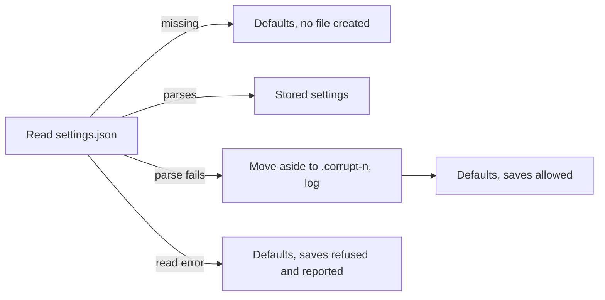

# Atomic Settings Persistence

## Why

`settings.json` holds every preference SpecForge has: provider credentials, web-server settings, the developer identity, favourites and window geometry. Unlike `workspaces.json` and `review-progress.json`, it has no crash-safety contract. `SettingsStore::save` truncates and rewrites the file in place. Concurrent setters from the desktop window and a browser tab can tear it into invalid JSON. `SettingsStore::load` turns any read or parse failure into defaults without saying so. On a typical install the first-run identity seed in `AppService::bootstrap` then saves those defaults over the damaged file during launch, before the user does anything, and the user's configuration is gone. `presentation.json` (workspace display names, colours and disabled flags) has the same two defects.

## What Changes

- **One atomic-write helper in `openspec-core`.** It writes a uniquely named temporary file in the target's directory, syncs it, renames it over the target and then syncs the directory on a best-effort basis. `WorkspaceRegistry` and the review-progress store already follow this recipe, each with its own copy. `preserve_corrupt_config` moves from `openspec-app`'s `service.rs` to sit beside the helper. The registry, review progress, settings and presentation stores all call the shared pair, so no third copy of the recipe is added.
- **`settings.json` is saved atomically.** A crash or a failed write leaves the previous file intact, and save failures are still returned to the control the user operated.
- **Settings saves reach disk in the order their changes were made.** Every setter makes its change and saves it under one write lock, so concurrent setters cannot leave an older snapshot on disk. The settings data lock is never held across file I/O, so the readers that poll every tick never wait for an fsync.
- **A `settings.json` that fails to parse is moved aside, not overwritten.** The file is moved to the first free `.corrupt-<n>` sibling, the event is logged, and the app starts from defaults. A missing file still loads as defaults and creates nothing. A file that exists but cannot be read (for example a permission or I/O error) is left where it is. The session runs on defaults and refuses to save over that file, and each attempted change reports the failure on its control.
- **`presentation.json` gets the same treatment.** Its save becomes atomic. Bootstrap stops discarding its load error: a file that fails to parse is moved aside and logged, and an unreadable file is not saved over.
- Per-field tolerance stays exactly as it is. Older files, unknown panel positions and unknown reading widths still load as they do today. Only a document that fails to parse as a whole is moved aside.

## Capabilities

### New Capabilities

_None._

### Modified Capabilities

- `settings-view`: adds two requirements. The settings file is saved atomically and in the order its changes were made. A settings file that fails to parse or cannot be read is never overwritten by defaults.
- `workspace-registry`: adds a requirement that the presentation store is saved atomically and that a corrupt or unreadable `presentation.json` is preserved rather than overwritten. The registry's existing atomic-save contract is unchanged; only its implementation moves onto the shared helper.

## Impact

- `crates/openspec-core`: a new module (`config_file.rs`) holding `write_atomic` and `preserve_corrupt_config`. `registry.rs` (`WorkspaceRegistry::save`) and `presentation.rs` (`WorkspacePresentationStore::save`, plus a store that refuses to save after an unreadable load) move onto it.
- `crates/openspec-app`: `settings.rs` (`SettingsStore::load`, `save`, a write lock, one shared update path for the 26 mutating methods, and doc comments that describe the old silent fallback), `review_progress.rs` (`write` and `read_for_write` move onto the shared helper), and `service.rs` (`preserve_corrupt_config` and its tests move out; `bootstrap` logs the settings load outcome and handles presentation load errors).
- No change to any frontend crate, IPC shape, event, setting field or on-disk format. No new dependency: `tempfile` is already a normal dependency of both library crates.
- Not addressed here, deliberately:
  - Cross-process lost updates. The desktop app, a standalone `specforge-serve` and worktree dev instances each hold their own copy of the settings in memory and share one file, so the last whole-file writer still wins. The atomic write stops this from tearing the file, but merging across processes is a separate design.
  - The activity log's non-atomic `persist()` belongs to `cache-dashboard-history`.
  - The registry's treatment of read errors (it moves the file aside on any load error) is unchanged.
  - Related sibling changes: `cache-dashboard-history`, `unblock-main-thread`.
