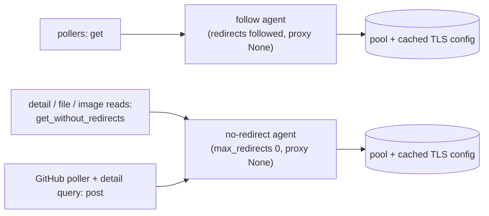

# Reuse HTTP Connections

## Why

Every network request SpecForge makes goes through one of the three builders in `crates/openspec-app/src/usage_http.rs` (`get`, `get_without_redirects`, `post`). Each one calls `ureq::get` / `ureq::post`, and in ureq 3.4.0 that builds a use-once `Agent`: a new connection pool, a new rustls connector and a fresh `Config::default()`, which also reads the environment for a proxy. So every request opens a new TCP and TLS connection, and every new connection builds a new rustls `ClientConfig` with the webpki trust store. The worst cases are the bursts of sequential requests to one host:

- a GitHub detail read is one GraphQL `POST` plus a `GET` for every 50 files, which is 8 requests for a 300-file pull request and at most 21;
- a GitHub file or image read is up to 3 `GET`s;
- a BitBucket detail read is 5 to 23 `GET`s;
- the BitBucket poller sends 2 + W `GET`s each cycle, where W is the number of workspaces.

Each of these requests pays its own handshake today.

## What Changes

- Keep two long-lived ureq `Agent`s in `usage_http`, built once per process: one that follows redirects, for the pollers' `get`, and one that follows none, for `get_without_redirects` and `post`. All three builders take their requests from these agents.
- Move the request posture into each agent's own `Config`: `timeout_global`, `http_status_as_error(false)`, `proxy(None)`, plus `max_redirects(0)` on the no-redirect agent. The builders stop calling `.config()`. This matters for two reasons:
  - ureq treats any per-request `.config()` as request-level. A request-level request never fills the connector's `ClientConfig` cache, so keeping the overrides would pool sockets but still rebuild the TLS config on every new connection.
  - Pinning `proxy(None)` at agent level means every request inherits it, including one from a builder added later.
- Pin ureq's idle-connection settings explicitly, with the default 15 s idle age, so a burst reuses connections and a socket left idle between poll cycles is not reused. Raising the idle age to cover poll cycles is rejected in `design.md`.
- Add hermetic loopback tests that pin the reuse and the agent posture. The existing redirect tests keep passing unchanged.
- No change to what is requested, from where, with which credential, or how replies are classified.

Out of scope (checked and set aside, so nobody has to rediscover them):

- **An explicit body-size limit for GitHub's `Reply::read`.** It relies on ureq's implicit 10 MB `read_to_string` cap, and so does the BitBucket poller's send. The claim that an oversized reply "is retried forever" is wrong: the reply becomes a transient read, which the hourly detail budget bounds, and nothing retries it in a loop. Spelling the cap out (as `bitbucket_detail`'s `JSON_LIMIT` does) would change no behaviour and is not a performance fix.
- **Reuse across poll cycles.** The GitHub poller sends 1 `POST` at least 60 s apart, the BitBucket poller starts a cycle at least 60 s apart, and the two quota pollers send 1 `GET` at least 30 s apart, so under the 15 s idle age no cycle reuses the previous cycle's connection. They still stop building an agent and a TLS config, and stop reading the proxy environment, on every request.
- **Environment-proxy support.** This change keeps ignoring ambient proxies, as today.

## Capabilities

### New Capabilities

_None._

### Modified Capabilities

- `github-pull-requests`: adds a *GitHub Connection Reuse* requirement. Requests to `api.github.com` in one burst (a detail read, a file read or an image read) share an open connection. Each request keeps the *GitHub Privacy and Safety* posture: no ambient proxy, no redirect, and the token only in its own `Authorization` header.
- `bitbucket-pull-requests`: adds a *Connection Reuse* requirement. Requests to `api.bitbucket.org` in one burst (a poll cycle, a detail read or an image read) share an open connection, with *Privacy and Safety* unchanged: no ambient proxy, no redirect followed by a detail or image read, and the credential only in each request's own `Authorization` header.

## Impact

- **Code:** `crates/openspec-app/src/usage_http.rs` only, covering the two shared agents, the three builders and their tests. The callers (`github.rs`, `github_detail.rs`, `bitbucket.rs`, `bitbucket_detail.rs`, `quota.rs`, `chatgpt_quota.rs`) keep calling the same three functions with the same signatures.
- **Dependencies:** none added. ureq stays at 3.4.0 with its current features (`rustls`, `gzip`; no `cookies`, so a shared agent has no cookie jar to carry state between requests).
- **Unchanged:**
  - Redirect behaviour of every caller: the pollers' `get` still follows redirects without forwarding `Authorization`, and `get_without_redirects` and `post` follow none.
  - Proxy behaviour (none), the 15 s per-request timeout, the status mapping in `classify`, the credential formatting in `Auth`, the per-request enabled-flag checks, and the rate-limit deadlines and detail budget.
  - No frontend crate (`specforge`, `specforge-tui`, `specforge-web`), IPC type or `src/` file changes.
- **Related sibling work:** `efficient-pull-request-reads` changes how many detail requests are sent and when. This change only makes each request cheaper, and the two compose without overlap.
