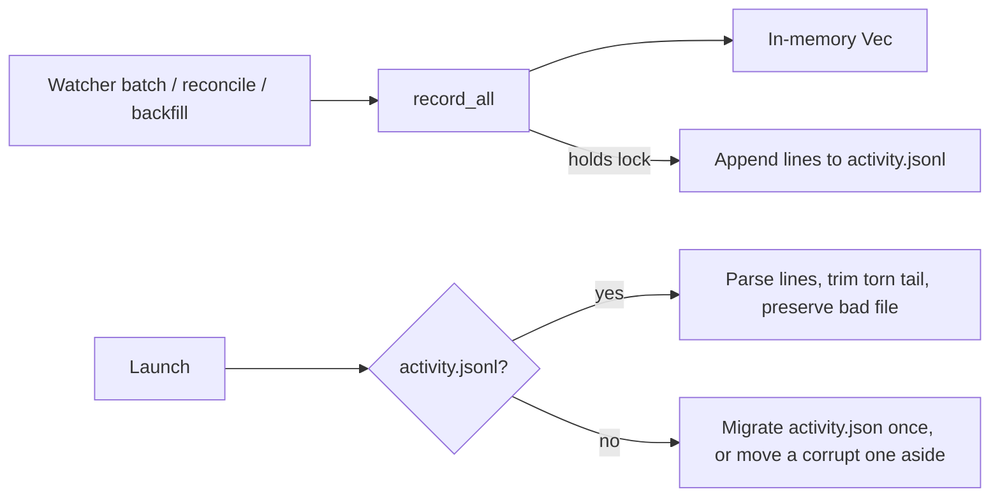

# Cache Dashboard History

## Why

The Dashboard keeps re-deriving history that has not changed and keeps rewriting history it already holds.

- **The commit garden re-mines git on every refresh.** Every `commit_garden` call runs `git log --all -n 500` plus `git remote` for each registered repository, serially and uncached. `useCommitGarden` refetches on `cache-updated`, which fires on every spec batch, every `.git/index` write and every window focus. Focusing the window refetches it twice.
- **Writing the activity log costs more as the log grows.** Every batch that yields an achievement makes `ActivityLog::persist` re-serialise the whole log as pretty JSON and `fs::write` it in place. That is 2.5 MB and 7,870 events on the live install, and the log has doubled in about ten weeks. An archival batch rewrites the log once per archived change. The write runs inline on a tokio worker. It is not atomic, and because it happens after the mutex is released, two concurrent persists can leave the older snapshot on disk.
- **One crash can wipe the log.** A truncated `activity.json` loads as empty. The first-launch backfill then runs again, and the next persist overwrites the damaged file, so every live event is lost for good. `activity.json` is the only config file that never goes through `preserve_corrupt_config`.
- **The first-launch backfill spawns git hundreds of times per repository.** `task_completion_history` runs one `git show --name-only` per commit and one `git show <sha>:<path>` per `tasks.md` touch, one after another. On this repository that is about 539 spawns, and the Dashboard shows no history until every repository has finished.

## What Changes

- **Per-repository garden cache.** The raw `git log --all` commit list behind the garden is cached in memory per repository. It is reused on the same `RepoCache` single-flight path as the lifecycle and commit-activity caches, and invalidated by the same `GraphChanged` signal and the same unregister eviction. Each call still filters to today and resolves authors against the current identity. The active-change count is still read from live views. A failed mine is never cached.
- **Linked-worktree HEAD counts as a graph change.** A detached-HEAD commit in a linked worktree writes only `.git/worktrees/<name>/HEAD`, so today it fires no `GraphChanged`. The garden currently hides that gap by re-mining on every refresh, and caching would expose it. `RepoMonitor` now classifies that HEAD and its reflog as `graph`, as it already does for the main worktree. The lifecycle and heatmap caches gain the same fix.
- **Activity log stored as append-only JSON Lines.** The log becomes `activity.jsonl`. A batch appends one line per event in a single write. It is written under the log's lock, so lines reach disk in the order they were recorded. An archival batch records once. Cost per batch is proportional to the batch, not to the log.
- **A crash or a bad file never costs recorded events.**
  - A torn (unterminated) final line after good lines is dropped and trimmed.
  - Any other unparseable content is preserved as a `.corrupt-<n>` sibling, and every line that parses is kept.
  - A legacy `activity.json` is migrated once, atomically, and kept as `activity.json.migrated`, never overwriting an earlier kept copy. One that fails to parse is moved aside rather than overwritten.
- **One persisting instance at a time.** The desktop app, a standalone `specforge-serve`, the TUI and worktree dev slots share the config directory. An instance persists only while it holds an advisory lock on the log file, so two instances watching the same workspace cannot record the same achievement twice. The other instances keep their in-memory log, which keeps them working for that session.
- **Batched task-history backfill.** `task_completion_history` makes one path-limited `git log` that carries each commit's changed `tasks.md` blob ids, followed by one `git cat-file --batch` that receives object ids only. Its window, author attribution, merge handling, deletion-as-zero and positive-delta output stay as they are.

## Capabilities

### New Capabilities

_None._

### Modified Capabilities

- `activity-log`: adds three requirements. The log persists in proportion to each batch, keeps disk order equal to record order, and never loses recorded events to a crash, a corrupt file or a format migration. Concurrent instances never persist one achievement twice. The backfill reads history in a fixed number of git processes per repository. It also modifies *App-Data Persistence and Workspace Read-Only Guarantee* to say that an achievement observed only by a non-persisting instance lasts that instance's session.
- `commit-garden`: adds a requirement that each repository's commits are mined at most once per history change. A failed mine is retried, today's scoping and identity resolution run on every call, and the cache lives in memory only.

## Impact

- `crates/openspec-core`:
  - `activity_log.rs` (load, migration, append, persistence lease, corrupt-file handling, module doc).
  - `git.rs` (`commit_log_authored` replaced by `commit_log_authored_checked`, batched `task_completion_history`, `cat_file` feeding stdin from a writer thread).
  - `garden.rs` (`compute_garden` takes a slice).
  - `repo_cache.rs` (a `GardenCache` alias and its module doc).
  - `repo_monitor.rs` (`RepoPaths::classify`).
  - `watcher.rs` (archival achievements recorded in one `record_all`).
- `crates/openspec-app`:
  - `service.rs` (`commit_garden` through the cache, invalidator and unregister eviction, the activity path, legacy-file migration at bootstrap).
  - `review_progress.rs` (a doc comment that names `activity.json` as a second writer).
  - `tests/dashboard.rs` (polls for the re-mined result instead of re-reading once).
- Reuses `write_atomic` and `preserve_corrupt_config` from `atomic-settings-persistence` (`openspec-core/src/config_file.rs`) when that change lands first. No new dependency: the advisory lock is std `File::try_lock`.
- Frontend crates: only the module doc of `crates/specforge-web/src/main.rs`, which describes two-writer `activity.json` contention, changes, together with the matching sentence in the root `CLAUDE.md`. No change to any IPC shape, event name or payload, setting, or `src/` code. The `useCommitGarden` refetch triggers stay as they are; each refetch just gets cheaper.
- Out of scope, deliberately:
  - **Redundant clones and per-fetch full-log scans in the Dashboard path** (`lifecycles` cloned twice, `query_window` cloned twice, `reconcile_lifecycle`'s HashSets, `commit_days` strings). They are real but cost milliseconds per fetch at today's log size. `me_created_change_ids` scans the whole log on purpose, because "did I create it" is a lifetime fact.
  - **Incremental lifecycle mining.** Each history move re-mines only that repository, in about 60 ms off the runtime. The `cache-change-lifecycle` design deferred incremental mining pending measurement, and the measurements do not justify it. It would also have to stay identical under rebase, amend and branch deletion.
  - **`CommitActivityCache` pins an empty result after a transient git failure, and `populate` does not warm it.** Both are noted here for a follow-up and are not changed.
  - **The `useDashboard` re-render** belongs to `stabilize-frontend-rendering`. **Settings and presentation atomicity** belong to `atomic-settings-persistence`. **Blocking work on the main thread** belongs to `unblock-main-thread`.
