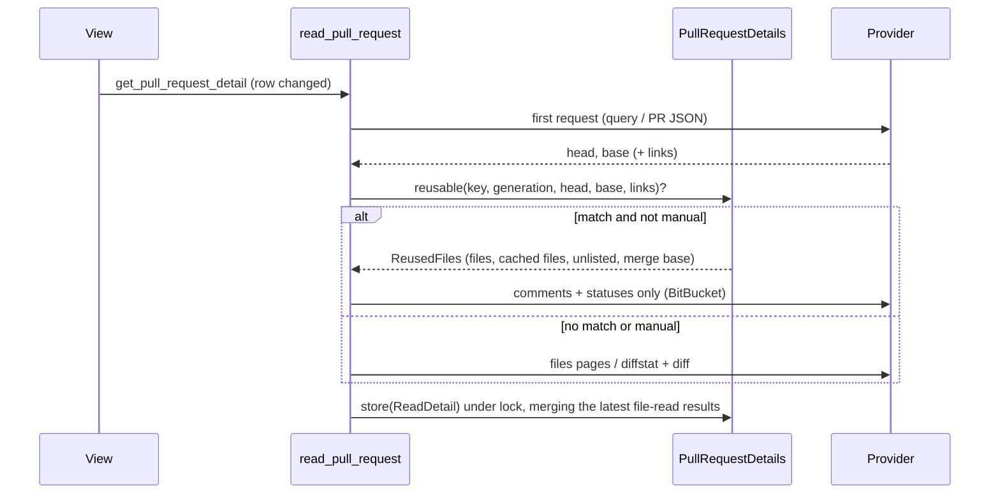

## Context

A pull-request view re-reads its detail whenever the provider's announcement shows that its row changed. On GitHub that means a change to the row's updated time, its checks or its count of unresolved conversations (`PullRequestView.tsx` together with `pullRequestView.ts`). A new comment, a review or a CI status flip moves those signals without moving either commit, so on an active pull request most re-reads change no file.

Today every read starts from nothing:

- **GitHub.** `github_detail::read_with` posts `DETAIL_QUERY`, which already returns `headRefOid`, `baseRefOid` and `files.totalCount`. It then GETs files pages `1..=DETAIL_MAX_FILES_PAGES` and stops only at a short page. A PR whose file count is an exact multiple of 50 therefore costs one extra empty GET. A 300-file PR spends 8 of `DETAIL_BUDGET` (500 per hour): 1 POST and 7 GETs.
- **BitBucket.** `bitbucket_detail::read_with` sends its requests serially: the PR, up to 10 diffstat pages, the diff (up to 8 MiB, re-parsed by `parse_diff_with_spans`), the comment pages, then the statuses.
- **The cache.** `PullRequestDetails::store` (`pull_request_cache.rs`) replaces the whole `CachedDetail`. It sets `merge_base: None`, and its `CachedFile` list loses every `fetched` result and the `hunks` digests a file read learned. Loading the same file again sends the compare GET plus up to two contents GETs. Until then, review progress (`service.rs` `review_progress`) reports the file's hunks as not known.

Every request is counted before it is sent: `pull_request_read::clear_to_send` calls `DetailPermit::request`. A request that is never sent is therefore never counted.

## Goals / Non-Goals

**Goals:**

- When head and base are unchanged under the same credential generation, a re-read sends no file requests:
  - GitHub: 1 request instead of $$1 + p_{\text{files}}$$;
  - BitBucket: $$2 + p_{\text{comments}}$$ instead of $$3 + p_{\text{diffstat}} + p_{\text{comments}}$$, with no 8 MiB diff download and no re-parse.
- Such a re-read keeps the work already done: the withheld hunks, file-read results, hunk digests and the merge base.
- The empty trailing GitHub files page is gone.
- All logic stays in `openspec-app`. No IPC, frontend or `DETAIL_QUERY` change.

**Non-Goals** (each was investigated and rejected; see the proposal's *Out of scope* list):

- **Concurrent GitHub files pages.** GitHub advises sending one token's requests serially. A secondary limit would set both deadlines, the poller's included, and with reuse the pages are rarely sent anyway.
- **Parallel BitBucket GETs.** They would save latency only, and would make it harder to stop at the first 401, 403 or 429, or on disable.
- **ETags.** The GraphQL POST has no conditional form, and `DetailPermit::request` charges the budget before a 304 is known.
- **Diffstat `pagelen`.** The default page length is unverified, and nothing shows it matters.
- **`take_counts` complexity.** Negligible: about 10^6 comparisons in the worst case, once per read, on the blocking pool.
- **The review-progress store's whole-file re-parse and rewrite.** It runs off the main thread on a small file. The spec also requires a re-read before every write, because `specforge-serve` and the desktop app share the file. A parse memo would be marginal.
- **A byte bound on the 32-entry cache, and `SkipRule` recompilation.** The worst case of the first is unlikely, and the 32-entry count is spec-mandated. The second is negligible.
- **Clone-per-answer in `cached()` and `fresh()`.** Minor next to IPC serialization.
- **`DETAIL_QUERY` pagination** of reviews, comments, threads and checks. This is a correctness gap that needs a spec change to the fixed-query rule. It is a separate follow-up.
- **A shared `ureq` agent.** That belongs to `reuse-http-connections`.

## Decisions

### D1. Reuse is keyed by head + base commit (+ BitBucket links) under the read's generation

The files a pull request shows are fixed by its head commit and merge base, and the merge base follows from head and base. So, under one credential (the same account sees the same repository), the pair (head, base) fully determines the file list.

- **GitHub** compares the query's `headRefOid`/`baseRefOid` with `CachedDetail.detail.head_commit`/`base_commit`.
- **BitBucket** compares `source.commit.hash`/`destination.commit.hash`, and also requires `links.diff` and `links.diffstat` to be byte-identical to the links the entry was read by. These are kept as a new `CachedDetail.links: Option<ReadLinks>`. BitBucket's hashes are 12-character short hashes, and the links embed the full diff spec (`…/diff/acme/api:<src>%0D<dst>?from_pullrequest_id=7&topic=true`). Requiring both means the content we would have downloaded is named identically.

The generation check uses `Cache::generation(provider) == read.generation`, under the same `Mutex` `store` and `forget` take. A credential change empties the provider's entries anyway (`Cache::forget`), so a stale entry cannot match.

*Alternatives considered:*
- **Per-page ETags / `If-None-Match`.** Rejected: GraphQL has no conditional form, and the app's own budget is charged before the reply is known. It would save GitHub's quota but none of `DETAIL_BUDGET`, unless the budget rule were redefined, which weakens the spec's guarantees.
- **Comparing the GitHub files list's `sha` fields after fetching page 1.** Rejected: it still spends a request per read and needs the whole list to be sure.
- **Keying BitBucket on commits alone.** Rejected: the link is what is actually fetched. Adding it costs nothing and guards against a short-hash or link-shape change.

### D2. The reuse check is a cache snapshot taken between the first reply and the first file request

New `PullRequestDetails::reusable(key, generation, head, base, links) -> Option<ReusedFiles>`:

- It locks the cache and checks the entry exists, the generation matches and the commits (and links) are equal.
- It returns a clone of `detail.files`, the parallel `Vec<CachedFile>`, `detail.unlisted_files` and `merge_base`.
- It uses `Cache::get`, not `touch`, so a reuse probe does not reorder the LRU before the read is stored.

`github_detail::read_with` and `bitbucket_detail::read_with` each gain a `reuse: impl FnOnce(..) -> Option<ReusedFiles>` parameter, called once after the first reply has been classified. `read_pull_request` passes `|..| None` for a manual refresh, and otherwise a closure over `context.details.reusable` with the read's generation.

`ReadParts.files` becomes an enum, `ReadFiles::{Listed(Vec<ReadFile>), Reused(ReusedFiles)}`. `assemble` (`pull_request_detail.rs`) applies the budgets only to `Listed`. `Reused` passes through unchanged, because the cached files already carry the budgets' verdicts, and re-applying them to a list of identical size gives the same result. `ReadParts` gains `links: Option<ReadLinks>`, which BitBucket fills and GitHub leaves `None`.

The injected `reuse` closure keeps both `read_with` functions pure over their transports, so the existing fake-transport tests can count requests for both outcomes.

*Alternative considered:* **checking reuse inside `store` only, after fetching everything.** Rejected: it saves CPU and the cache's work, but none of the requests or budget, which is the point.

### D3. `store` merges against the live entry, not the snapshot

At most one detail read per pull request is in flight (`read_once`), but a file read or image read may keep a result (`keep_fetched`, `keep_merge_base`) between the snapshot and the store. Under the store's lock:

- If the live entry has the same head and base, the new entry takes the live `merge_base`. When the read reused, it also takes the live `detail.files` and `Vec<CachedFile>`. This carries every result kept since the snapshot.
- If no live entry matches (evicted in between, or a different commit pair), a reused read uses its snapshot, which is equally valid for those commits. A listed read uses its own files with `merge_base: None`.
- A listed read whose commits match the live entry (a manual refresh) keeps only the `merge_base`. Its fresh files replace the cached ones, so a manual refresh is a true re-read.

`ReadDetail` gains `reused: bool` and `links`. The existing generation and enabled check in `store` is unchanged and still runs first, so the *Credential changes* rule ("its result SHALL be neither cached nor returned") holds for reusing reads too.

*Alternative considered:* **always store the snapshot.** Rejected: a file loaded while the re-read was in flight would silently lose its result, which is exactly the regression this change removes.

### D4. A manual refresh never reuses

A manual refresh is already bounded to one per 30 s per pull request. It is the reader's way to say "show me what the provider has now". Bypassing reuse makes it a guaranteed escape hatch if a provider ever served an incomplete or stale files list for a commit pair (see the risks).

*Alternative considered:* **a maximum reuse age** (for example, re-read files older than 10 minutes). Rejected for now: it adds a timer-shaped rule to a spec that deliberately has none (*An idle view does not poll*). The manual path covers the same need at the reader's discretion.

### D5. The GitHub page count comes from `files.totalCount`, and a short page still stops

`read_with` reads `/files/totalCount` from the query reply, as `parts` does today, before the loop. The page bound is

$$p_{\max} = \begin{cases} \min\!\left(\max\!\left(\left\lceil n/50 \right\rceil, 1\right), 20\right) & \text{total present} \\ 20 & \text{total absent} \end{cases}$$

and the loop keeps its `entries.len() < FILES_PER_PAGE` break.

- **The floor of one page.** It keeps today's behaviour for an empty pull request, and guards against a zero `totalCount` that disagrees with the pages.
- **The short-page break.** It covers a push that lands between the POST and the GETs and shrinks the list.
- **A push that grows the list.** The list stops at `p_max`. This is consistent with the query that described the detail, and the next announcement shows a new `headRefOid` and reads again.

`FILES_PER_PAGE` stays 50, because of the patch-omission comment beside it.

*Alternative considered:* **dropping the short-page break and trusting `totalCount`.** Rejected, because of the race above. *Alternative considered:* **concurrent pages bounded by `totalCount`.** Rejected; see the Non-Goals.

### D6. BitBucket: the link check precedes the reuse check

`followable_link` still runs on both links before `reuse` is consulted. A payload whose links may not be followed stays `Unavailable` even when its commits match the cache. That keeps *A foreign payload link is not followed* and the privacy rule independent of the cache's state. The order of the remaining requests (comments pages, then statuses) is unchanged, so the disabling and 429 scenarios hold as they do today. No transport changes: every request still goes through the existing `DetailIo` transports (`github::send`, `github_detail::send_get`, `bitbucket_detail::send_get`), so the credential stays in the `Authorization` header, no redirect is followed and no ambient proxy is used. Reuse only removes requests; it never adds a destination.

### D7. Spec deltas

- **Added: *Detail Re-reads Reuse Unchanged Files*** carries the cross-provider rule.
- **Modified: *GitHub Detail Reads*** (page bound and formula; request 3's merge-base rule) and ***Pull-Request Image Reads***. Both said "a new read of the pull request SHALL drop it [the merge base]". This change contradicts that on purpose: the merge base now survives a read that reports the same commits, because the merge base is a function of those commits.
- **Modified: *BitBucket Detail Reads*** (formula and the five-GET scenario's precondition).
- **Modified: `bitbucket-pull-requests` *Privacy and Safety*.** It said a detail read requests the diffstat and diff, and now says it does so unless it reuses. The host, link, redirect and enabled-flag rules are unchanged.

Every existing scenario name is kept verbatim.

*Shared Backoff and Detail Budget* needs no change. Unsent requests are simply not counted, and the worst-case requests per read (21 and 23) that the BitBucket budget inequality relies on are unchanged. *Detail Reads Are Scoped to the Snapshot* is also unchanged. Its freshness rule decides *whether* the service reads; this change only decides what a read that happens sends.

## Risks / Trade-offs

- **[GitHub serves a files list that lags its `headRefOid` right after a push, and reuse pins it until the next commit change]** → Reuse also requires the query's `files.totalCount`, when present, to equal the cached files' listed plus unlisted count, so a lagged list whose count differs reads again on the next read (added at implementation). A manual refresh always reads the files in full (D4). If the pages were read for a newer head than the query reported, the next read sees a different `headRefOid` and reads again.
- **[BitBucket `destination.commit.hash` might not move when the destination branch does]** → Partly mitigated only. The links embed the same `<src>%0D<dst>` pair as the payload's hashes, so link equality adds no protection if BitBucket leaves both stale; it guards against a link-shape or query change (D1). The backstop is that a manual refresh always reads the files in full (D4). Today's behaviour is no better here: the diff link already names the payload's pair, so a stale destination hash already yields a stale diff. The implementer should confirm against a live pull request that `destination.commit.hash` follows the destination branch before relying on reuse for BitBucket; if it does not, BitBucket reuse should be dropped from this change rather than weakened.
  - *Resolution at implementation.* No live BitBucket credential was available, and neither Atlassian's API reference nor the repository's fixtures say whether `destination.commit.hash` follows the destination branch. Rather than rely on it, reuse is made independent of it: BitBucket reuse is asked only when both links name the payload's own commits as their diff spec (the path ends `:{source}%0D{destination}`, the shape the fixtures and the fake transport carry). Such a link is content-addressed, so the files reused are exactly what re-fetching that same link would return; a stale destination hash yields the same stale diff with or without reuse, which is today's behaviour. A link of any other shape reads the files in full. The reuse rule gains this condition in the spec delta, with its own scenario.
- **[A manual refresh joins a background read in flight]** → `read_once` lets a manual refresh asked while another read of the pull request is in flight subscribe to that read, so it can receive a reused result. This is documented in the spec's *Manual refresh* paragraph rather than handled with flight-level machinery; a second refresh, once the read has ended, reads in full.
- **[Short BitBucket hashes collide]** → Negligible at 12 hex characters within one repository's pull request, and also guarded by link equality.
- **[A file read kept between the snapshot and the store is lost]** → `store` merges against the live entry under the lock (D3). A dedicated deterministic test interleaves `keep_fetched` between `reusable` and `store`.
- **[The reused detail's `unlisted_files` disagrees with a changed `totalCount`]** → `totalCount` is fixed by the commits too, so a disagreement means GitHub changed its answer for identical commits. A manual refresh recomputes it.
- **[Mutation gate: the reuse predicate is an `&&` chain over five conditions]** → One test per condition flips exactly that condition (head, base, generation, links, manual), so every `&&` → `||` and `==` → `!=` mutant is killed. The generation case must keep the entry present: `forget` drops the entry, so a test that only calls `forget` is caught by the "no entry" branch and leaves the generation comparison's mutants alive. The test stores an entry under the advanced generation and probes with the stale one.
- **[Existing scenarios that assumed a re-read drops the merge base]** → *A patchless file with lines is read on request* and *A BitBucket image read reads the merge base and both versions* said "for the first time since the pull request was read" and expected the merge-base request. Their headings are kept and their preconditions now add "no merge base known", which is what they always meant. The page bound gets table tests at n = absent, 0, 1, 49, 50, 51, 100, 1,000 and 1,200.
- **[Memory]** The snapshot clones one entry's files once per reusing read. That is the same order as the clone `fresh()` already makes per answer, and far less than re-parsing an 8 MiB diff.

## Open Questions

- Should a reused read's response tell the frontend that files were reused, for example so it can keep scroll or expanded state? Not needed for correctness: the view receives an identical file list. It is deferred to `stabilize-frontend-rendering` if it proves useful.
