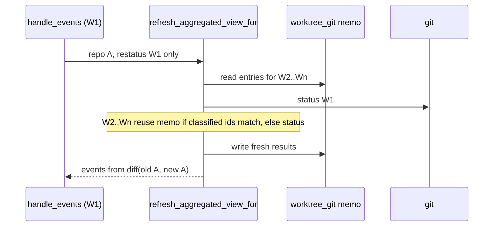

## Context

The watcher re-aggregates `last_views` after every debounced `openspec/` batch, on every repository git event, and on every window focus. The paths live in `crates/openspec-core/src/watcher.rs` (`Inner::handle_events`, `refresh_aggregated_view{,_locked,_for}`) and `crates/openspec-core/src/repo_view.rs` (gather, compute, `build_repo_view`). A performance sweep at `b581063` found that the per-save work is driven by the size of the registry and of the archive, not by what the event could have changed:

| # | Where | What runs per recompute today |
|---|---|---|
| 1 | `build_repo_view` → `newest_mtime` (repo_view.rs ~1152–1159, ~1391–1414) | Recursive `read_dir`+`stat` of every `archive/<dir>/` in every worktree. Here that is 135 dirs and 1,332 entries per worktree, run serially after the git fan-out and repeated on every focus. |
| 2 | `handle_events` (watcher.rs ~1143–1147) | A flat batch runs the full `refresh_aggregated_view`: `git worktree list` per repo plus `git status` per worktree for the whole registry. `git_identity_for` also spawns 2× `git config` per flat batch. |
| 3 | `refresh_aggregated_view_for` → `compute_worktree` | One `git status` per worktree of the repository, even though only one worktree's file changed. |
| 4 | `dirs_differ` (repo_view.rs ~1338–1366) | Full `std::fs::read` of both copies of every file, per diverged-candidate pair. The doc promises a size check the code never makes. |
| 5 | `resolve_main_worktree` (repo_view.rs ~596–607) | `git worktree list --porcelain` per warm repo per recompute, although `git::main_worktree_for_common_dir` already gives git's answer. |
| 6 | `refresh_aggregated_view_for` (watcher.rs ~1341–1347) | Clones the whole snapshot twice, then `diff_views` indexes both full snapshots, archived sections included. |

The live contracts this has to respect:

- `working-tree-status`: *Status Freshness*, *Non-Blocking Aggregated Recompute*, *Concurrent Per-Worktree Status Invocation*.
- `archive-browser`: *On-Demand, Off-Hot-Path Loading*. The aggregation may make a directory listing of `archive/` and nothing more, which the walk in row 1 already exceeds.
- `workspace-registry`: *Deterministic Config-Ordered Top-Level View*, *Cold Aggregation of Disabled Rows*, *OpenSpec Presence Is Derived on Every Aggregation*, *Coalesced Repository Refresh*.
- `spec-browser`: *Per-Instance Divergence Label*, which requires a byte-level comparison.

All logic stays in `openspec-core`. No frontend crate and no IPC shape changes.

## Goals / Non-Goals

**Goals:**

- Make an `openspec/` file batch in worktree W cost one `git status` (for W) plus cache work for W's repository. For a flat workspace, no git at all.
- Stop the aggregation from reading anything beneath `archive/<dir>/`.
- Drop the subprocess from main-worktree resolution.
- Make the scoped merge clone and diff one repository, not the snapshot.
- Keep every emitted event and every serialized field identical to today, apart from the sibling-worktree staleness the amended *Status Freshness* explicitly admits.

**Non-Goals:**

- **Excluding `archive/` from the filesystem watch.** On Linux this costs about 530 inotify watches per worktree here, and on WSL a poll of every entry each interval. It is real, but notify cannot exclude a subtree, so the fix means non-recursive parents plus per-change recursive watches re-armed on add/remove. No CI job compiles the `cfg(windows)` backend. The fix also needs a MODIFIED *Filesystem Watching of Registered Workspaces* and *Polling Watcher for WSL Workspaces*. Deferred as high complexity for a niche win.
- **Dropping `--untracked-files=all`** (git.rs ~507). It is load-bearing: in `normal` mode a wholly-untracked `openspec/changes/` collapses to one `? openspec/` line, and every change in it would misclassify as `Committed` (*Per-Change Spec Commit State*).
- **The per-batch active re-parse** (`parse_all_changes`, watcher.rs ~1065). It is bounded by the active change count and small next to the batch's `git status`.
- **`Arc<Vec<WorkspaceView>>` for `last_views`.** Every consumer (`AppService::workspace_views`, dashboard, commit garden, warm-up) mutates its copy, so the clone would only move to them as clone-on-write. IPC serialization of the same data costs more than the clone.
- **The gather-phase `ChangeData` clone** (repo_view.rs ~550, ~388). *Non-Blocking Aggregated Recompute* releases the cache lock before compute, so gather must own its inputs.
- **A memo for `dirs_differ`.** mtime is checkout time in a fresh worktree and a same-length edit keeps the size, so no cheap key equals content identity (see `files.rs`, "Why content, and not size+mtime").
- **Parallelising `build_repo_view` across repositories.** Once D1 removes the archive walk, what remains serial (active-change `newest_mtime` and `dirs_differ`) is a handful of small directories.
- **The deep clone in `WatcherManager::workspace_views` (watcher.rs ~566), `archived` stubs included.** `unblock-main-thread` names this as belonging here. It is the same clone as the `Arc` item above: `AppService::workspace_views` filters and joins presentation into its copy, and the Dashboard reads `archived` (`archived_count`, `repo_ships`), so the stubs cannot simply be dropped from the copy either. Left for a follow-up that splits the IPC projection from the Dashboard's.
- **Parallel per-workspace initial parses inside `AppService::populate`.** `unblock-main-thread` also names this as belonging here. It is a start-up cost, not the per-event recompute this change bounds, and it is not done here. It needs its own change.
- **Elsewhere.** The registry mutex held across git, and blocking calls on tokio workers, belong to `unblock-main-thread`. Lifecycle, garden and activity caching belong to `cache-dashboard-history`.

## Decisions

### D1. Archived-instance recency comes from the directory name

In `build_repo_view`, an archived instance's `modified_at` becomes the Unix seconds of 00:00 UTC on the date in its directory name's `YYYY-MM-DD` prefix. That is `parser::archive_dir_date` parsed with `chrono::NaiveDate`, which is already a dependency. An undated legacy directory gets `0`. `newest_mtime` is no longer called on any `archive/` path. Stage 2's `sort_by_key(Reverse(modified_at))` is stable, and stage 1 pushes instances in snapshot worktree order, which is the registry's config order for that repository (`gather_repo_inputs` keeps it on both paths). Same-date copies therefore keep that order. `annotate_divergence` runs before the sort and never reads an archived directory (`compute_divergence` returns `[stale]` or nothing for archived pairs), so divergence labels are unaffected. The partition into `active` and `archived` after the sort keeps the active order independent of archived keys, as it already does. `dashboard::repo_ships` takes the first matching archived instance, so "the copy archived today" becomes the one in the earliest tracked worktree, and stays so on every recompute.

The value is barely consumed. `RepoView::archived` is `skip_serializing`, and archived `modified_at` only orders archived instances among themselves. The directory name is also the date the Archive view already shows (*Newest-First Ordering and Date Labels*), and the Archive view's own grouping (`parser::group_archived_rows`) already leads with the newest-dated copy, so the two orderings now agree. The doc on `ChangeInstance::modified_at` will say that for an archived instance it is the archive date, and the "most-recently-modified first" docs on `LogicalChange` (repo_view.rs ~185) and the comment in `repo_ships` (dashboard.rs ~507) are corrected to match. This does not touch `spec-browser`'s *Last changed* header, which reads the artifact file's own mtime through a separate read and never this field.

**Alternatives rejected:**

- *Memoize `newest_mtime` per (worktree, dir).* This still walks every directory once per worktree at start-up and for each new worktree, still reads beneath `archive/<dir>/` (which *On-Demand, Off-Hot-Path Loading* does not allow), and adds invalidation for content that never changes.
- *Use a single `stat` of `archive/<dir>`.* That is still a per-entry syscall beyond the listing. A directory's mtime across a `mv` into `archive/` also differs by filesystem, since some update it for the rewritten `..` entry and some do not, so it is not a reliable archival instant.
- *Use `ChangeLifecycle::archived_at_by_dir`.* It needs git history mining, which belongs to `cache-dashboard-history`, and it is not available on the cold path.

### D2. A flat-workspace batch splices only its own row and spawns no git

`handle_events` dispatches `repo_id == None` to a new `Inner::refresh_flat_view_for(uri)`. It takes the `recompute` lock and gathers the flat row from the registry and cache with a new `repo_view::gather_flat_view(registry, cache, uri, is_disabled)`. It builds the row exactly as `aggregate` builds `ViewInput::Flat`, stamps presence through the existing `stamp_openspec_presence` on that one row, and swaps it in with a new `repo_view::replace_flat_view`, the flat twin of `replace_repo_view`, which keeps the row's position. `diff_views` never indexes flat rows, so the derived event list is empty, the same thing a full recompute yields for a flat row. If the row is not yet in the snapshot (first appearance), or the entry is no longer a user-registered flat, the method falls back to `refresh_aggregated_view_locked`, as the scoped repo path does.

`git_identity_for` returns `None` without spawning when `repo_id` is `None`. *Local Identity Resolution from Git Config* (`developer-identity`) already says a workspace outside a git repository resolves no identity, and *A flat workspace records an author-less live event* (`activity-log`) already describes the outcome, which is that the event resolves as the local developer's. Today's `git config --get` in a non-repo directory falls through to the global config, which contradicts both. Separately, `handle_events` will resolve the identity only when an activity log is attached. It cannot simply move the call inside the achievements `map`, because the archival branch further down reuses the same `local_identity`. Instead it reads the attached log once and resolves the identity once when that read is `Some`, and both branches reuse the result.

**Alternatives rejected:**

- *Keep the full recompute,* which the live spec says the batch MAY run. Its cost scales with the whole registry for an edit that cannot affect any repository.
- *Memoize the flat identity per path.* That freezes the global identity just the same, keeps a spawn on first batch, and still contradicts `developer-identity`.

### D3. A file batch re-statuses only its originating worktree

The new state in `repo_view.rs` is a `pub(crate) struct WorktreeGitState { branch, upstream, status: WorktreeStatus, classified_ids: Vec<String> }`. `classified_ids` is the sorted list of active change ids the status was classified against. `Inner` gains `worktree_git: Mutex<HashMap<PathBuf, WorktreeGitState>>`, keyed by worktree path and only read or written while `recompute` is held.

- `gather_repo_view` takes a new `restatus: Restatus` argument (`Restatus::All | Restatus::Worktree(PathBuf)`) and the memo. For `Worktree(w)`, every other warm worktree whose memo entry's `classified_ids` equals its current sorted active ids gets a `reuse: Option<WorktreeGitState>` on its `WorktreeGatherInput`. This is a map lookup and stays within gather's no-I/O contract.
- `compute_worktree` returns the reused state unchanged when `reuse` is `Some`, and otherwise spawns `worktree_branch_and_status` as today. A cold row ignores `reuse` and keeps its current clean, branchless result.
- The merge phase writes every freshly computed warm worktree back into the memo. The full path (`refresh_aggregated_view_locked`) replaces the memo with exactly the warm worktrees it statused, which prunes removed and cold worktrees. The scoped path replaces only that repository's entries.
- `Restatus` is an argument of the private `Inner::refresh_aggregated_view_for` only. The public `WatcherManager::refresh_aggregated_view_for` (called by `tests/repo_monitor.rs`) keeps its signature and passes `Restatus::All`, so `Restatus` and `WorktreeGitState` stay `pub(crate)`.
- Only `handle_events` passes `Restatus::Worktree`. `refresh_status_for` (repo-monitor index, refs, `HEAD` and config events, and `service.rs` re-enable) and the focus refresh pass `Restatus::All` or use the full path, so git events keep full per-repository re-status.

The narrowing is sound for a sibling W2 for three reasons. An edit inside W1's `openspec/` cannot change W2's branch or upstream, which change only through W2's `HEAD` or refs, both git events. It cannot change W2's spec commit states either, because those come from W2's own `openspec/changes/<id>/` paths, and an edit there produces W2's own batch. A change to W2's set of active changes, from re-registration, a populate, or W2's own batch, fails the `classified_ids` check and forces a status. That leaves one thing reuse can leave stale: W2's dirty bit after a purely unstaged non-spec edit, which *Status Freshness* already tolerates. Ordering is untouched: results are still written back by original index (*Concurrent Per-Worktree Status Invocation*).

This conflicts with the live *Status Freshness* text, which says the merged result SHALL be identical to a full recompute of the repository. The change therefore MODIFIES that requirement instead of adding beside it. Every existing scenario heading is kept verbatim. *A spec file edit in one repository does not recompute others* gains the precondition that no other worktree of A changed since its last status, and three scenarios pin the new bound.

**Alternatives rejected:**

- *Reconstruct sibling state from the previous `RepoView`* using `dirty_worktrees`, per-instance `spec_commit_state` and `worktree_refs`. That couples the memo to rollup shapes that exist for the UI. A cold row's default values are also indistinguishable from a genuinely clean warm worktree, so a re-enabled row could inherit "clean".
- *Keep re-statusing every worktree.* The worktree calls already run concurrently, so this mostly costs subprocesses and CPU, but repositories with many worktrees (drain sessions under `.claude/worktrees/`) pay one spawn per worktree per save.

### D4. Main worktree derived without `git worktree list`

`resolve_main_worktree` drops the warm-path `git::worktree_list` call and always returns `git::main_worktree_for_common_dir(repo_id.as_path())`. Its `cold` parameter goes away. The pooled path's `MainWorktree` jobs in `compute_repo_rows_pooled` stop being jobs, because the value is computed inline. `main_worktree_derivation_matches_git_worktree_list` (git.rs ~2611) already pins the derivation against real git for the plain, separate-git-dir, submodule and bare layouts. The cold path already depends on it (archive `2026-08-12-harden-workspace-disable`, Decision 2), so warm and cold now agree by construction. The new `workspace-registry` requirement *Main Worktree Resolved Without a Subprocess* records this as an outcome.

**Alternative rejected:** *Memoize the warm result and invalidate it on `.git/worktrees/` events.* The main worktree of a common directory never changes when linked worktrees are added or removed, so the invalidation hook is irrelevant and the memo is state for no gain.

### D5. `dirs_differ` compares sizes first, then streams bytes

`walk` already calls `entry.metadata()`, so `collect_relative_files` returns `(relative path, len)` pairs at no extra syscall cost. `dirs_differ` sorts both lists and returns `true` on any path or length mismatch. Only then does it compare each equal-length pair, opening each side as a plain `File` and filling two fixed 8 KiB buffers with `read_exact`, exiting at the first differing chunk. An unreadable file still counts as differing, which is today's semantics for `[diverged]`. A file that changes length between the walk and the read must not compare equal on a prefix. The compare therefore counts as differing on a short read from either side before the known length, and on either side still yielding bytes after it. The doc is corrected to describe this, and also to drop its claim about symlinks: `DirEntry::metadata` does not follow them, so `walk` skips symlinks and special files entirely today, and still does. Equal sizes always lead to a byte comparison, as *Per-Instance Divergence Label* requires. A `read_exact` that fails on either side (a short read before the known length) counts as differing. After the last chunk, an `at_end` check reads one more byte from each side and requires `Ok(0)`, so a file that grew counts as differing too. To keep mutants from hanging, the loop is a `for` over `0..len.div_ceil(CHUNK)`, a fixed iteration count derived from the known length, because a mutant that zeroes a loop step would otherwise hang until the CI timeout fails the gate.

**Alternative rejected:** *Reuse `files::copies_differ`.* It treats an unreadable copy as *not* differing, which is the right stance for the file browser's marker but the opposite of `dirs_differ`. It also compares 64-bit hashes, not bytes.

### D6. The scoped merge swaps one repository and diffs one repository

`refresh_aggregated_view_for` takes the `last_views` write lock, finds the repository's slot, and `std::mem::replace`s the new `RepoView` in, keeping the old one. If there is no slot, it drops the lock and falls back to the full path. Once the lock is released, it returns `diff_views(&[WorkspaceView::Repo(old)], &[WorkspaceView::Repo(new)])`. `diff_views` keys on `(repo_id, change name)`, and every other repository is byte-identical between the old and new snapshots, so their keys produce no events. Diffing the one repository therefore emits exactly the event set the whole-snapshot diff emits, with no snapshot clone. D2 uses the same swap. A unit test pins the equivalence against `diff_views` over the full snapshots.

**Alternative rejected:** *Swap an `Arc<Vec<WorkspaceView>>`.* See Non-Goals: the clone moves to the consumers instead of disappearing.

## Risks / Trade-offs

- **[Risk] A sibling worktree's dirty bit lags after an unstaged non-spec edit** (D3). → This is the staleness *Status Freshness* already admits for that edit. It clears on the next git event or focus, and the MODIFIED requirement states it explicitly.
- **[Risk] A main-worktree branch or ref move leaves no index write** (D3). `git switch -c`, `git branch -m` and `git reset --soft` rewrite `HEAD`, `logs/HEAD`, `packed-refs` or `refs/heads/*` and leave `.git/index` alone. Before this change the next file batch anywhere re-statused every worktree and hid that. Now a sibling's batch reuses the main worktree's entry. → `RepoMonitor` classifies those four paths as `status` as well as `graph`, so a git event re-statuses every worktree of the repository, as *Status Freshness* requires. Remote-tracking refs and tags stay `graph` only, so an ordinary fetch costs no status (a pruning fetch that rewrites `packed-refs` does).
- **[Risk] Reuse where a repository's git events are never observed** (D3). A WSL repository's `RepoMonitor` uses the native watcher, which hears nothing on the 9P share. A monitor whose debouncer failed to build observes nothing. A watch can also fail while the debouncer builds: on Linux an exhausted `max_user_watches` (monitors install after every `openspec/` watcher) or an unreadable directory. A monitor whose task has ended is deaf too. A reftable repository (`git init --ref-format=reftable`, and the default from Git 3.0) moves `HEAD` and every ref inside `.git/reftable/`, which nothing watches. → Reuse is gated on observation. `gather_repo_view` never sets `reuse` for a WSL `RepoId`. `RepoMonitor::observes_git_events` holds only when the debouncer was built, the git-dir watch and the `refs/` and `worktrees/` watches (where those exist) all succeeded, no `reftable/` store exists, and the dispatch task is still running. `Inner::refresh_aggregated_view_for` downgrades `Restatus::Worktree` to `Restatus::All` unless it holds, so such a repository keeps today's full per-repository re-status on every batch. Watching `reftable/` would make reftable repositories eligible again, and becomes worth doing once Git 3.0 makes the format the default.
- **[Risk] A status read that began before its repository was observed.** A recompute can read a worktree's status before `sync_repos` installs the repository's monitor, and a git event in between is then lost. → A state is recorded only for a repository that `observes_git_events` already reported before the reads began: the full path checks it per repository between gather and compute, the scoped path before gather. So every memo entry is one that a later git event is guaranteed to replace, and nothing has to be cleared when a monitor is installed.
- **[Risk] A failed `git status` would be remembered as clean.** `worktree_branch_and_status` degrades to a clean, branchless result when git is missing or fails. → `compute_worktree` uses `git::try_worktree_branch_and_status` and marks a failed read as unread, and `worktree_git_states` never records an unread worktree, so the next batch statuses it again.
- **[Risk] Unverified on Windows: `\\wsl$` and `\\wsl.localhost` spellings of one WSL repository** (D4). `git::git_common_dir` joins git's Linux answer onto whatever UNC form the workspace was registered under, while `worktree_list` and `worktree_toplevel` translate back to `\\wsl.localhost`. A linked worktree registered first through `\\wsl$` could therefore yield a `RepoId`, and a derived main worktree, in the `\\wsl$` form while the main worktree's registry entry is `\\wsl.localhost`, so the main instance would lose `is_main_worktree`. Before this change the warm path took git's own (`\\wsl.localhost`) answer and only the cold path had the exposure. → `RepoId` normalisation is not changed here. This needs a real Windows + WSL2 box to confirm, and a fix belongs to `RepoId` formation, not to aggregation.
- **[Risk] The memo drifts if a code path statuses a worktree without recording it.** → Memo writes go through one merge helper used by both the full and scoped paths. The full path rewrites the memo wholesale, and a test asserts that after a full recompute the memo holds exactly the warm tracked worktrees.
- **[Risk] A cold-to-warm transition reuses a clean result recorded while cold.** → Cold results are never written to the memo, and re-enable goes through `refresh_status_for` (`Restatus::All`).
- **[Risk] Today's-ships copy selection changes** (D1). Ties now resolve by worktree order, not by newest file mtime. → Any same-day copy is a valid target for the title and deep link. The new order is deterministic, which mtime ordering was not across checkouts. A test pins the chosen copy.
- **[Risk] A WSL repository's derived main worktree differs from git's translated path** (D4). → `RepoId` is formed by `git::git_common_dir` (git.rs ~335), which joins git's answer onto the UNC workspace path and canonicalises it. A relative `.git` joins directly, and an absolute Linux path, which is rooted but has no prefix on Windows, replaces everything but the UNC prefix when joined. Either way the `RepoId` is UNC. The derivation only strips a trailing `.git` component, so the parent of a canonical UNC common directory is the canonical UNC worktree that `worktree_list` would have translated to. The cold path already relies on exactly this. A `cfg(windows)` unit test on a UNC-shaped path covers it. No CI job compiles Windows, so it also needs a local cross-target `cargo check --target x86_64-pc-windows-msvc` where available.
- **[Risk] Flat live events lose their global-config author** (D2). → *A flat workspace records an author-less live event* already specifies this outcome, and author-less events resolve as the local developer's, so "me" queries do not change.
- **[Trade-off] The flat batch no longer catches up other repositories as a side effect.** → Nothing relied on that. Each repository's own events and the focus refresh remain its freshness path.
