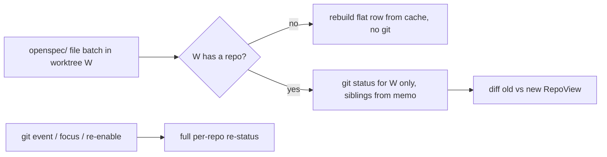

# Scope Status Recompute

## Why

Every save under a watched `openspec/` tree makes the watcher re-aggregate its view. That costs far more than the edit warrants. Each recompute walks every archived change of every worktree with a recursive `readdir`+`stat`. Here that is 135 archive directories and about 1.3k entries per worktree, the archive only grows, and none of it is cached. An edit in a flat (non-git) workspace re-runs `git worktree list` and `git status` for every registered repository. An edit in one worktree re-statuses all the sibling worktrees of its repository. The divergence check reads every file pair in full, and the scoped merge clones the whole snapshot twice. The per-save cost should track what the event could have changed, not the size of the registry or the archive.

## What Changes

- **Archived instances stop walking the archive.** The aggregation stops running `newest_mtime` over `openspec/changes/archive/<dir>/`. An archived instance's recency now comes from the `YYYY-MM-DD` prefix of its directory name, which the listing already holds. Ties keep the repository's worktree order. The aggregation path then stays within what *On-Demand, Off-Hot-Path Loading* allows, which is a directory listing only, and the Dashboard's "today's ships" still picks one copy deterministically.
- **A flat-workspace file batch rebuilds only its own row.** The batch rebuilds the flat row from the cache, splices it in at its config position and re-stamps `hasOpenSpec`, all without spawning git. It no longer runs a full registry recompute. The live-event identity lookup for a flat workspace no longer spawns `git config` either. It resolves to no identity, which is what *Local Identity Resolution from Git Config* already requires.
- **A file batch re-statuses only the worktree it came from.** On the scoped path, an `openspec/` file batch in worktree W re-runs `git status` for W alone. The repository's other worktrees reuse the branch, upstream and status they had at their last computation, held in a new per-worktree memo. Git events (index, refs, `HEAD`, config), the window-focus refresh and re-enable keep full per-repository re-status.
- **The main worktree resolves without a subprocess.** `resolve_main_worktree` drops its warm-path `git worktree list` spawn and always uses `git::main_worktree_for_common_dir`. That function is already test-pinned to git's answer for the plain, separate-git-dir, submodule and bare layouts, so warm and cold rows agree by construction.
- **Divergence comparison rejects on size first.** `dirs_differ` takes file sizes from the metadata its walk already reads, rejects on unequal sizes, and compares equal-sized files in streamed chunks with an early exit. It no longer reads whole files into memory. Its doc now matches what the code does.
- **The scoped merge clones and diffs one repository.** `refresh_aggregated_view_for` swaps the new `RepoView` into `last_views` in place and diffs only the replaced repository's old and new views. It no longer clones the snapshot twice and diffs the whole thing.
- **Doc fixes.** `RepoView::archived` and `dashboard::repo_ships` still describe the pre-partition "mixed changes bucket into `active`" shape. Their docs are corrected.

## Capabilities

### New Capabilities

_None._

### Modified Capabilities

- `working-tree-status`: *Status Freshness* changes in two ways. A flat-workspace file batch SHALL rebuild only its own row and spawn no git process (today it MAY run a full recompute). An `openspec/` file batch SHALL re-status only its originating worktree and reuse the sibling worktrees' last computed status. Git events, focus and re-enable keep full per-repository re-status.
- `archive-browser`: adds *Archived Instances Are Ordered Without Reading the Archive*. Aggregation SHALL NOT read or stat anything beneath an archived change's directory, and archived-instance recency comes from the directory-name date.
- `workspace-registry`: adds *Main Worktree Resolved Without a Subprocess*. Aggregation SHALL resolve every repository's main worktree with no git spawn, and the result SHALL equal git's own answer for every repository layout.

## Impact

- **Code:** `crates/openspec-core/src/repo_view.rs` (`build_repo_view`, `newest_mtime` call sites, `resolve_main_worktree`, `compute_worktree`, `compute_worktree_snapshots`, `gather_repo_view`, `dirs_differ` / `walk`, `RepoView::archived` doc), `crates/openspec-core/src/watcher.rs` (`handle_events`, `refresh_aggregated_view_for`, `refresh_aggregated_view_locked`, `git_identity_for`, a new per-worktree git-state memo on `Inner`) and `crates/openspec-core/src/dashboard.rs` (doc of `repo_ships` only). Tests go in `crates/openspec-core/tests/repo_monitor.rs`, `tests/watcher.rs` and the `repo_view.rs` unit tests.
- **Unchanged:** IPC shapes (`RepoView`, `ChangeInstance` and `WorkspaceView` serialize exactly as before, and `ChangeInstance::modified_at` changes meaning only on never-serialized archived instances), `src/types.ts`, every frontend crate (`specforge`, `specforge-tui`, `specforge-web`), the React app, dependencies, and the filesystem watch scope (`archive/` stays watched). Window-focus refresh stays a full recompute. `--untracked-files=all` stays.
- **Out of scope:**
  - Excluding `archive/` from the Linux inotify and WSL poll watches. It is real but platform-specific, it needs a restructured watch tree, and no CI job compiles the Windows backend.
  - The per-batch active-change re-parse. It is small and bounded by the active change count.
  - Making `last_views` an `Arc`. Every consumer mutates its copy, so the clone would only move to them. The same goes for the deep clone in `WatcherManager::workspace_views`, `archived` stubs included, which `unblock-main-thread` hands to this change. It is left for a follow-up.
  - Parallel initial parses in `AppService::populate`, which `unblock-main-thread` also hands to this change. That is a start-up cost, not a per-event one, and it needs its own change.
  - The gather-phase `ChangeData` clone. *Non-Blocking Aggregated Recompute* requires it.
  - The registry mutex held across git. That belongs to `unblock-main-thread`.
  - The lifecycle, garden and activity caches. They belong to `cache-dashboard-history`.
