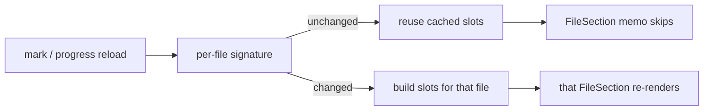

# Stabilize Frontend Rendering

## Why

The React frontend throws away rendered work when nothing it shows has changed. Every render of a workspace document hands `ReactMarkdown` a fresh set of override components. React therefore remounts every heading, list item, table, link and fence, and every Mermaid diagram falls back to its pending placeholder and is drawn again. This happens on each live edit of the artifact and twice for each link click that fails. It is wasted work, and it also shifts the page height under the reader during a refresh the reader did not start. Every coalesced cache event also replaces the whole workspace-views array with new objects. That defeats the tree's memo boundaries, recomputes every views-keyed memo in `App`, and re-applies an unchanged pull-request links snapshot. In the pull-request view, marking one file or hunk viewed takes at least three parent renders, and each of them gives every file new slots, so every file section rebuilds every row it shows. Finally, every window loads the whole application graph up front, including the reader, pull-request and zoom windows, along with the maths engine and its stylesheet.

## What Changes

- **Stable markdown overrides.** The workspace-mode component overrides (`h1`–`h6`, `li`, `input`, `table`, `pre`, `a`) become module-level components and stop being per-render arrows. Each render's state reaches them through a context: the heading-id set, the fragment handler, and the link opener and failure reporter. The pull-request mode's `a`/`img`/`pre` overrides keep winning over them, and its headings, `li`, `input` and `table` stop remounting as well. An unchanged diagram stays drawn across a document re-render. A diagram is still drawn again when its source or the colour scheme changes.
- **The link-failure indication leaves the document's render.** The "Couldn't open that link" status moves into its own child component. A failed click then re-renders only that component and no longer reruns the markdown pipeline.
- **Structural sharing for workspace views and links.** A pure `shareStructure(previous, next)` helper keeps the previous object for every subtree that is deeply equal. A refresh that changes nothing returns the previous array itself, and a refresh that changes one repository keeps every other repository's identity. `useWorkspaces` and `usePullRequestLinks` both apply it. `LogicalChangeRow` becomes memoized, so the existing `RepoNode` / `FlatWorkspaceNode` boundaries take effect. The links snapshot is still re-read after every views read, as its requirement says. That read is now driven by a views-read notification, not by the identity of the views array, and an equal reply is not re-applied.
- **Per-file slot identity in the diff view.** The pull-request view builds each file's header extra, preamble and hunk slots through a per-file cache. The cache is keyed on a signature of that file's own inputs: its progress, its hunk states, its pending, including and failed marks, and the detail's head and base. Callbacks inside the slots read the latest handlers through refs. `DiffView` passes `FileSection` per-file values in place of host render functions. It also reuses its `slotsByKey` map when no entry changed. A mark then re-renders the one file it touches.
- **In-order commit-graph refreshes.** `useCommitGraph` routes ref-change refreshes through `useCoalescedRefetch` and applies a reply only when it is the newest one requested. It shows the loading state only for a load that has no graph to show.
- **Load surfaces and engines on demand.** Each window kind lazily imports its root, so a reader, pull-request or zoom window no longer loads the main window's dashboard, settings, graph rail or commit garden. Inside the main window, the surfaces not shown by default are lazy: pull request with the diff view, commit detail, settings, file browser and archive. `rehype-katex` and the KaTeX stylesheet load only when a document contains maths, using a conservative `$$` / `math`-fence test, and are warmed off the critical path after the first paint. `installHeadPolicies` moves out of the pull-request root's import path, so the pull-request window's content-security policy is still in place before any fetch it governs.

### Out of scope (checked and set aside)

- **Windowing very large diffs, or capping on-request file loads.** No windowing exists, and the first render of a large loaded file highlights and builds every row synchronously. Re-renders do not re-tokenise, because `hunkTokens` is memoized per hunk. Windowing conflicts with the diff view's DOM-based place-keeping, its sticky headers and select-and-copy. The 8 MiB per-file ceiling is mandated by `diff-view` *Line and Byte Budgets With On-Request Loading*. This is a possible later change of its own and is deliberately left out here.
- **Trimming the lowlight grammar set.** `diffHighlight.ts` shares `rehype-highlight`'s `common` grammars and adds no bytes. `diff-view` *Syntax Highlighting* requires the same grammar set as markdown code blocks.
- **DocumentView re-reading on every cache event.** This is deliberate and spec-mandated: the refresh must not be conditioned on the notification's workspace. It is already coalesced and made free by the reducer's equality guard.
- **`useDashboard` double render per refetch.** Loads are already coalesced and the hook is mounted only while the Dashboard is shown. The backend-side dashboard caching belongs to `cache-dashboard-history`.
- **FileBrowserView filtering per keystroke.** `buildTree` is already memoized on the listing. What remains is the inherent filter pass.
- **MermaidBlock's per-label `getComputedStyle`.** It runs once per drawn diagram. It was hot only because of the remounts above, so the stable overrides fix it.
- **Bumping KaTeX.** It must stay at 0.16.x, because `rehype-katex` pins it.

## Capabilities

### New Capabilities

_None._

### Modified Capabilities

- `spec-browser`: adds *Rendered Blocks Survive Document Re-renders*, under which a re-render does not remount unchanged blocks or redraw unchanged diagrams, and a failed link click does not re-render the document. It adds *Unchanged Workspace Views Keep Their Rows*, under which a views refresh re-renders only the rows whose data changed. It adds *Surfaces and Rendering Engines Load on Demand*, which covers per-window and per-surface code and the maths engine loading without ever showing maths as source.
- `diff-view`: adds *Host Slot Updates Re-render Only Their File*, under which a host's change to one file's slots re-renders that file's section alone, while fold pruning and place-keeping still see the change.
- `pull-request-viewer`: adds *Review Marks Re-render Only the Marked File*, under which a mark, its in-flight state and the progress reload after it touch only the marked file's section and the header count.
- `pull-request-worktree-links`: adds *An Unchanged Links Snapshot Is Not Re-applied*, under which the frontend still re-reads after every views read and pull-request announcement but keeps its current snapshot when the reply is equal.
- `commit-graph`: adds *Overlapping Graph Refreshes Settle on the Newest*, under which refreshes are coalesced, an older reply never overwrites a newer one, and a refresh with a graph on screen shows no loading state.

## Impact

- **Frontend only.** `src/components/MarkdownView.tsx`, `src/pullRequestMarkdown.tsx`, `src/components/MermaidBlock.tsx` (verification only), `src/hooks/useWorkspaces.ts`, `src/hooks/usePullRequestLinks.ts`, `src/components/WorkspaceTree.tsx`, `src/App.tsx`, `src/components/ReaderRoot.tsx`, `src/components/PullRequestWindowRoot.tsx`, `src/components/PullRequestView.tsx`, `src/pullRequestView.ts` (the per-file slot signature), `src/components/DiffView.tsx`, `src/hooks/useCommitGraph.ts`, `src/main.tsx`, `src/windowKind.ts` (comment only) and `src/CLAUDE.md`. New modules are added for structural sharing, the per-file slot cache and the maths engine loader, each with `bun test` coverage. There is also a small latest-ref hook and a shared home for `readerAddressPath`. All of this is in the desktop app's and `specforge-web`'s shared bundle; the TUI has no React frontend and is unaffected.
- **What does not change:** no Rust, no IPC command or payload shape, no event names, no dependencies added, removed or bumped (KaTeX stays at 0.16.x). The 3,000-line eager budget and the 8 MiB per-file ceiling are unchanged, as are the grammar set and the `vite.config.ts` build target. The `openspec-core` / `openspec-app` crates are not touched, so the mutation gate does not apply. Coverage comes from ordinary `bun test` tests and a real-window smoke check.
- **Related work:** `trim-frontend-overhead` makes `specforge-web` cache and compress the bundle. The content-hashed lazy chunks this change produces fall under its `immutable` rule with no further work. `efficient-pull-request-reads` changes how detail reads reuse files and does not touch the view's render path.
