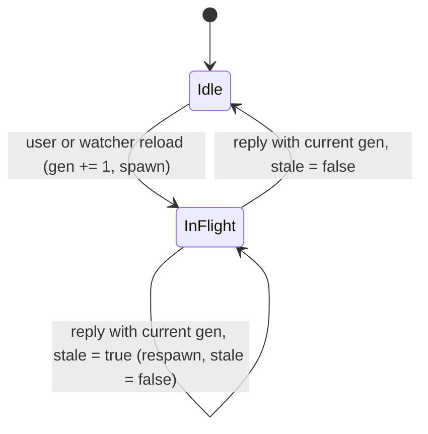

## Context

The three frontends are deliberately thin. This change touches only two of them, `specforge-web` and `specforge-tui`, and fixes work they repeat even though its result has not changed. Line references are to master at `b581063`.

**Web (`crates/specforge-web`).** `assets.rs::static_handler` serves `dist/`, which rust-embed embeds. It calls `content.data.into_owned()` on all three paths (`:94` shell, `:99` asset, `:122` SPA fallback). In release builds the data is `Cow::Borrowed(&'static [u8])`, so each request copies the file, up to 956 KB for the main chunk. In debug builds rust-embed reads the file from disk on every request (`Cow::Owned`), and the dev loop depends on that. `shell_response` (`:73-84`) sets `Content-Type` and the three shell headers that the *Localhost Trust Boundary* requirement requires. No response carries `Cache-Control`, `ETag` or `Last-Modified`, and nothing is compressed. `router_with_bind` (`lib.rs:92-95`) has one layer, `authority_guard`. `tower-http` is not a dependency of this crate, but version 0.6.11 is already in `Cargo.lock` through other crates. Its compression features are not enabled anywhere today, so `async-compression` is not yet in the lock file. Every file under `dist/assets/` has a Vite content hash in its name. The root files (`favicon.*`, `icon-*.png`, `apple-touch-icon*.png`, `manifest.webmanifest`) come from `public/` and keep stable paths.

**TUI (`crates/specforge-tui`).** The event loop in `main.rs:85-111` draws on every turn. It maps every `CacheEvent` except the two pull-request snapshot updates to its own `Msg::Cache`, and `r.ok()` discards `RecvError::Lagged`. `Msg::Cache` leads to `apply_cache_refresh` (`app.rs:699-727`), which calls `Model::refresh` (two `last_views` clones, `list_workspaces`) and `refresh_settings_workspaces` (`list_workspaces` again). It also spawns `read_artifact` and, on History, `reload_graph`, which runs `git log` over `graph_limit + 1` commits and is not single-flight. One debounced watcher batch emits several events (`Updated`, `ChangeAdded`/`Archived`, `Logical*`/`Instance*`, `GraphChanged`). The handler for `Msg::Graph` (`app.rs:655-662`) applies any reply without checking that it is still current. A 250 ms tick (`main.rs:83`) only redraws: its handler (`app.rs:607`) is a no-op. On every Browse frame `ui.rs:611` re-parses the markdown (`markdown::render`). On every History frame `ui.rs:858-872` rebuilds the commit rail (`graph::commit_rail`), which costs $$O(commits \times edges)$$ and allocates a `String` for every cell.

Neither crate is mutation-gated (`.cargo/mutants.toml` scopes `openspec-core` and `openspec-app`), so ordinary unit and integration tests cover them.

## Goals / Non-Goals

**Goals:**

- A reload of the web UI downloads only what changed since the last build, compressed. A `304` keeps the shell's security headers.
- Release builds serve embedded bytes without a per-request copy. Debug builds keep reading `dist/` from disk.
- One TUI refresh for each watcher burst, with no added latency. Graph reads are single-flight, and stale replies are dropped.
- TUI frames reuse rendered markdown and rail lines, and the idle TUI stops redrawing four times a second.

**Non-Goals:**

- Avoiding the `serde_json::Value` intermediate in `dispatch.rs::to_val` (verification marked it not worth fixing; see the proposal's *Out of scope*).
- Deduplicating the tray tooltip/title and Dock badge in `crates/specforge`. The `dock-indicator` spec requires a write on every `CacheEvent`, and the gain is negligible. Blocking hops onto the main thread belong to `unblock-main-thread`.
- Reducing the cost of a single refresh (`last_views` clones, registry lock). `unblock-main-thread` covers the registry lock; `scope-status-recompute` deferred the `Arc` snapshot to a follow-up. This change only cuts how many refreshes run.
- A service worker, build-time precompression, or any change to the Vite build.
- Any change to `openspec-core`, `openspec-app`, IPC types or `src/`.

## Decisions

### 1. Caching policy by namespace, with validators from rust-embed's SHA-256

| Path | `Cache-Control` | Validator |
|---|---|---|
| `assets/*` (hit) | `public, max-age=31536000, immutable` | `ETag` |
| shell: `/`, `/index.html`, SPA fallback | `no-cache` | `ETag` |
| stable root files: favicon, icons, manifest | `no-cache` | `ETag` |
| namespace miss (404), build hint (404) | `no-store` | none |

The `ETag` is weak, `W/"<hex sha256>"`, built from `EmbeddedFile::metadata.sha256_hash()`. In release builds the hash is computed at compile time, so it is free. In debug builds rust-embed hashes the bytes it has just read from disk, so a `bun run build` changes the tag with no restart. A pure helper `if_none_match_matches(header: Option<&HeaderValue>, etag: &str) -> bool` in `assets.rs` implements weak comparison. It handles a comma-separated list, `*`, and either strong or weak forms of the client's tags. On a match the handler returns `304` with the `ETag`, the `Cache-Control` and no body. For the shell this goes through `shell_response`, which now takes the status, an optional body and the tag. The three shell headers are therefore still set in exactly one place, and a `304` cannot lose them.

The handler also sets `Vary: Accept-Encoding` itself on every `200` and `304` it sends for a compressible type. `CompressionLayer` appends `Vary` only to a response it actually compresses, and a bodiless `304` never is. Without this, a `304` would omit a `Vary` header the matching `200` carried, which RFC 9110 §15.4.5 asks a server to repeat. The layer checks for an existing `Accept-Encoding` entry before appending, so the header is never doubled.

Every function that returns a response for a hit decides the policy from the path that was served (`index.html`, `assets/` prefix, or anything else at the root), never from the request path. The SPA fallback therefore always gets the shell policy.

*Alternatives considered.*

- **`Last-Modified`.** Rejected. rust-embed's `last_modified` is the file's mtime at build time in release builds and on disk in debug builds, has one-second resolution, and is optional. The SHA-256 tag is exact and already available.
- **A short `max-age` on the shell.** Rejected. During that window a resumed install could render a cached shell without contacting the server, which the *A suspended install does not present cached state as live* scenario forbids.
- **The immutable policy for every bundled file.** Rejected. Icons and the manifest are stable paths by contract (`web-app-install`: *Served Document Declares an Icon Set*), so a new icon would never reach a browser that cached the old one.
- **A strong ETag.** Rejected. The compression layer changes the bytes on the wire per encoding but leaves the tag alone. A strong tag would then claim byte-identity across representations that differ.

### 2. Serve borrowed bytes; keep the debug disk read

A helper `body_of(data: Cow<'static, [u8]>) -> Body` maps `Cow::Borrowed` to `Body::from(Bytes::from_static(..))` (no copy) and `Cow::Owned` to `Body::from(Bytes::from(vec))` (moves the buffer the disk read already allocated). It replaces all three `into_owned()` calls.

*Alternative considered:* rust-embed's `compression` feature. Rejected: it shrinks the binary but decompresses on every `get`, which adds per-request work instead of removing it.

### 3. On-the-fly compression with `tower-http`'s `CompressionLayer`

`crates/specforge-web/Cargo.toml` adds `tower-http = { version = "0.6", features = ["compression-br", "compression-gzip"] }`. `router_with_bind` adds a `CompressionLayer` outside the authority guard, so every response the router produces is eligible. The layer keeps `DefaultPredicate`, which already skips bodies under 32 bytes, gRPC, images other than SVG, and `text/event-stream`. The `/api/events` SSE stream is therefore never wrapped in an encoder that would buffer events. The level is set explicitly with `CompressionLayer::quality`, not left at the library default. That one setting applies to every enabled encoding, so the value is chosen for both: `CompressionLevel::Precise(5)` is the measured choice. On the bundle's 1.07 MB main chunk, Brotli q4 (322.6 KB) is no smaller than gzip at level 6 (321.7 KB), so it would buy nothing for the codec's binary cost. Brotli q5 gives 295.3 KB, 8% smaller, for about 19 ms of CPU per MB in a release build, and q6 gains only another 1%. Gzip at level 5 gives 324.5 KB. If the default resolves to Brotli's maximum quality, a 1 MB chunk costs on the order of a second of CPU per request. Immutable caching means each client pays the chosen cost once per build anyway.

*Alternatives considered.*

- **Build-time precompression** (a Vite plugin writing `.br`/`.gz` sidecars that the handler serves when available). Rejected for now. It changes the Vite build, roughly doubles the embedded payload in the npm binary, does not cover the `/api/invoke` JSON results (the largest repeated payloads over Tailscale), and debug builds would need the sidecars kept in sync on disk.
- **A hand-written gzip of embedded files cached in a `OnceLock` map.** Rejected as unnecessary. Revisit only if profiling shows compression CPU on the serving host.

### 4. TUI: drain the broadcast into flags, one refresh per loop turn

`main.rs` gets a pure helper:

```rust
struct CacheBurst { refresh: bool, quota: bool }
fn drain_cache(first: Result<CacheEvent, RecvError>, rx: &mut broadcast::Receiver<CacheEvent>) -> (CacheBurst, bool /* closed */)
```

It classifies the event that woke `select!` and then calls `try_recv()` until the channel reports `Empty`, OR-ing each event into the burst. The drain is bounded (for example by the watcher's `EVENT_CHANNEL_CAPACITY` of attempts), so a pathological flood still returns to `select!` and keyboard input stays responsive; anything left over wakes the next turn. `Lagged(_)` sets `refresh = true`. `QuotaUpdated` sets `quota`. The PR snapshot updates set nothing. `Closed` is reported to the caller, which disables the branch. Today `Closed` would make the loop spin, because `recv` resolves immediately forever (this is unreachable while `svc` holds the sender). The loop then calls `app::update` with at most one `Msg::Cache` and at most one `Msg::Quota`. `Msg::Cache` still runs the same `apply_cache_refresh`. The presentation rules (the scroll clamp, the `pending_trigger` upgrade in `load_selected_artifact`, generation-based discards) are therefore unchanged and keep their tests.

*Alternatives considered.*

- **A trailing debounce timer (for example 50 ms).** Rejected. It adds latency on top of the watcher's own debounce, and the *Rows Without OpenSpec* requirement promises a row update within that debounce window. The events of one batch are sent back to back, so most of them are already queued when the loop wakes. If a burst sometimes splits into two refreshes, that is acceptable. One refresh per event is what this change removes.
- **A coalescing subscription in `openspec-app`.** Rejected. The desktop and web consumers forward each event by name to the browser or WebView and need every one. Merging events is local plumbing for the TUI, not shared domain logic.

### 5. TUI: generation-checked, single-flight graph reads

`Model` gains `graph_gen: u64`, `graph_in_flight: bool` and `graph_stale: bool`. `Msg::Graph` becomes `Graph { gen: u64, result: Result<Box<CommitGraph>, String> }`. `reload_graph` currently sends nothing on `Err`. It must now always reply, so that `graph_in_flight` can never stick at `true`.



A reload the user initiates (`load_graph` on entering History, `m` for more) always bumps the generation and spawns a read. A reload that `apply_cache_refresh` triggers spawns only when nothing is in flight; otherwise it sets `graph_stale`. A reply applies only when `gen == model.graph_gen`. An `Ok` replaces the graph through `Model::set_graph`, which also bumps the graph's render revision (Decision 6) and clamps `graph_selected` as today. An `Err` keeps the current graph. If `graph_stale` was set, it is cleared, and one more read is issued when History is still open with a `graph_repo`, the same condition `apply_cache_refresh` checks. Otherwise the next entry into History reloads anyway through `load_graph`.

*Alternative considered:* latest-wins generations alone, still spawning on every watcher event. Rejected. That fixes the stale-overwrite bug but still runs one `git log` per event.

### 6. TUI: render caches behind `RefCell`, keyed so they cannot go stale

`ui::view` takes `&Model`, so the caches live in `Model` behind `RefCell`. Their keys are checked on every frame:

- **Markdown.** `MarkdownCache { src: String, scheme: Scheme, lines: Vec<Line<'static>> }`. Before drawing, `ui::detail` compares the key with `(&model.detail_md, theme().active_scheme())` and re-renders on any difference. The width is not part of the key: `markdown::render(src, th)` takes no width, and wrapping is left to `Paragraph::wrap` at draw time. Comparing the body by value costs a `memcmp` of a few KB each frame, which is negligible next to a pulldown-cmark pass. It also means that every site assigning `detail_md` (the initializer and three assignments in `app.rs`), and the tests that assign it directly, cannot leave the cache stale. *Rejected:* a revision counter bumped in a setter, because one missed bump would show a stale body, a correctness bug, to save a `memcmp`.
- **Rail.** `RailCache { rev: u64, scheme: Scheme, lines: Vec<Line<'static>> }` holds the lines with no row selected. `graph.rs` is split into `rail_lines(graph) -> Vec<Line<'static>>`, which builds the lines with no row selected, and `highlight(line, selected)`. `commit_rail(graph, selected)` stays as their composition, so existing render tests and an equivalence test can still call it. `ui::history` slices the visible window out of the cached lines, clones only those rows, and applies `REVERSED` to the selected row. `rail_lines` first groups edge indices by `band` into a `Vec<Vec<usize>>`, so row `r` visits only the edges with `band == r` or `band + 1 == r`, which makes the build linear in commits plus edges. Each bucket keeps the edges in their original order. The diagonal pass overwrites shared cells, so the last edge in `graph.edges` order must still win. The vertical pass writes the same glyph and lane colour for a given column whichever edge sets it, so visiting the two buckets one after the other gives the same cells. It also stops allocating a `String` per cell by merging runs of cells that share a colour into one span. The rendered output is unchanged.

The renderer reads the process-wide `theme()`, a `OnceLock<Theme>`. Its colour depth, emoji support and `hyperlinks` are resolved once from the environment and never change. Only the active scheme, an `AtomicU8` that the Settings screen flips, can change between frames, so the scheme is the only theme input either key needs. If `Theme` ever becomes swappable at runtime, its other fields must join both keys.

### 7. TUI: draw only when something changed; 1 s tick

The loop keeps a `needs_draw` flag. It starts `true` and is set after any `Msg` is applied, including `Resize` and `Tick`. It is not set when `select!` yields nothing, for example on a key release or a PR-only burst. The tick interval changes from 250 ms to 1 s, with `MissedTickBehavior::Delay`. Its only time-dependent consumers are the quota countdown and the "now" marker (`ui.rs:337-341`, `:411-424`), and both have minute resolution.

*Alternative considered:* ticking only while a quota gauge is visible. Rejected. It needs extra state to track which screens show a gauge, and it gains little once idle frames come from the caches.

## Risks / Trade-offs

- **[A browser keeps a hashed asset after a rebuild]** → Harmless. A rebuilt asset gets a new hashed name, and the shell is always revalidated, so the new shell references the new names. The stale entry is simply never requested again.
- **[`304` drops a shell header]** → The `304` is built through the same `shell_response` that serves `200`. The existing `assert_the_shell_carries_its_headers` test is extended to send a matching `If-None-Match` under all three bind configurations.
- **[Compression buffers the SSE stream]** → `DefaultPredicate` excludes `text/event-stream`. An integration test opens `/api/events` with `Accept-Encoding: br, gzip` and asserts that the response has no `Content-Encoding`.
- **[Brotli CPU on the serving host]** → An explicit moderate quality, plus immutable caching, so a client compresses each chunk once per build.
- **[Compression as a length side channel (BREACH)]** → An attack of this kind needs a response that reflects attacker-chosen input next to a secret, and an attacker able to make the browser send requests and observe their sizes. `/api/invoke` returns no credential: the provider tokens are write-only (`settings.rs`). The authority guard still runs inside the compression layer. Under a loopback bind its `Origin` check stops a cross-origin page from driving the endpoint. An explicit network bind already sets that check aside by design (`web-ui`: *Localhost Trust Boundary*). Compression changes neither of those.
- **[Larger binaries]** → `async-compression` and the Brotli and gzip codecs add to the npm-shipped `specforge-serve` binary, and to the desktop app, which embeds `specforge-web` for its serve toggle. This is accepted for the transfer saving, which is why the Brotli quality is the measured q5 rather than a level that compresses no better than gzip. The implementer notes the size difference in the PR.
- **[Debug builds and stale `dist/`]** → Debug builds still read from disk and hash per request, so a rebuilt `dist/` is revalidated into the browser on the next load. This matters because CLAUDE.md already warns that a stale `dist/` serves a pre-merge UI. Caching does not make that worse, because the shell is never served without revalidation.
- **[A coalesced refresh hides a per-event difference]** → Every refresh re-reads current state from the service, so the last refresh of a burst is a superset of the per-event refreshes it replaces. The rules that need ordering (`artifact_gen`, the `pending_trigger` upgrade) live in `update`, which is unchanged.
- **[`RefCell` double borrow panics in `view`]** → Each cache is borrowed only inside the one function that draws its pane, and never across a call that could borrow it again. The headless render tests in `render_tests.rs` draw every screen.
- **[Graph read stuck "in flight" after a panic in the spawned task]** → The task's body cannot panic on the `Err` path, and it always sends a reply. If a reply is lost because `tx` closed, the app is shutting down. A user-initiated reload always spawns regardless of `graph_in_flight`, so a manual reload clears any stuck state.
- **[Idle redraw at 1 s delays a time-dependent change]** → The quota display has minute resolution, so a delay of up to one second is invisible.
