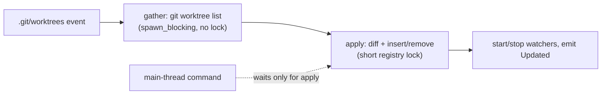

# Unblock the Main Thread

## Why

Several desktop commands are synchronous Tauri commands, so they run on the main (UI) thread, and some of them spawn subprocesses there. `get_identity` runs two `git config --get` per registered folder, every worktree included, on every Dashboard mount. `resolve_tailscale_name` runs `tailscale status --json` with no timeout, so a hung `tailscaled` freezes the window. In the async layer, the worktree reconciler and workspace registration hold the registry mutex while `git worktree list` runs, and they run it inline on a tokio worker. The reconciler fires on every index write in any linked worktree. While it holds the mutex, the main-thread commands that need the registry stall behind it, and so does every recompute's input gather.

## What Changes

- **Desktop commands off the main thread.** `get_identity`, `resolve_tailscale_name`, `open_artifact_link`, `archived_artifact_status`, `get_workspace_views` and `list_workspaces` become `async` commands. Their subprocess and filesystem work runs on the blocking pool. `list_workspaces` stops duplicating `AppService::list_workspaces` and calls it. `open_reader_window` becomes `async` too: it builds a window from a sync command, which `crates/CLAUDE.md` forbids because it deadlocks on WebView2.
- **Cheaper identity reads.** Candidate detection reads git identity once per repository instead of once per worktree. Flat (non-git) folders are still read one by one. The Dashboard's profile band reads only the saved identity configuration through a new `get_identity_config` command, so mounting the Dashboard spawns no git process. The first-run seed in `AppService::bootstrap` stops at the first identity it resolves.
- **Bounded Tailscale discovery.** `tailscale status --json` gets a wall-clock bound. On timeout the child is killed and resolution falls back to the manual name or to `None`, which fails closed. The embedded and standalone web servers run this discovery off the async runtime at start-up.
- **Registry lock excludes git.** `WorkspaceRegistry::reconcile_repo` and `register_resolved` are split into a lock-free *gather* of git facts and a short, locked *apply*. The apply re-validates against the registry's current state. `repo_monitor::reconcile` and `AppService::add_workspace` run the gather in `spawn_blocking`. The misleading comment in the status/remotes dispatch (`repo_monitor.rs:293-302`, "Off the async runtime, matching the `reconcile`/`default_branch` dispatches above"), which claims `reconcile` already runs off the runtime, is corrected.
- **Browse-root authorization off the async workers.** The whole `ensure_browse_root` check moves inside the blocking closures of `list_markdown_files` and `read_workspace_file`, including its `git rev-parse` fallback. `watch_document` and `unwatch_document` get blocking closures of their own. `ensure_registered_workspace` and `ensure_registered_repo` stop re-canonicalizing entries the registry already stores in canonical form.
- **Web dispatch parity.** The `specforge-web` arms for `get_identity`, `archived_artifact_status` and `register_workspace` (which calls `AppService::add_workspace`) await the now-async service methods, so their git and filesystem work runs on the blocking pool, not on an axum worker. The `list_workspaces` and `get_workspace_views` arms stay inline: they are memory-only, and the registry lock they take is now short.

## Capabilities

### New Capabilities

_None._

### Modified Capabilities

- `workspace-registry`: adds *Registry Lock Excludes Git Subprocesses*, which covers reconcile and registration: git runs with no registry lock held and off the async runtime, decisions are re-validated under the lock, and only an operation that loses three consecutive races falls back to one locked gather. Also adds *Workspace Commands Run Off the UI Thread*, which keeps registry-reading, view-reading and path-authorizing commands off the desktop main thread and off async workers on every transport, with their output unchanged.
- `developer-identity`: modifies *Local Identity Resolution from Git Config* so that the worktrees of one repository share one identity read. Adds *Bounded Candidate Identity Detection*: one read per repository, a fresh read for Settings, no git on Dashboard mount, a first-run seed that stops early, and none of it on the UI thread.
- `web-ui`: adds *Bounded Tailscale Name Discovery*: discovery has a time bound, a timeout fails closed or falls back to the manual name, and discovery never blocks the desktop UI thread or an async worker.

## Impact

- **Rust:** `crates/openspec-core/src/registry.rs` (gather/apply split of `reconcile_repo` and `register_resolved`), `crates/openspec-core/src/repo_monitor.rs` (`reconcile`), `crates/openspec-core/src/identity.rs` (per-repo dedupe, early-stop seed helper), `crates/openspec-app/src/service.rs` (`identity_info`, `identity_config`, `bootstrap`, `add_workspace`, `ensure_browse_root`, `ensure_registered_*`, `watch_document`, `unwatch_document`, `list_markdown_files`, `read_workspace_file`, `open_artifact_link`, `archived_artifact_status`), `crates/specforge-web/src/tailscale.rs` (bounded discovery), `crates/specforge-web/src/lib.rs` (`serve`, a new `router_with_guard`, `build_guard_config`), `crates/specforge-web/src/dispatch.rs` (arms), `crates/specforge/src/commands.rs` and `lib.rs` (sync to async, new command registration).
- **Frontend:** `src/api.ts` and `src/types.ts` get `getIdentityConfig`. `src/components/DashboardView.tsx` uses it in place of `getIdentity`. No other frontend changes: the async commands keep their names and wire shapes.
- **IPC:** one new read-only command, `get_identity_config`, registered in all four places listed in `src/CLAUDE.md` and mirrored on the web transport. Every other command keeps its name, arguments and payload.
- **What does NOT change:** the settings setters stay synchronous (small, rare, user-initiated writes; `atomic-settings-persistence` owns that file). The `block_on(svc.populate())` in Tauri setup stays as it is (see design, Non-Goals). `repo_monitor::classify` still marks every `.git/worktrees/**` path for reconcile. The deep clone inside `WatcherManager::workspace_views` (and its `archived` stubs) stays: `scope-status-recompute` evaluated an `Arc` snapshot and deferred it to a follow-up, because every consumer mutates its copy. This change moves only the command off the main thread. The tray and Dock updaters' native setters keep hopping to the main thread from their tokio tasks (see design, Non-Goals). No new dependencies.
- **Related:** `scope-status-recompute` (recompute scoping; it evaluated and deferred an `Arc` snapshot of `last_views`), `atomic-settings-persistence` (settings write path and the bootstrap seed's save), `trim-frontend-overhead` (web serialization).
