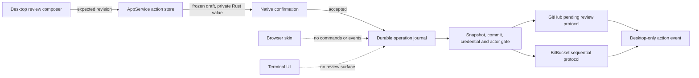
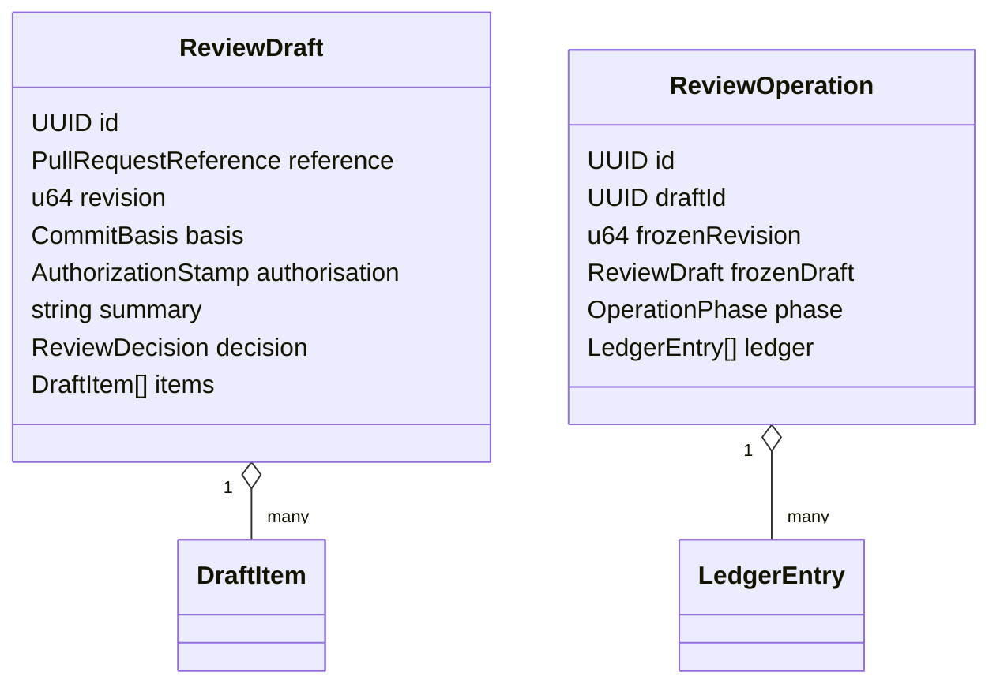
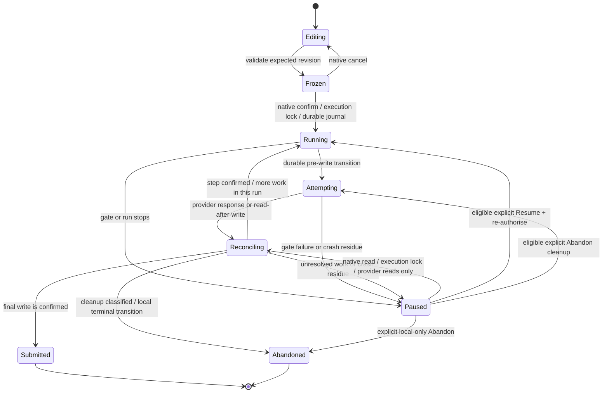

## Context

SpecForge already has almost all of the context needed to review a pull request: a provider snapshot authorises which pull requests may be read, the 32-entry detail LRU holds the current head and base commits and provider-neutral changed files, `PullRequestView` renders submitted conversation and review threads, and `DiffView` gives every rendered line a side-qualified identity. What it does not have is a provider-write boundary. Every provider request is currently a read, the browser transport deliberately mirrors read and local-configuration commands, and Tauri has no application-command manifest, so its narrow window capabilities constrain plugins but not `#[tauri::command]` handlers.

The first action slice is deliberately narrower than a provider's complete review API. A desktop user may draft a summary, single-line inline comments and replies to existing threads, then explicitly submit the draft as Comment, Approve or Request changes. It does not merge, close or decline, resolve or reopen threads, create multiline ranges or first-class structured suggestions, or infer a new anchor after a push. The browser skin and terminal remain provider-read-only.

Provider behaviour differs materially:

- GitHub can hold comments and replies in a pending review and publish them together, but an account can already have an unrelated pending review. GraphQL mutations have no documented idempotency guarantee merely because they carry `clientMutationId`.
- BitBucket comments and replies become visible immediately. Its approval and request-changes endpoints are separate writes, so a submission can succeed only in part.
- Current GitHub discovery includes authored and review-requested pull requests. Current BitBucket discovery includes authored pull requests only, even though its API also has approval and request-changes endpoints.
- The process-local credential generation protects current reads but resets at restart. A durable operation therefore also needs a stable, non-secret credential fingerprint and the provider's stable authenticated actor id.

Stakeholders are reviewers using either desktop pull-request presentation, operators who expose the browser skin on loopback or a tailnet, and repository owners whose provider credentials must never be widened to an unauthenticated transport. The implementation crosses `openspec-app`, the Tauri shell, the shared React bundle, provider integrations, capability files, documentation and product copy. `openspec-core` remains Tauri-free and gains no provider client.

## Goals / Non-Goals

**Goals:**

- Let the desktop app compose and explicitly submit one review containing a summary, single-line inline comments and replies, with a Comment, Approve or Request-changes decision when the current provider row permits it.
- Make every draft edit and every start or resumption of submission fail closed unless the current snapshot, cached commits, credential and provider actor still authorise it.
- Prevent an ambiguous network result or a restart from blindly repeating a provider write.
- Keep drafts and operation journals durable independently of detail-cache eviction, with stable ids and optimistic revisions for two desktop windows showing the same pull request.
- Preserve useful prose after a push while requiring the user to re-place every inline draft explicitly.
- Store newly saved credentials in the operating system's credential store and prevent legacy plaintext credentials from authorising writes.
- Give the main and pull-request windows only the application commands they need, and keep all provider mutations, credential setters and action events out of the browser and terminal transports.
- Render current single-line threads, replies and draft comments at the same provider-neutral line anchors in unified and side-by-side layouts.

**Non-Goals:**

- Merging or declining a pull request, closing it, changing branches or commits, editing repository files, toggling provider-native viewed state, or resolving or reopening a thread.
- Multiline review ranges, first-class code-suggestion items or controls, batch suggestions, reactions, editing or deleting already submitted user comments, or moderation actions. User Markdown remains opaque even when a provider gives some Markdown construct special rendering.
- Automatically remapping an inline draft after either commit changes. Matching path and line numbers are not evidence that the line still means the same thing.
- Adding BitBucket reviewer-requested discovery. Until such discovery exists, BitBucket rows expose Comment only; the other decisions remain capability-gated.
- Giving the browser skin or terminal any provider-write path, even when served on loopback or when the terminal launched the desktop app.
- Making provider submission atomic. GitHub is staged but still remote; BitBucket is explicitly partial-success.

## Decisions

### D1. Provider writes are a desktop capability, not another shared transport command

Review-action operations live in `openspec-app` so provider logic and persistence remain testable without Tauri. The commands that expose them live only in `crates/specforge`. `crates/specforge-web/src/dispatch.rs` has no action command and no provider credential setter, and the frontend guards those APIs with `isTauri()` before invocation. The terminal starts neither an action client nor an action UI. `AppService` records the action-store path at bootstrap, but opening and recovery are lazy behind the native action API, so starting `specforge-serve` or the terminal neither reads nor rewrites draft or operation state.

The Tauri build will introduce an `AppManifest::commands` containing all 83 handlers registered before this change plus every new review handler. Activating that manifest makes application-command ACL enforcement complete rather than opt-in by accident. Capabilities are then split by window kind:

- `main` receives the complete main-window command set, including review actions;
- `pull-request-*` receives only pull-request reads, local progress, its window/link operations and review actions;
- `reader-*` receives only document reads/watch, its size and checked-link operations;
- `image-*` receives only the image reads and close operation it uses.

Both desktop places that render `PullRequestView` can review; reader and image windows cannot invoke review commands. Review commands still validate all service-side invariants: ACL is a boundary, not business authorisation.

*Alternative considered:* mirror action commands through the existing web dispatcher and hide their controls in React. Rejected because the local web server is intentionally unauthenticated and can be published to a LAN or tailnet; hiding controls is not an authorisation boundary. *Alternative considered:* leave the application manifest absent and rely on untrusted markdown not executing. Rejected because a compromised renderer or unrelated frontend defect would retain every command in every window.

### D2. Drafts and operations use a service-owned durable store separate from the detail LRU

`AppService` owns a new `pull-request-actions.json` beside `review-progress.json`. Every read-modify-write transaction takes an inter-process sidecar lock, then reads the file afresh and replaces it atomically; the lock covers revision and operation-conflict checks as well as the write, so two desktop processes cannot both win from the same input. A journal transition that permits a provider mutation is not complete until the replacement file and its parent-directory entry have crossed the platform's durability barrier; a failed flush sends no provider mutation. The file is never returned wholesale. Unlike a cache or preference store, this file is an idempotency journal: corrupt input is preserved and review actions fail closed as `actionStoreCorrupt` rather than starting from an empty model that could repeat an ambiguous BitBucket write. It is not part of the 32-entry detail LRU: evicting or refreshing a detail must not erase prose or an operation ledger.

Each operation also has an execution lock that serialises callers in this process and other processes. Initial acceptance, read-only reconciliation, Resume and Abandon acquire it non-blockingly and hold it across their provider requests and intervening journal transitions. Store transactions remain short and always nest inside that execution lock; no code takes the two in the opposite order. Settings and action-store locks are never held simultaneously: a durable credential gate completes and releases the settings lock before a short action-store transaction, and the mandatory pre-request gate runs again after the journal transition. A second process may expose the operation's live in-flight phase, but cannot normalise, reconcile, resume or abandon it. A process changes crash residue to paused only while holding the execution lock, which proves that no live owner remains; an operating-system lock release after a crash supplies that proof without a timeout or a persisted process id.

The persisted model has two kinds of records:

- A `ReviewDraft` has a backend-generated UUID, canonical pull-request reference, monotonically increasing revision, head/base basis, authorisation identity, summary, selected decision and ordered items. Every item has its own UUID. An inline item carries body, path, old/new side, one line and placement state. A reply carries body and the stable provider thread/comment target.
- A `ReviewOperation` has its own UUID, the complete frozen draft revision, its authorisation stamp, provider protocol state, one ledger entry per write, phase, last error and completion receipt. It deliberately duplicates the frozen content so a later draft edit or cache eviction cannot change what was confirmed.

Every draft mutation names the expected revision. A mismatch returns the current revision and changes nothing, allowing the UI to re-read rather than lose an edit from another window. Backend-generated stable ids, not array indexes or provider ids, tie UI rows to journal entries and idempotency markers. One canonical pull request has at most one current draft; concurrent creation returns it, while Start over atomically replaces it with a new UUID. At most one unfinished operation may exist for that pull request, and one draft revision may be confirmed into at most one operation. The acceptance transaction re-checks those rules and the frozen draft UUID while holding the store lock inside the operation's execution lock; two native confirmations that were opened from the same revision cannot create two journals or two provider runs, and an old dialog cannot revive a draft Start over replaced. Draft editing may continue while an older frozen operation runs, but the newer revision cannot start until that operation is submitted or abandoned.

The persisted phase set is `running`, `attempting`, `reconciling`, `paused`, `submitted` and `abandoned`. The first three are live under the execution lock; paused is unfinished; submitted and abandoned are terminal. “Partial” is a presentation derived from confirmed review content/decision effects that remain, or uncertain writes/cleanup that may remain, on a non-submitted operation. It is not another phase, a successfully cleaned pending review is not partial, and partial status is not by itself permission to retry.

*Alternative considered:* attach drafts to `CachedDetail`. Rejected because the cache is in memory, capped at 32 and intentionally forgotten on credential changes. *Alternative considered:* use browser local storage. Rejected because the two desktop presentations would race, native code could not reconcile after a crash, and web-served tabs would receive provider-write state. *Alternative considered:* preserve a corrupt file and continue from an empty model, as non-authority stores do. Rejected because forgetting an uncertain write is exactly how a later operation could duplicate it. *Alternative considered:* rely on the operation's persisted `running` phase as a process lease. Rejected because a process can crash while leaving that phase behind, while another live process can otherwise mistake it for crash residue; an OS-held execution lock distinguishes those cases.

### D3. One authorisation stamp fences editing and submission

The service derives an `AuthorizationStamp` for draft creation only after all of these are current:

1. fresh credential resolution returns an environment or OS-store credential, never legacy plaintext, and supplies a SHA-256 fingerprint;
2. the provider is enabled and its current non-stale snapshot was read under that fingerprint, contains the canonical reference and provider-owned remote identifiers, and supplies a stable authenticated actor id;
3. the detail cache has that pull request under the current credential generation and fingerprint and supplies its head and base commits; and
4. the requested decision and item type are included in the row's provider-derived capabilities.

The fingerprint includes the provider, normalised principal where one exists, and secret, and only its digest is persisted. It is not a replacement for the process generation: generation catches a credential change immediately within one run; fingerprint and actor make the same check meaningful after restart. No secret, token prefix or reversible derivative enters the action file, IPC, events or logs.

Draft creation records the current commits, fingerprint and actor. Every ordinary edit, freeze, initial submission, resume and provider cleanup repeats the gate and requires all three to equal that stamp. Explicit stale recovery is the only path that may replace the commits: the fingerprint and actor must still match, and the recovered revision records the current basis. Start over is the only path that may replace identity: it discards rather than copies the fenced draft, runs a fresh creation gate and records a new stamp.

Immediately before every provider request, the operation freshly resolves the credential and re-checks its source/fingerprint, enabled state, process generation, current snapshot row/trusted ids and stable actor against the stamp. Snapshot and cached-detail private context retain the fingerprint under which they were read. This catches replacement or clearing by another desktop process rather than relying on a generation held only in this process. GitHub then applies its pending-review checks and BitBucket its commit checks. A failed gate sends no mutation and returns a structured reason such as `notListed`, `detailRequired`, `staleCommits`, `legacyCredential`, `credentialChanged`, `actorChanged` or `decisionUnavailable`.

A fenced draft remains readable but cannot silently adopt a different credential. The explicit **Start over** action is local-only, runs the fresh creation gate without comparing the old stamp, and is available only after the pull request has no unfinished operation. It discards the fenced draft and creates a fresh empty draft with a new UUID, revision 1, current basis and current authorisation stamp; it copies no summary, item, decision or provider-effect state. An unfinished operation must first be explicitly abandoned. Its receipt remains available, so the reviewer can inspect confirmed or uncertain remote effects before re-authoring anything under the new credential.

*Alternative considered:* authorise once when the composer opens. Rejected because another window can disable the provider, save a credential or refresh to a pushed head before Submit. *Alternative considered:* persist only the process generation. Rejected because it starts over after a restart and could make a different token look identical. *Alternative considered:* use display login alone. Rejected because logins can change and BitBucket supplies stable `account_id`/`uuid` values. *Alternative considered:* copy a permission-failed operation into a draft stamped by the replacement credential. Rejected because earlier BitBucket items may already be visible or uncertain, so an automatic copy would invite duplicates.

### D4. Native confirmation freezes one exact revision before the first write

The Tauri submission command asks the service to validate and freeze the expected draft revision as a private Rust value. It then opens a native confirmation naming the provider, repository, pull request, exact decision, summary presence, item counts and draft revision. Cancellation drops the frozen value and writes nothing to the provider or journal. Acceptance allocates the operation id and acquires its execution lock first, re-authorises current state after however long the dialog was open, releases the settings lock used by that gate, and then takes the action-store lock. It rejects a revision already claimed by an operation, a pull request with another unfinished operation, or a frozen draft UUID that Start over has replaced. It durably persists the complete operation directly in `running` before issuing the first provider mutation. The provider runner repeats D3 after that transition and before its request, so a change in the narrow interval fences the operation without writing. It submits exactly the frozen value, even if the same draft has since gained a later revision in another view.

Only this initial transition requires native confirmation. A paused operation already contains the exact confirmed revision; Resume is itself an explicit desktop action and can continue it after re-authorisation without asking the user to confirm different content. Content can never change inside an operation. To submit edits, the user creates a new revision and a new confirmed operation.

*Alternative considered:* a React modal. Rejected because it would be controlled by the same renderer and transport being constrained. *Alternative considered:* confirm only the decision and read the live draft afterwards. Rejected because the body or anchors could change between confirmation and mutation.

### D5. GitHub submission owns one commit-pinned pending review and reconciles by ids and markers

GitHub submission uses a pending review tied to the cached head commit. The detail/discovery data is extended with the pull-request node id, stable viewer id and enough pending-review ownership data to distinguish SpecForge's operation from any review the user began elsewhere.

The protocol is:

1. Read pending-review state. If a pending review carries this operation's marker, belongs to the stamped actor and contains only the exact marker-bearing or already-reconciled objects named by this operation's ledger, adopt it. If another pending review exists, or a previously adopted review has acquired an unrecognised body edit, comment or reply, stop without changing, submitting or deleting it.
2. Otherwise create a pending review for the exact pull-request node and head OID, carrying an invisible operation marker.
3. Add each inline comment and reply in frozen draft order. Bodies temporarily carry an invisible marker containing the operation UUID and item UUID.
4. After every mutation, read the created object back and record its provider id. On a transport error or ambiguous reply, read first and find the marker; retry only when that read proves the item absent.
5. Once every item is confirmed, remove each item marker from comments and replies, reconciling each cleanup read-after-write, but keep the review-level operation marker while the review remains pending.
6. Submit that same review with the clean summary and selected event in `submitPullRequestReview`; its `body` variable atomically replaces the last operation marker as the review becomes submitted. Read the stable review id and state to reconcile an ambiguous final reply.

The journal records and durably flushes each attempting step before moving to the provider request. It never treats `clientMutationId` as idempotency, never adopts an unmarked pending review, and never deletes or submits a review owned by another actor or operation. Content added through github.com or another client after SpecForge created its marked review is foreign even though GitHub attached it to the same pending review; detecting it pauses the operation for manual handling on GitHub.

A user may explicitly abandon a paused GitHub operation. Provider cleanup may delete only the pending review carrying that operation's marker, containing no foreign content, and only after the same authorisation gate. It durably records the cleanup attempt before DELETE and reconciles an ambiguous result by reading: absence confirms cleanup, while an inconclusive bounded read is never followed by a blind second DELETE. If cleanup is unauthorised, foreign, failed or uncertain, abandonment is local-only, preserves the pending-review reference and cleanup outcome, and tells the reviewer that provider-side handling may remain.

One reconciliation pass reads at most ten provider pages total across the pending review's relevant connections, requests at most 100 objects per page and accepts at most 10 MiB for any one response body. Reaching either bound is uncertainty, never proof that a marker is absent.

*Alternative considered:* create a submitted review in one mutation with all comments. Rejected because an ambiguous response gives no durable per-item reconciliation point and replies do not fit the same input uniformly. *Alternative considered:* reuse whichever pending review exists for the actor. Rejected because that review may contain work created on github.com or by another tool. *Alternative considered:* trust `clientMutationId`. Rejected because GitHub documents response correlation, not replay deduplication.

### D6. BitBucket submission is deterministic, sequential and explicitly partial-success

BitBucket has no pending review transaction and its mutation endpoints accept no expected-head condition. The operation therefore writes one item at a time in a deterministic order: frozen inline comments and replies in draft order, the non-empty summary as a general comment, then the decision. Immediately before every mutation it re-reads the pull request and compares both commits with the frozen basis; after a successful or ambiguous mutation result it reads them again before continuing or permitting a retry. A changed basis stops the run as stale, with any write that raced the change retained explicitly in the partial ledger. Comment is represented by the content writes alone; Approve and Request changes use their provider endpoints and are always last.

Before each content write the ledger is durably persisted as `attempting`. The body carries an invisible operation/item marker where BitBucket preserves it. Success is recorded with the returned comment id. After a timeout or malformed response, reconciliation reads at most ten pages of 100 pull-request comments and at most 10 MiB for any one response body, and treats a unique matching marker as success; it never immediately repeats the POST. Reaching a bound or otherwise lacking enough state is inconclusive and pauses the operation as uncertain. The post-write commit read still runs after an ambiguous response; its result and marker reconciliation together classify the raced effect as confirmed or uncertain.

The decision endpoint has no comment body in which to place a marker. Before attempting it and before any retry, the service reads the stamped actor's participant state. If that state already equals the frozen decision, the ledger records success; if it proves the decision absent, an explicit Resume may attempt it; if it is ambiguous, no write is made. Confirmed comments and decisions are never rolled back or posted again. The UI presents the durable list of succeeded, pending and failed items and calls the result partial whenever confirmed content or a decision remains without completed submission, or a write remains uncertain.

*Alternative considered:* parallelise comments. Rejected because order would become nondeterministic, several writes could escape after the first credential or rate-limit failure, and the ledger would be harder to explain. *Alternative considered:* apply approval first. Rejected because the visible decision could land while its explanatory comments do not; applying it last gives the closest available approximation to one review.

### D7. Interrupted operations reconcile by reads and resume only on user action

An operation found in `running`, `attempting` or `reconciling` when the store is opened becomes `paused` only when the opener can first acquire that operation's execution lock, proving no live owner remains. Otherwise it is exposed in its live phase and cannot be normalised, reconciled, resumed or abandoned by that process. Reading paused action state may perform provider reads needed to reconcile marked objects and stable provider ids only while holding that same lock. Reconciliation requires a current listed row whose private snapshot fingerprint matches the freshly resolved stamped secure/environment credential, plus the stamped actor, but deliberately does not require unchanged commits or decision capability, so it can classify a write that raced either change. It may advance ledger entries from uncertain to confirmed, but it performs no provider mutation.

Only an explicit desktop Resume or Abandon action can cross from paused state to a provider mutation. Either acquires the execution lock non-blockingly, re-reads the operation under the nested store lock, and releases that lock before D3's settings read. Resume is offered only when the first unresolved step is eligible for another attempt; it repeats D3, durably persists the transition, skips every confirmed ledger entry and starts there. An unreconciled ambiguous write remains paused rather than guessed absent. Abandon preserves BitBucket's confirmed and uncertain remote effects in the receipt; it cannot pretend to undo them. When GitHub cleanup is unsafe, fails, remains uncertain or D3 no longer holds, Abandon makes only the local terminal transition and records that manual provider handling may remain.

The action store and action event expose structured phases and per-item outcomes, not raw provider bodies. A completed operation invalidates the affected cached detail and requests an ordinary read so submitted content returns through the same read model as content created elsewhere.

*Alternative considered:* automatically resume during application startup. Rejected because a launch must never cause a provider mutation and the user may be starting after changing their mind. *Alternative considered:* mark every in-flight step failed and let Retry POST again. Rejected because a timeout can occur after the provider committed the write.

### D8. Commit changes preserve prose but unplace every inline draft

When the current cached head or base differs from a draft's basis, ordinary edits and submission stop. The user may explicitly recover the draft onto the current detail:

- the summary and selected decision are retained when that decision is still available;
- a reply is retained only when its exact provider target still exists and remains replyable in the new detail; otherwise it becomes an unplaced item with its body and former target described;
- every inline comment becomes unplaced, retaining body, old path, side, line and old commit basis;
- no path, hunk digest, surrounding text or numerically equal line is used to place it automatically.

The recovered draft gets a new revision and current authorisation stamp. The UI groups unplaced items with their former line or reply target and requires the user to select one current line or current replyable thread for each before submission. A stale confirmed operation is not rewritten: it pauses and can be abandoned; its frozen revision remains an audit of what was confirmed.

*Alternative considered:* remap by path plus line number, or by nearby text. Rejected because both can silently attach criticism to different code, which is worse than asking the reviewer to place it again. *Alternative considered:* discard all draft content. Rejected because summaries and most reply prose remain useful after a push.

### D9. Settings and secure credentials commit coherently across processes

The existing process-local settings writer lock is not enough when the desktop and a standalone server share `settings.json`: either process can otherwise replace the file from an old in-memory snapshot. Unless startup already fenced the instance from saving an unreadable file, every mutation therefore takes a path-scoped process-local writer lock and an inter-process settings sidecar lock, re-reads the current file while holding both (or starts from defaults when it is absent), applies only its requested delta, atomically replaces the file and then publishes that result in memory. A present file that became unreadable or unparsable is left untouched and the mutation fails. Reads of the current in-memory value take neither writer lock and remain non-blocking with respect to file I/O. This deliberately replaces the base spec's former cross-process last-writer-wins rule without weakening its damaged-file fence.

`openspec-app` gains a small credential-store abstraction backed in production by the operating system credential store and by an in-memory fake in tests. Stable provider namespaces and versioned entry ids distinguish GitHub from the BitBucket pair. Saving or replacing a credential is a two-resource transaction held under the settings lock: a staged secure entry does not become the resolved credential until an atomic settings commit identifies it as active and removes the corresponding plaintext field. Clearing uses the same boundary. Runtime failure at any save, replacement or clear step restores the previously resolved and stored credential state, and therefore its write authority; no operation claims success while only half applied. No getter returns a secret, and the browser has no setter or clearer.

Only non-secret transaction metadata is durable. Before another settings mutation or review-boundary credential resolution, the holder of the settings lock recovers an interrupted transaction. A pre-commit staged entry is ineligible and is rolled back; after the settings commit point, the new or cleared state remains authoritative and cleanup of retired entries is completed or retained for retry. Credential resolution follows only the active entry id in committed settings, never an unreferenced staged or retired entry. This gives crashes an explicit recovery rule without putting a token, token prefix or reversible derivative in `settings.json`.

Resolution preserves the established precedence:

- GitHub: non-empty `GH_TOKEN`, then `GITHUB_TOKEN`, then OS store, then legacy plaintext;
- BitBucket: a complete non-empty `BITBUCKET_USERNAME` + `BITBUCKET_API_TOKEN` environment pair, then the OS-store pair, then the complete legacy pair.

Legacy fields remain deserialisable and continue to authorise list/detail/image reads so upgrading does not break the existing panels. They never satisfy D3 for a review write. Settings reports only non-secret state: whether resolution has a credential, its active source (`environment`, `secure`, `legacy` or `none`), and the independently clearable stored source (`secure`, `legacy` or `none`). Keeping active and stored source distinct lets an environment override remain in force while native Settings still reports and clears an underlying stored value. A review-boundary resolution takes the settings lock, recovers transaction state and reads the current durable active-entry metadata instead of trusting this process's cached settings; this is how D3 observes another process's committed replacement. There is no automatic migration because reading plaintext and writing it into an unlockable keychain without an explicit user save can prompt unexpectedly and would turn a historical value into write authority.

*Alternative considered:* keep whole-file last-writer-wins semantics and special-case credential setters. Rejected because any stale process could later resurrect the removed plaintext through an unrelated setting. *Alternative considered:* encrypt tokens inside `settings.json`. Rejected because the decryption key would need another protected store and would recreate an OS credential-store integration badly. *Alternative considered:* automatically migrate on first launch. Rejected because it changes the authority of an old credential and may trigger OS prompts without a user action.

### D10. Provider capabilities, not provider names, decide which review choices appear

The action state returned to the desktop includes provider-neutral capabilities: comment, inline comment, reply, approve and request changes, each available or unavailable with a reason. The service derives them from current discovery, actor/author identity, provider support, credential source and detail data, and validates them again at mutation boundaries.

GitHub review-requested rows may offer all three decisions; an authored row offers Comment but not self-approval or self-request-changes. BitBucket's present authored-only discovery offers Comment and content items only. Its Approve and Request-changes protocol is implemented behind capabilities so a later reviewer-discovery change can expose it without redesigning the journal, but this change does not claim such rows.

The draft decision is explicit. Comment requires at least one non-empty summary, inline comment or reply, while Approve may have no body; Request changes requires explanatory content. Whitespace-only bodies are rejected before confirmation. Each user-authored body is limited to 30 KiB of UTF-8 and one draft to 100 comment/reply items, leaving room for provider reconciliation markers while bounding a confirmed operation. User-authored bodies otherwise remain opaque Markdown. “Suggestions” are excluded as a first-class range/item type and control; the service does not rewrite or censor prose merely because the provider may give some Markdown sequence special rendering.

*Alternative considered:* show all three buttons and let the provider reject invalid decisions. Rejected because an authored-only BitBucket panel would advertise actions it cannot safely contextualise, and provider errors occur after confirmation. *Alternative considered:* hard-code visibility in React by provider. Rejected because authorisation belongs beside the snapshot and actor data and must also protect direct command calls.

### D11. Diff line slots are provider-neutral and preserve renderer invariants

`DiffView` gains optional old/new line slots keyed by the file identity it already uses (new path, or old path for a deletion), side and line number. A rename therefore remains one file with distinct old/new line sides. The renderer still owns line pairing and identity:

- in unified, slot content follows its anchored line across the file width;
- side by side, old and new slot content follows the corresponding half of the paired row, and both may appear beneath one row;
- a context line can host both its old and new identities;
- slot content is outside model-based selection/copy, carries its own accessible label, and switches layout without a read or re-tokenisation.

`PullRequestView` fills these slots with current, non-outdated, single-line submitted threads and placed drafts. Replies render with their parent thread. Multiline/ranged threads, outdated threads, threads whose line is absent, and unplaced drafts remain in the file preamble, where their original anchor is stated. Commit detail supplies no line slots and remains unchanged. Slot maps retain per-file identity so an edit re-renders only that file, extending the existing host-slot performance contract.

*Alternative considered:* absolutely position comments over line DOM nodes in `PullRequestView`. Rejected because it would fork layout knowledge, break side-by-side pairing and be fragile across folds. *Alternative considered:* keep every thread in the preamble. Rejected because it preserves implementation simplicity at the cost of the context needed to write a useful review.

### D12. Review-action events use a desktop-only broadcast

`ServiceNotice` is intentionally bridged to browser SSE, so review state must not be added to it. `AppService` owns a separate action-notice broadcast carrying only the canonical reference and new revision/phase. The Tauri shell forwards it to desktop windows under a dedicated event name. `specforge-web` neither subscribes to nor serialises this channel.

This lets the main and detached pull-request windows converge after draft edits, submission progress or reconciliation without exposing draft existence, prose or operation timing to served tabs. Receivers always re-read state; the event is an invalidation, not a payload containing review content.

*Alternative considered:* add another `ServiceNotice` variant and filter it in the web server. Rejected because the type's established contract is that all service notices reach all attached transports; a separate channel makes accidental SSE exposure structurally harder. *Alternative considered:* emit directly from each command. Rejected because the other desktop window would not reliably hear operations advanced by service/provider work.

### D13. Product copy states the narrower safety promise

The global “read-only” label becomes inaccurate once the desktop can post a review. Product surfaces instead state three durable boundaries: SpecForge never changes local work, only the desktop posts a review and only after explicit confirmation, and SpecForge never merges. Provider integrations remain off by default. Browser-facing copy must not imply that opening the served UI can post a review.

*Alternative considered:* keep “read-only” and describe reviews as an exception. Rejected because the headline promise would be false. *Alternative considered:* remove safety positioning entirely. Rejected because the non-mutating local-work boundary and never-merge guarantee remain meaningful differentiators.

## Risks / Trade-offs

- **[A provider commits a write but its reply is lost]** → Persist the attempt first, use operation/item markers or stable actor state, and require a read to prove absence before any retry (D5–D7).
- **[GitHub already has a pending review]** → Adopt only the stamped actor's review carrying this operation's marker; pause without changing or deleting every other pending review (D5).
- **[The user adds content to SpecForge's pending review on github.com]** → Treat every unrecognised body edit, comment or reply as foreign; do not clean, submit or delete that review (D5).
- **[BitBucket stops after only some comments]** → Surface the durable per-item ledger, keep confirmed effects, apply decisions last and resume only from the first unresolved item (D6).
- **[BitBucket's head changes between its commit check and an immediate write]** → Check both commits immediately before and after every mutation, stop as stale, and show the raced write in the partial ledger; BitBucket offers no atomic expected-head condition and confirmed effects cannot be rolled back (D6).
- **[A credential changes to another account with equal repository access]** → Check both generation/fingerprint and stable actor identity at edit, submit and resume boundaries (D3).
- **[Another desktop process replaces a credential during a multi-request run]** → Freshly resolve and compare the credential plus the snapshot's private fingerprint/actor immediately before every request; do not rely on this process's generation alone (D3).
- **[A legacy plaintext token has write scopes]** → Continue reads for compatibility but return `legacyCredential` from every action gate until the user explicitly re-saves it into the OS store (D9).
- **[The OS credential store is unavailable or locked]** → Report the save failure on the desktop credential control, leave the old resolution path intact, and grant no new write authority. Tests use an injected fake rather than a developer's real keychain.
- **[The secure write succeeds but the settings half of a credential save fails]** → Keep the staged entry inactive or restore the previous secure value, report failure, and leave the previous resolution and authority in effect (D9).
- **[A clear removes one credential resource but the other write fails]** → Restore the removed value, report failure and retain the previous active/stored source state (D9).
- **[A process exits midway through a credential transaction]** → Recover non-secret transaction state under the settings lock before another mutation or review credential resolution; never resolve a staged or retired entry (D9).
- **[A stale server saves an unrelated setting after desktop credential migration]** → Re-read under the inter-process settings lock, apply only the requested delta and preserve the secure-source metadata and removed plaintext (D9).
- **[A push lands during a multi-request operation]** → GitHub pins its pending review to the frozen head OID. BitBucket re-authorises at submission/resume and stops on any provider stale-anchor response; confirmed immediate writes remain in the ledger. No item is remapped (D3, D8).
- **[Application-command ACL activation accidentally breaks an existing window]** → Register all 83 existing handlers plus the new ones in one manifest, derive/test per-window allowlists against actual frontend calls, and smoke every main, reader, pull-request and image window before release (D1).
- **[Markers leak into visible provider content]** → Use provider-preserved HTML comments, clean GitHub item markers before submission and replace its final review marker in the submit mutation itself; test rendered bodies/read-back parsing. BitBucket markers remain non-visible where update-free reconciliation is required (D5, D6).
- **[Line slots regress large-diff rendering]** → Keep stable per-file slot maps and extend the existing “only changed file re-renders” tests; commit detail passes no slots (D11).
- **[A native confirmation is accepted while another window edits the draft]** → The operation owns a copied frozen revision, and the confirmation says that later edits are not included. Later draft revisions cannot alter it and require a separate submission (D2, D4).
- **[Two native windows confirm the same revision]** → The store lock makes operation uniqueness part of the acceptance transaction; one wins and the other sends no provider request (D2, D4).
- **[Another desktop process opens state while an operation is running]** → Its non-blocking execution-lock attempt fails, so it exposes the live phase and cannot normalise, reconcile, resume or abandon the operation (D2, D7).
- **[A state read races Resume or Abandon]** → Reconciliation, Resume and Abandon all hold the same operation execution lock and nest every store transaction inside it (D2, D7).
- **[Start over wins while an older confirmation is open]** → Acceptance re-checks the frozen draft UUID and refuses to revive the replaced draft (D2, D4).
- **[`pull-request-actions.json` is corrupt]** → Preserve it and disable review actions instead of forgetting an uncertain operation and risking a duplicate write (D2).
- **[A replacement credential follows a permission failure]** → Locally abandon the fenced operation, inspect its retained effects, and explicitly Start over with a fresh empty draft; never copy or resume the old frozen operation under new authority (D3, D7).
- **[A served browser calls a hidden function directly]** → Omit the commands from Rust dispatch, guard native-only frontend wrappers, omit the action event channel, and enforce Tauri window ACLs; CSS visibility is never relied on (D1, D12).

## Migration Plan

1. Add the shared cross-process lock abstraction, lock–re-read–apply–replace settings writes, and recoverable transactional credential store without changing source precedence. Existing plaintext fields remain readable; no automatic migration runs.
2. Extend provider snapshots/details with stable actor, remote pull-request and capability data while preserving current read-only poll/detail behaviour.
3. Add and test the action store, optimistic draft API, recovery and provider protocols behind desktop-only service methods.
4. Register the complete Tauri application manifest, split window capabilities and add the native-confirmation commands and desktop-only event forwarder. Verify existing windows before enabling the composer.
5. Add line slots and anchored rendering, then the desktop composer/recovery/partial-result UI. Keep all native wrappers guarded and the web dispatch omissions tested.
6. Update Settings to save new secrets to the OS store and hide credential editing in the browser. Existing legacy users retain reads and see a re-save prompt before reviewing.
7. Update product copy and run provider-fake, Rust workspace, frontend, capability, browser-dispatch and manual desktop scenarios.

## Archive Plan

Delta specs deliberately contain requirement operations only, so they cannot repair descriptive `## Purpose` prose. During archive sync, after the requirements have been applied to the base specs, update these Purpose sections directly rather than adding a non-standard Purpose block to a delta:

- create `openspec/specs/pull-request-actions/spec.md` with a Purpose that names desktop-only drafts, current-state authorisation, native confirmation, durable provider-specific reconciliation, browser/terminal exclusion and least-privilege window commands;
- update `openspec/specs/pull-request-viewer/spec.md` so it no longer calls the whole viewer read-only and instead distinguishes native review controls from the provider-read-only browser presentation;
- update `openspec/specs/github-pull-requests/spec.md` and `openspec/specs/bitbucket-pull-requests/spec.md` to name OS-stored newly saved credentials, legacy read compatibility and bounded desktop review writes; and
- update `openspec/specs/diff-view/spec.md` so its host summary names file, hunk and provider-neutral line slots rather than only two per-file slots.

No other base Purpose currently contradicts this change. Run the strict validator again after that archive-time prose sync.

## Rollback Plan

Rollback removes the composer and action commands first, leaving any already submitted provider content untouched. The action file can remain unread by an older build. Legacy settings fields remain schema-compatible, and credentials already moved to the OS store are not copied back to plaintext; a rolled-back version may therefore require environment credentials or an explicit credential re-entry. No rollback attempts to reverse a submitted or partially submitted review.

## Open Questions

No question blocks this slice. Reviewer discovery for BitBucket, multiline anchors, first-class structured suggestions, thread resolution/reopening and whether to offer provider-comment editing are intentionally deferred capabilities rather than unresolved implementation choices.
