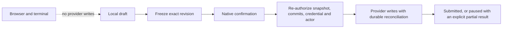

# Pull-Request Actions

## Why

SpecForge already keeps review context, diffs, threads and local progress together, but completing a review still requires moving to the provider and reconstructing that context. The desktop app can close that gap without exposing provider writes to the unauthenticated browser transport or weakening its guarantee that local work and pull requests are never changed implicitly.

## What Changes

- Add desktop-only review drafts containing a summary, single-line inline comments, thread replies and an explicit decision of Comment, Approve or Request changes.
- Require a native confirmation of one exact draft revision before any provider write, and re-authorize the pull request, commits, credential and provider actor at every edit and submission boundary.
- Persist drafts and operation journals independently of the pull-request detail cache, with optimistic revisions, restart-safe reconciliation, stale-head recovery and durable partial-success reporting.
- Submit GitHub reviews through an owned, commit-pinned pending review with durable markers and read-after-write reconciliation; submit BitBucket items sequentially, apply the decision last and never blindly repeat a confirmed write.
- Move newly saved provider secrets to the operating-system credential store through a recoverable transaction, while retaining read-only migration compatibility for legacy plaintext settings and the established environment-variable precedence; serialise settings mutations across processes so a stale instance cannot restore removed plaintext.
- Place current single-line review threads, replies and draft comments at provider-neutral diff line anchors; keep ranges, outdated threads and unplaced drafts in the file preamble.
- Split Tauri application-command permissions by main, reader, pull-request and image windows. Both desktop pull-request presentations may review; reader and image windows may not.
- Keep the browser skin and terminal provider-read-only: provider mutations and credential setters remain absent from the web dispatch surface and review-action events use a desktop-only broadcast.
- Reframe product copy from globally “read-only” to the precise promise that SpecForge never changes local work, posts a review only from the desktop after explicit confirmation, and never merges.
- Exclude merge, close/decline, thread resolution/reopening, multiline ranges, first-class structured suggestion items/controls, automatic anchor remapping and new BitBucket reviewer discovery from this first action slice; user-authored Markdown remains opaque.

## Capabilities

### New Capabilities
- `pull-request-actions`: Defines desktop-only review drafts, authorization and confirmation gates, durable operation journals, GitHub and BitBucket submission protocols, recovery, events, UI states and application-command permissions.

### Modified Capabilities
- `pull-request-viewer`: Replaces the blanket no-actions rule with the desktop review surface, places eligible threads and drafts at diff lines, and tightens pull-request-window command permissions.
- `diff-view`: Adds provider-neutral old/new line slots that hosts can fill with anchored review content in unified and side-by-side layouts.
- `github-pull-requests`: Moves newly saved tokens to the OS credential store, binds writes to the authenticated actor and permits only the specified review mutations under the action gate.
- `bitbucket-pull-requests`: Moves newly saved credential pairs to the OS credential store, retains actor identity, adds bounded review writes and capability-gates decisions that authored-only discovery cannot safely expose.
- `settings-view`: Makes provider credential editing desktop-only and settings writes cross-process transactional, while keeping non-secret pull-request configuration available in the browser skin.
- `web-ui`: Explicitly excludes provider review mutations, review-action events and provider credential setters from the web transport and browser UI.
- `marketing-site`: Replaces the global read-only claim with the local-work, explicit desktop-review and never-merge safety boundary.
- `product-identity`: Carries that same precise safety positioning through the README, bundle metadata, About copy and agent context.

## Impact

- `crates/openspec-app`: new action store and orchestration; provider action clients; snapshot, commit, credential-generation and actor fencing; recoverable keychain-backed credential resolution and cross-process settings writes; dedicated desktop event broadcast.
- `crates/specforge`: review commands, native confirmation, complete `AppManifest::commands` registration, split Tauri capabilities and desktop event forwarding.
- `src/`: mirrored action and anchor types, desktop-guarded API calls, review composer and recovery UI, and line-slot rendering in `PullRequestView`/`DiffView`.
- `crates/specforge-web`: explicit omissions and tests for review mutations and credential setters; provider reads and local review-progress operations remain available.
- `openspec-core` diff parsing remains provider-neutral and Tauri-free; no provider mutation is added to the terminal frontend.
- `README.md`, `openspec/config.yaml`, desktop metadata and `site/`: safety wording only; the product still never edits specs, toggles task files, changes git state or merges pull requests.
- No new provider is added, no local repository content is mutated, and no browser or terminal request can post a review.
