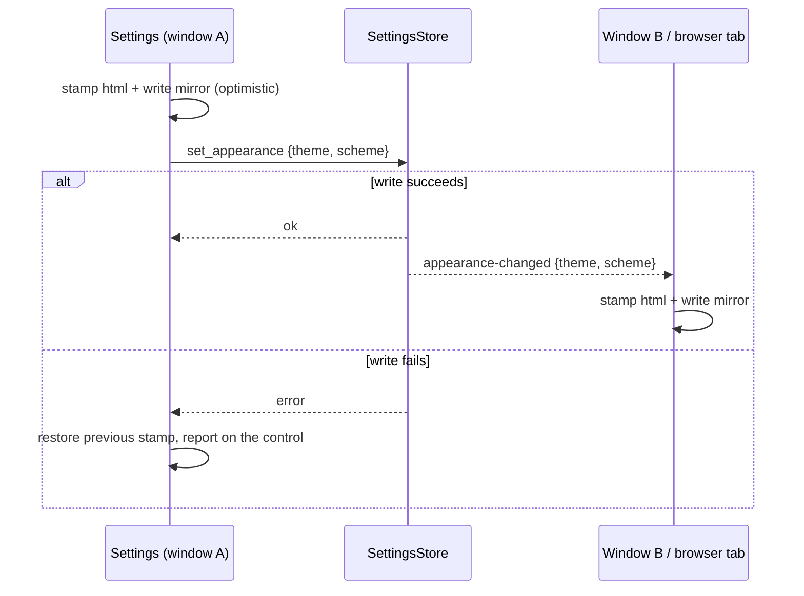
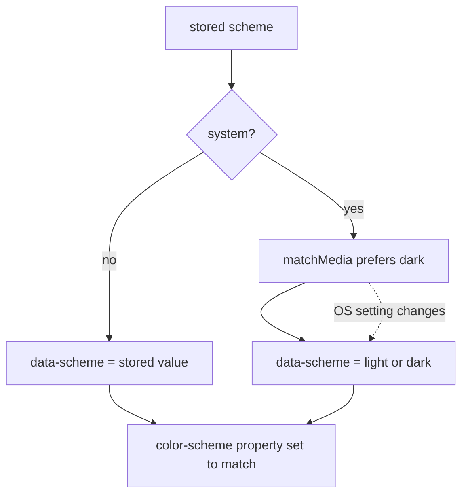
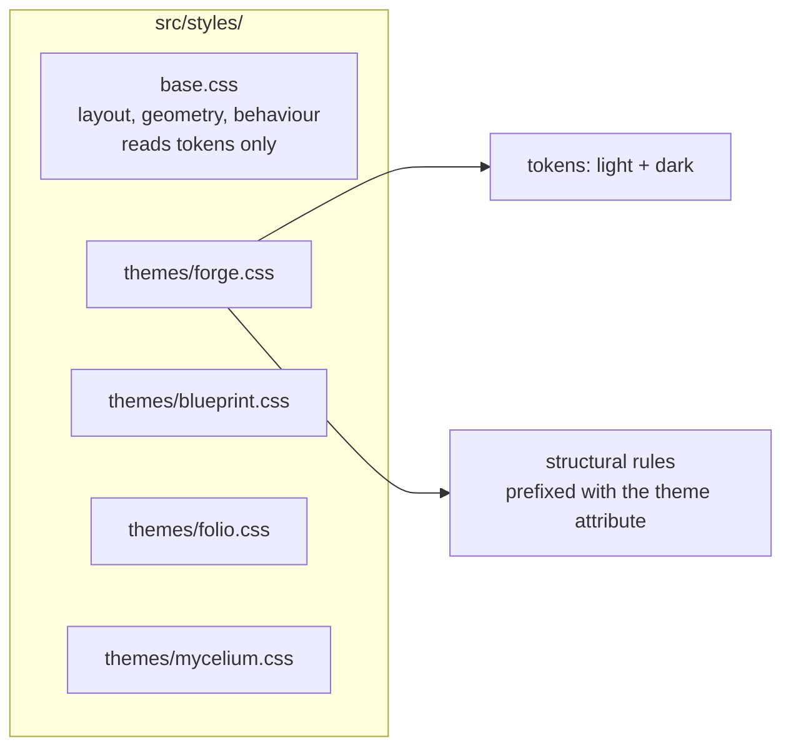

## Context

The whole desktop and browser UI is styled by one file, `src/App.css` (7,705 lines, 142 custom properties). Its discipline is good — almost no colour literal outside a token definition — but identity and structure are interleaved: the same rule that lays out a tree row also gives it its glow, and the dark scheme is four `@media (prefers-color-scheme: dark)` blocks. `openspec/specs/visual-identity/spec.md` pins that identity ("Elevated Indigo") down to hex values and measured contrast ratios across 21 requirements.

Three things already in the codebase make a theme system cheaper than it sounds:

- **The reading width is the template.** `DocumentWidth` in `crates/openspec-app/src/settings.rs` is a stored enum with a hand-written `Deserialize` that degrades an unknown value to the default; `src/main.tsx` stamps `body[data-doc-width]` before React mounts from a `localStorage` mirror; `useDocumentWidth` corrects the mirror from the store on mount and listens for a change event. Appearance needs exactly this shape.
- **One entry point.** `src/main.tsx` boots every window kind (main, reader, pull request, image), so one stamp covers all of them.
- **Runtime token readers are few.** `src/theme.ts` and `MermaidBlock` read tokens from `document.documentElement`; `useDarkScheme` has three consumers (`MermaidBlock`, `SvgBlock`, `DashboardView`).

Decisions already taken in exploration, which this design implements rather than reopens: four themes (Forge, Blueprint, Folio, Mycelium); Forge is the default and the brand; themes may differ structurally; everything ships in one change; the marketing site uses Forge only; the terminal UI is out of scope. Mockups: Forge has app, site, settings, diff, pull-request and dashboard boards; Blueprint and Folio have app and site boards only.

## Goals / Non-Goals

**Goals:**

- A user can choose theme and scheme, and the choice holds across windows, instances, restarts and both hosts.
- No flash: the stored appearance is painted on the first frame.
- One component tree. A new feature is built once and styled per theme.
- Mycelium keeps today's colours, depth and treatments (its sizes, spacing and mono typeface follow Forge and Meslo — see D14).
- Legibility is guaranteed mechanically for every theme in both schemes.

**Non-Goals:**

- User-authored or downloadable themes, per-workspace themes, or a custom accent colour.
- Theming the terminal UI.
- New brand artwork (app icon, tray icon, Open Graph image).
- Retuning Mycelium, or changing the reading-width ladder.
- A theme or scheme control on the marketing site.

## Decisions

### D1 — Appearance is one stored value pair in `openspec-app`

`AppSettings` gains `appearance: Appearance { theme: Theme, scheme: ColorScheme }`, with `Theme = forge | blueprint | folio | mycelium` (default `forge`) and `ColorScheme = system | light | dark` (default `system`). Both enums get the same hand-written, degrade-to-default `Deserialize` as `DocumentWidth`. One command pair (`get_appearance` / `set_appearance`) and one event (`appearance-changed`, payload the full pair).



*Rejected — two independent settings with two events.* A theme change and a scheme change arriving separately means two repaints of every open window and a visible intermediate state (new theme, old scheme) when both change at once, as they do on first load from the store.

*Rejected — frontend-only storage in `localStorage`.* It is per origin, so the desktop app, each `specforge-serve` port and each detached window would disagree, and a second instance could never learn of a change. `localStorage` is kept only as the first-paint mirror.

### D2 — `<html>` carries `data-theme` and the *resolved* `data-scheme`

CSS never sees "system". JavaScript resolves it to `light` or `dark` from `matchMedia("(prefers-color-scheme: dark)")`, stamps the result, and re-stamps when the media query changes while the stored scheme is `system`. Stylesheets then need only two selector shapes per theme:

```css
[data-theme="forge"] { /* light tokens */ }
[data-theme="forge"][data-scheme="dark"] { /* dark overrides */ }
```



The `color-scheme` property is set to the resolved value on the same element so native scrollbars and form controls follow the override.

*Rejected — keep `@media (prefers-color-scheme)` and add override selectors.* Every dark block would have to be written twice (once in the media query for `system`, once under `[data-scheme="dark"]`), for four themes, and a light override would need a third copy to undo the media query.

*Rejected — the CSS `light-dark()` function with `color-scheme` as the switch.* It expresses exactly this, but it needs Safari 17.5-era WebKit; the desktop app's webview is the operating system's, so older supported macOS and WebKitGTK versions would silently render no colours at all.

### D3 — First paint from a mirror, with a fallback that needs no script

`src/main.tsx` stamps both attributes from a `localStorage` mirror before React mounts, next to the existing `data-doc-width` stamp; `useAppearance` fetches the authoritative pair on mount and corrects the stamp and the mirror if they disagree. A bare `:root` (no attributes at all — script failed, or a host that never stamped) carries Forge's tokens, with Forge's dark values under `@media (prefers-color-scheme: dark)` guarded by `:root:not([data-scheme])`. That is the only media query for scheme left in the app stylesheet.

*Rejected — wait for the store before painting.* The store is behind an async call; every cold start would paint Forge and then repaint, which for a Mycelium user is a full-window colour and font change.

### D4 — Theme selectors match any element, not only the root

Rules are written `[data-theme="forge"] …`, never `:root[data-theme="forge"] …`. The active theme is stamped on `<html>`, but any subtree given its own `data-theme` (and `data-scheme`) renders in that theme. The Settings picker uses this: each card is a small real fragment rendered inside `data-theme="<id>"`, so previews cannot drift from the themes they represent.

Runtime token readers (`src/theme.ts`, `MermaidBlock`) keep reading from `document.documentElement`, which is where the active theme lives.

*Rejected — hand-picked swatch colours per card.* They would be a fifth copy of each palette, correct on the day they were written.

### D5 — One component tree; structure in `base.css`, identity in one file per theme



Each theme file has two parts: a token block (both schemes) and structural rules, every one prefixed with `[data-theme="<id>"]`. The prefix adds an attribute to the selector, so a theme rule always outranks the base rule it restyles without `!important` and without depending on source order.

What belongs where:

| In `base.css` | In a theme file |
|---|---|
| layout, sizing from tokens, scroll and overflow behaviour, pointer and touch rules, the reading-width ladder, z-order | every colour, typeface, type size, radius, shadow and border style; selection, hover and focus treatments; text transform and letter-spacing; task marks, chip and tab shapes |

The existing token names are kept, and the set grows where a treatment that differs between themes can be a value rather than a rule (for example the inline-code background, the selection fill, the label transform).

*Rejected — CSS cascade layers (`@layer base, theme`).* Unlayered rules beat every layer regardless of specificity, and the bundle contains third-party unlayered CSS (KaTeX, the syntax highlighter); putting the app's own rules in layers would hand those stylesheets precedence over the whole reading surface.

*Rejected — per-theme React components or conditional markup.* Every later feature would be built once per theme, and themes would drift in behaviour, not only in look.

*Consequence, accepted:* a look that needs different markup is not available to a theme. The Blueprint mockup's section numerals in the heading margin are dropped for this reason — real headings carry their own numbers in their text.

### D6 — Extract Mycelium first, against a pixel gate

The split is done in two passes so regressions are attributable:

1. **Extraction.** Move identity declarations out of `App.css` into `themes/mycelium.css` with no change in rendering. Gate: screenshots of a fixed set of surfaces under `data-theme="mycelium"`, light and dark, compared against the same surfaces on `master`. Any difference is a bug in the extraction.
2. **Authoring.** Write Forge, then Blueprint and Folio, against the now-identity-free base. Anything a new theme cannot express means a declaration was left in the base by mistake.

*Rejected — write the new themes as overrides on top of today's stylesheet.* Each theme would then have to undo Mycelium (zero its shadows, cancel its uppercase labels) before stating itself, and Mycelium's values would remain the hidden default of every future rule.

### D7 — Theme identities

Each theme's defining treatments, all reachable from CSS over the shared markup:

| | Forge (default) | Blueprint | Folio | Mycelium |
|---|---|---|---|---|
| UI typeface | Geist | IBM Plex Sans | Instrument Sans | Inter |
| Document typeface | Geist | IBM Plex Sans | Newsreader | Inter |
| Mono typeface | Geist Mono | IBM Plex Mono | JetBrains Mono | Meslo |
| Smallest text | 13px | 13px | 13px | 13px (was 11px) |
| Chrome / document body | 15px / 17px | 15px / 17px | 15px / 19px | 15px / 17px (was 13–15px / 16px) |
| Corners | 8–10px | 0 | 12px, pills | 4–8px (unchanged) |
| Depth | flat, hairlines | flat, hairlines | flat, tonal panels | shadows and glows (unchanged) |
| Selected row | filled neutral row | 1px accent outline | accent-tinted row | bar, wash and glow (unchanged) |
| Section labels | sentence case | uppercase mono | sentence case | uppercase (unchanged) |
| Inline code | neutral chip | hairline box | plain mono | emerald text (unchanged) |
| Task mark | square box | bracketed mono mark | disc | unchanged |

Starting palettes, taken from the mockups. These are starting values: the figure that ships is whichever passes D8.

| Token | Forge dark | Forge light | Blueprint dark | Blueprint light | Folio dark | Folio light |
|---|---|---|---|---|---|---|
| `--bg` | `#141312` | `#f6f5f2` | `#0b1524` | `#f3f6fb` | `#17171a` | `#fafafa` |
| `--surface` | `#1b1a18` | `#ffffff` | `#0f1c30` | `#ffffff` | `#1d1d21` | `#ffffff` |
| `--surface-2` | `#262421` | `#ecebe7` | `#152846` | — | `#2b2a3a` | — |
| `--border` | `#35322e` | `#dcd9d3` | `#27406a` | `#c3d0e4` | `#36363d` | `#e0e0e5` |
| `--text` | `#f2efea` | `#1c1a17` | `#e8eef8` | `#0d1b30` | `#ededf0` | `#18181b` |
| `--text-muted` | `#b5afa6` | `#5a554d` | `#aebcd2` | `#44536c` | `#b6b6bf` | `#54545d` |
| `--text-faint` | `#958e84` | `#6e685f` | `#8499b8` | — | `#93939e` | — |
| `--accent` (ink) | `#ff7a3d` | `#b03f0c` | `#5cc8ff` | `#0f4bb0` | `#a99bff` | `#5b3fd6` |
| `--ok` | `#7fd1a3` | `#1f7a4d` | `#8be0a8` | — | `#86d6a5` | — |

A dash marks a value the mockups did not need; it is authored during implementation. Forge's primary-button fill is `#ff7a3d` with a dark label (`#1f0f05`) in both schemes. Mycelium's palette is today's, unchanged.

Because Forge's accent is orange and "removed" in a diff is red, Forge's diff removal ink and tint must differ from the accent in lightness as well as hue; the mockup uses `#ff9b8a` on `#35201c` (dark) and `#b3261e` on `#fbe8e4` (light).

### D8 — Contrast is a `bun test`, over the theme files themselves

A test parses the token blocks of each `themes/*.css` (they are flat `--name: value;` lists by construction), resolves each theme in both schemes, and asserts the shared floors for a fixed table of foreground/background pairs: body and informational text at 4.5:1 or better on every surface it can sit on, load-bearing edges and the focus indicator at 3:1 or better, primary-button label on its fill at 4.5:1, syntax-highlight classes on the code surface and on the diff tints. Tokens that take part in a measured pair must be opaque colours, so no pair needs alpha compositing; tints that sit behind text are written as their composited value.

*Rejected — keep measured ratios in comments and the spec.* That is eight palettes; the current stylesheet already records one figure that was claimed and wrong (`#6f7a86`).

*Rejected — a TypeScript palette as the source of truth, generating CSS.* It adds a build step and breaks the direct edit-and-see loop on the stylesheet for a problem a 40-line parser solves.

### D9 — Fonts are vendored and declared; the browser fetches only what a theme uses

Six families are added to `src/assets/fonts/` as Latin-subset variable `woff2` (Geist, Geist Mono, IBM Plex Sans, IBM Plex Mono, Instrument Sans, Newsreader), declared in `src/fonts.css` with `font-display: swap` and metric-compatible fallbacks, as Inter and JetBrains Mono are today. A browser downloads a declared face only when a rendered element uses it, so the inactive themes' fonts cost disk, not load time. All are under the SIL Open Font License.

*Rejected — dynamic `import()` of a per-theme font stylesheet.* It adds an async step in front of first paint to save nothing the browser does not already save.

### D10 — The native window follows the scheme

When the stored scheme is `light` or `dark`, the desktop shell sets each window's native theme to match, and clears the override for `system`, so titlebars of detached windows, native menus and system controls do not contradict the page. This is applied at startup, to every detached window as it is created, and on each appearance change.

Every theme paints an opaque sidebar. An earlier draft of this decision assumed the sidebar is translucent over macOS window vibrancy and reserved that for Mycelium; it is not — the application applies no vibrancy effect, and `visual-identity` already locks the sidebar to a solid background — so there is nothing to keep or remove.

*Rejected — rely on the native window theme to drive `prefers-color-scheme` in the webview and skip `data-scheme`.* It works in the desktop shell on some platforms and not at all in the browser skin, which must behave identically.

### D11 — Token-derived renderings key on the appearance

`useDarkScheme` is replaced by `useAppearance()` returning `{ theme, resolvedScheme }`. Diagrams, `currentColor` SVG fences and the dashboard heatmap re-render when either changes, exactly as they do today for an operating-system scheme change. The `<meta name="theme-color">` tags in `index.html` are replaced by one tag updated at runtime from the active `--bg`, so an installed web app's chrome matches; `manifest.webmanifest` takes Forge's dark background as its static value.

### D12 — The site copies Forge by hand

`site/src/styles.css` takes Forge's token values and type, keeps its own `@media (prefers-color-scheme: dark)` block, swaps `@fontsource/inter` and `@fontsource/jetbrains-mono` for the Geist packages, and updates the font allowlist in `site/renderer/+onRenderHtml.tsx`.

*Rejected — import the app's `themes/forge.css` into the site.* The site is deliberately isolated from the root package (own lockfile, own build); a shared file would make the app's stylesheet a build input of a separately deployed product.

### D13 — Everyone lands on Forge

An install with no stored appearance — which is every existing install — resolves to Forge with scheme `system`. There is no migration step and no in-app notice; the release notes say where Mycelium is.

*Rejected — detect an existing settings file and default it to Mycelium.* It makes the default depend on install history, so two machines on the same version look different for a reason nobody can see, and the new identity would reach only new users.

### D14 — Decisions revised during implementation

- **The change event is a service notice, not a direct emit from the command (revises D1's diagram in detail, not in shape).** `AppService::set_appearance` raises `ServiceNotice::AppearanceChanged`, which both transports forward as `appearance-changed`. A direct emit from the desktop command, as `set_document_width` does, would never reach a browser tab served by the same application, which the spec requires.
- **Propagation stops at the process boundary.** Windows of the running application and the tabs it serves are notified. A second, separately started instance is not; it adopts the stored value on its next start, exactly as the reading width behaves. The spec was narrowed to say so.
- **Mycelium is exempt from the floors on a closed list of pairs (revises D8).** Measured, Mycelium falls short on 14 pairs — among them `--border-strong` on every light surface (1.37–1.57:1), `--text-faint` on the selected row in both schemes, and the dark primary button's hover and pressed fills under a white label (2.39:1). "Mycelium renders as today" and "every palette passes" cannot both hold; the first is the explicit product decision, so the test pins Mycelium's shortfalls exactly and the spec says the list may not grow. Retuning Mycelium is a separate change.
- **"Differ in lightness" is a number.** A CIE lightness difference of at least 8 between any two state colours. Meeting it moved Forge's dark accent ink to `#ff8547` (the button fill stays `#ff7a3d`) and retuned the done and error colours in the three new themes.
- **The first-paint stamp runs from an inline script in `<head>`, not only from `src/main.tsx` (revises D3).** The module script runs after the stylesheet has loaded and after a rendering opportunity, leaving a window of roughly 25 ms in which the unstamped root resolves Forge's fallback tokens. A synchronous inline script closes it.

- **Classic is renamed Mycelium, and is no longer "as today" (revises the Goals, D6 and D7).** After the extraction gate proved it identical to master, the product decision changed. The theme is named **Mycelium** (identifier `mycelium`): "Classic" described its history, not its look, and nothing had shipped under the old identifier. Beyond the name: Mycelium takes Forge's type scale, line heights, document size and row and control spacing, and Meslo (Apache-2.0) replaces JetBrains Mono as its monospaced typeface. Inter stays for interface and prose; colours, shadows and glows, the selection model, chips, uppercase labels and radii are untouched. The extraction gate still stands as evidence that the split itself changed nothing; the retune is applied on top of it and checked by a second comparison in which only typeface, type-size, line-height and box-geometry properties may differ from master. JetBrains Mono remains bundled because Folio uses it.

## Risks / Trade-offs

- **[A change this size regresses surfaces nobody looked at]** → D6's two-pass order with the Mycelium pixel gate; a fixed smoke matrix (every surface × four themes × two schemes) in the verification tasks; the contrast test covers legibility without a human.
- **[Blueprint and Folio are only mocked for the app shell and the site]** → Forge is authored and reviewed first on every surface; the other two are derived from it and may ship with treatments closer to Forge than their mockups suggest. Their identity is the D7 table, not a pixel reference.
- **[Structural themes multiply future work]** → D5 limits the multiplication to CSS. The rule is stated as a requirement so a later change cannot add a per-theme component without modifying the spec.
- **[A stale `localStorage` mirror paints the wrong theme for one frame]** → Same behaviour and same correction as the reading width today; it only occurs when another instance changed the setting while this window was closed.
- **[Font weight in the installer]** → Six more Latin-subset `woff2` files. Measure the bundle delta during implementation and record it; if it is objectionable, the first lever is dropping unused weights from the variable ranges.
  - **Measured (implementation):** the fonts add 305,548 bytes to `dist/assets` — Geist 29,400, Geist Mono 23,128, IBM Plex Sans 45,712, IBM Plex Mono 400/500/600 45,216 (static: the family has no variable cut), Instrument Sans 30,092, Newsreader 132,000 (optical-size and weight axes) — against 88,660 for Inter and JetBrains Mono before, so the app's own fonts go from ~87 KiB to ~385 KiB on disk. A window downloads only the active theme's faces. The minified app stylesheet grows from 96,711 to 124,472 bytes (+27,761: the four theme files, the Forge fallback copy and the Appearance group's rules).
    - **Group 11:** Meslo LG M's four Latin faces (Regular 17,596, Bold 17,784, Italic 18,504, Bold Italic 18,512) add 72,396 bytes more, so the fonts add 377,944 bytes in all and the app's own fonts come to ~456 KiB on disk. JetBrains Mono stays, for Folio.
- **[The mutation gate does not cover this]** → Nearly all of the change is in `src/` and `crates/specforge*`, where the Mutants job reports green without running. Only the `openspec-app` settings code is gated; the frontend is covered by `bun test` (appearance resolution, mirror, contrast) and the manual matrix.
- **[The site deploys live from `master`]** → A push touching `site/**` publishes. The site task group is last, and the site's e2e suite runs before the push.
- **[Existing users are surprised by a new look]** → Accepted (D13). Mycelium is one setting away and is named in the release notes.
- **[Forge's orange accent sits near the red of errors and removals]** → Error and removal colours are required to differ from the accent in lightness, and the contrast test includes those pairs.

## Migration Plan

1. Settings and commands land first with no visual effect (the stylesheet ignores the attributes).
2. Mycelium extraction lands behind the pixel gate; the app still looks as it does today.
3. Forge is authored and becomes the default in the same commit that makes `Theme::default()` return it.
4. Blueprint and Folio follow; then the Settings group; then the site.

Rollback is a revert of the change; a settings file written with an `appearance` field is read without error by an older build, which ignores the unknown field.

## Open Questions

- Should the reading-width control move from Layout to Appearance? This design leaves it in Layout to keep `document-width` and its settings requirement untouched.
- Folio sets documents in a serif. Should code-heavy artifacts (tasks) fall back to the UI typeface in Folio, or is the serif the point? Decide when Folio is authored against real task lists.
  - **Outcome (implementation):** the serif stays on task lists. Authored against this change's own `tasks.md` (dense with identifiers), the task text reads as prose and every identifier in it is already set in the mono face, so the two faces separate words from code by themselves; a UI-face fallback would make tasks the one artifact Folio does not set as a document. Only the small headings (h4–h6, which read as labels) take Folio's chrome face.
- The README and site screenshots show Mycelium. They are retaken in Forge at the end of this change; the Open Graph image still shows the old palette until the artwork change.
