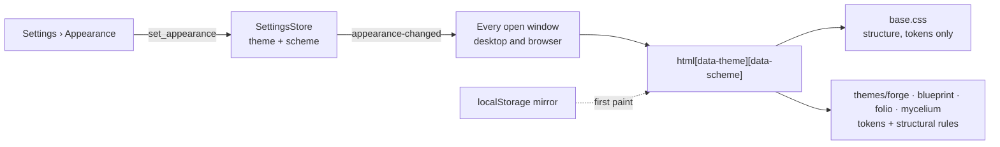

# Selectable Themes With Forge as the New Default

## Why

The desktop and browser UI reads as small, dense and heavy: 130 of roughly 175 font-size declarations in `src/App.css` sit at 11–13px, and depth is signalled by shadows, glows, inner highlights and hairlines stacked on the same elements. The look is also fixed — one identity, following the operating system's light/dark setting with no override. Three replacement identities were mocked up and all three were liked, so rather than picking one this change makes the identity a user choice, with a new default.

## What Changes

- **A theme system.** The user picks one of four themes and one of three schemes in Settings; the choice is stored by `SettingsStore`, applies to every window and every running instance, and is in effect on the first paint.
  - **Forge** — the new default and the SpecForge brand: warm graphite neutrals, an ember-orange accent, Geist and Geist Mono, larger type, no shadows or glows.
  - **Blueprint** — drafting blue, square corners, IBM Plex Sans and Mono, mono section labels.
  - **Folio** — reading first: documents set in Newsreader, quiet chrome in Instrument Sans, a violet accent.
  - **Mycelium** — today's "Elevated Indigo" colours, depth and selection style, re-set at Forge's sizes and spacing, with Meslo replacing JetBrains Mono for code and identifiers.
- **A scheme override.** System (follow the operating system, as today), Light, or Dark. **BREAKING** for the `visual-identity` requirement that forbids an in-app override.
- **BREAKING: the default look changes.** An install with no stored theme opens in Forge after upgrading. Mycelium is one click away in Settings.
- **Themes are structural, over one component tree.** A theme may restyle anything CSS can reach — selection treatment, task marks, tabs, labels, corners, depth — but there is exactly one set of React components and one markup. `src/App.css` is split into a structural base plus one stylesheet per theme.
- **A new Appearance group in Settings** holding the theme picker (each card previews its theme with that theme's real tokens), the scheme control and a sample.
- **Contrast is enforced by a test**, not by measured figures in comments: every theme in both schemes must clear the same floors.
- **The marketing site adopts Forge** as its one fixed identity, still following the visitor's operating-system scheme. It gets no picker.

## Capabilities

### New Capabilities

- `theme-system`: The selectable theme and scheme — the four-theme catalogue and its default, the scheme override and how "System" resolves, persistence and propagation across windows and instances, first-paint application, the one-component-tree rule, the shared contrast floors and the test that enforces them, and how token-derived renderings (diagrams, embedded SVG, the heatmap, the browser's theme colour) follow the active appearance.

### Modified Capabilities

- `visual-identity`: The token layer becomes per-theme (same token names, values supplied by the active theme and resolved scheme). Every concrete value and treatment the capability pins — hex colours, pixel sizes, typefaces, the selection model, the chip vocabulary — is scoped to the Mycelium theme. The *Theme Follows System Preference* requirement is removed in favour of `theme-system`.
- `settings-view`: The Settings view gains a sixth group, **Appearance**, between Workspaces and Layout.
- `marketing-site`: The site's identity is the Forge theme specifically, fixed, with no theme or scheme control.

## Impact

**Touched**

- `crates/openspec-app/src/settings.rs`, `events.rs`, `lib.rs` — `Theme` and `ColorScheme` enums, the `appearance` field on `AppSettings`, getter/setter, the `appearance-changed` event.
- `crates/specforge/src/commands.rs` and its `build.rs` command list; `crates/specforge-web` invoke dispatch — the `get_appearance` / `set_appearance` commands (the four registration places in `src/CLAUDE.md`).
- `crates/specforge/src` window setup — native window theme follows the scheme override so titlebars and native controls match.
- `src/App.css` → `src/styles/base.css` + `src/styles/themes/{forge,blueprint,folio,mycelium}.css`; `src/fonts.css` and `src/assets/fonts/` (Geist, Geist Mono, IBM Plex Sans, IBM Plex Mono, Instrument Sans, Newsreader and Meslo added; Inter kept; JetBrains Mono kept for Folio).
- `src/main.tsx` (first-paint stamp), `src/types.ts`, `src/api.ts`, a new `src/appearance.ts` and `src/hooks/useAppearance.ts`; `src/hooks/useDarkScheme.ts` and its three consumers (`MermaidBlock`, `SvgBlock`, `DashboardView`); `src/theme.ts`.
- `src/settingsGroups.ts`, `src/components/settings/` — the Appearance group.
- `index.html`, `public/manifest.webmanifest` — the browser theme colour follows the active theme.
- `site/src/styles.css`, `site/package.json`, `site/renderer/+onRenderHtml.tsx` (font allowlist), the site's screenshot assets and e2e expectations.
- `docs/screenshot.png` and the README screenshot.

**Deliberately not changed**

- **No component or markup forks.** No theme gets its own React component, conditional JSX or layout. If a look cannot be reached from CSS over the shared markup, the theme does not get it.
- **The terminal UI.** `crates/specforge-tui` keeps its own palette and ignores both settings, as it does the reading width.
- **Mycelium's colours, depth and treatments.** Its palette, shadows and glows, selection model, chips and label casing are moved, not retuned. Its type sizes, spacing and monospaced typeface do change (see above), so today's exact look is no longer available.
- **The app icon, tray icon, dock badge and Open Graph artwork.** Brand artwork is a separate change.
- **Reading width.** It stays in the Layout group with its own ladder; themes do not alter the preset figures.
- **`openspec-core`.** No parsing, registry, cache or watcher change.
- **No new runtime dependency.** Fonts are vendored `woff2` files, as today.
