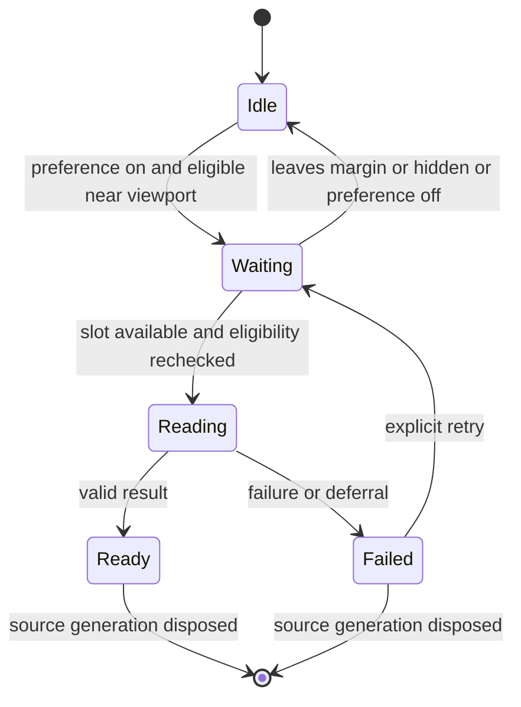

## Context

`PullRequestFiles` currently passes `imageReads="onRequest"` to the shared `DiffView`; commit detail passes `"nearView"`. The existing image queue permits two reads and observes one viewport above/below the scroll port. Withheld text files have an independent, manual `loadFile` path. Some PR loads are served from cached hunks; GitHub entries without a patch require authenticated API reads.

PR descriptions, conversation and submitted thread comments pass through `MarkdownView`'s pull-request mode. `ContentImage` deliberately produces a labelled link, not a remote image element. Detached PR windows allow only self/data/blob images through their CSP. The main window relies on the renderer's guard rather than that CSP, so a safe implementation must work in both places.

The user confirmed that the image setting must cover **both** changed-image comparisons and embedded description/comment images. On 2026-11-17 the user directed merging the completed compact navigator into local master before continuing this work. Commit `e4bacb9` is now this worktree's base, including the retained Overview/Files/Discussion tabs from PR #19. Loading integrates those visibility boundaries without changing navigator semantics.

## Goals / Non-Goals

**Goals:**
- Two independent, opt-in PR loading preferences with the existing Settings persistence and cross-window conventions.
- Automatic loading near visible content, with bounded pending/in-flight work and explicit retry after failure.
- Embedded public HTTPS Markdown images, including bounded checked CDN redirects, without provider-token forwarding, browser-cookie use, private-network access or broader image CSP.
- Preserve existing hard byte/pixel limits, stale-content fencing, review/draft identity and reading position.

**Non-Goals:**
- Eagerly load every file/image on opening a PR, configure numeric preview limits, or bypass provider backoff.
- Change commit detail, workspace Markdown, review submission, terminal UI or PR navigation/filter semantics.
- Render raw HTML, including HTML-only `` screenshots; execute Mermaid; render remote SVG; resolve relative embedded-image sources; authenticate to attachment hosts; follow unvalidated or unlimited redirects.
- Build a general URL proxy, cross-window image-byte cache, persistent image store, virtualised renderer, image uploader/exporter or new zoom window for embedded images.

## Decisions

### D1. Store one independent pair, defaulting off

Add `PrContentLoading { autoShowImages, autoLoadLargeDiffs }` as one `prContentLoading` block in `AppSettings`. Missing or malformed preference fields default to false without making the entire settings file corrupt. A typed setter changes **one field** under the store transaction and returns the complete pair, so flipping one switch cannot overwrite the other from a stale UI snapshot.

Commands are `get_pr_content_loading` and `set_pr_content_loading(preference, enabled)`. The service raises `pr-content-loading-changed` with the effective pair after a successful save, through `ServiceNotice`, the Tauri forwarder and SSE. A failed save raises no success notice. A shared `usePrContentLoading` hook subscribes before reconciling its initial read and ignores reads older than an observed notice; automatic fetching starts only after authoritative preferences are known, never from a stale localStorage mirror.

The pair is application-wide for all rich clients of a service, as review skip patterns are, not per PR/provider. Separately running services adopt stored changes on their next settings read/start; no new interprocess notification system is introduced.

**Rejected:** per-PR preferences create unbounded persisted state; duplicating the switches inside each provider creates conflicting defaults; a surface-only localStorage value would not match the requested saved application settings. A pair-replacing setter was rejected because unrelated switches would race.

### D2. Put both switches with review skip patterns, and disclose the privacy trade-off

`IntegrationsGroup` renders two `SettingsRow`/`Switch` rows after the provider cards and before “Skip in review”, while either provider is enabled. The switches apply on desktop and browser; there is no seventh Settings group.

- **Automatically show images** — “Show changed-image comparisons and supported images in PR descriptions and comments as you scroll. Embedded image hosts can learn when an image is read and the IP address of the machine running SpecForge. Embedded images are fetched without credentials; protected or unsupported images stay links. Changed-file previews use the configured provider API.”
- **Automatically load large diffs** — “Load withheld file diffs as you scroll. Some loads use the provider API. Preview limits and rate limits still apply.”

Persist on change; show failed writes on their row and revert to stored values. Turning a switch off clears its pending automatic work in every open presentation but does not delete previews already loaded. Detached PR windows read the preference and receive notices, but cannot set it.

**Rejected:** burying this under Appearance or Layout misclassifies network behaviour; silent opt-in obscures the unavoidable tracking/IP disclosure of fetching author-controlled images; adding a per-PR override or third switch is unnecessary for this request.

### D3. One per-presentation scheduler, with explicit eligibility and lifetime

Extract/generalise the existing queue into a pure `src/nearViewQueue.ts`, retaining a commit-view adapter with exactly its current behaviour. A PR-scoped controller (`src/prContentLoading.ts` and a React provider/hook) owns one queue shared by changed-file images, embedded images and automatic withheld-file loads. At most two automatic reads are in flight per PR presentation:

$$I_{\text{changed images}} + I_{\text{embedded images}} + I_{\text{withheld files}} \le 2$$

Observers use each content area's actual scroll port with a one-viewport-height margin above/below. Merely existing in a retained hidden tab does not qualify. Before every dequeue, recheck the preference, document visibility, selected workspace tab, parent collapse/minimisation and current source/model generation. Drop waiting entries that leave the margin. User actions retain immediate/manual access and are never silently swallowed behind an automatic retry.

Started reads may complete; there is no claim to undo already-sent network requests. Suspending or disposing a queue prevents a settling promise from pumping more work. A failed or deferred item is attempted automatically at most once for its source/model generation; re-entering the margin, ordinary rerenders and preference flips do not create retry loops. “Try again” is explicit. Turning automation off does not prevent the existing manual changed-image or text-diff loads.

File work is keyed by model generation plus file key and read kind; embedded work by reference, body digest and canonical source. Duplicate embedded images within one PR presentation share their read/result. No byte cache is shared across windows or persisted.

**Rejected:** loading every withheld file in an effect defeats eager budgets and floods the API; separate uncoordinated queues multiply concurrency; using CSS visibility alone leaves retained tabs able to fetch; recursive retries or deadline timers spend quota without an explicit new request.

### D4. Keep existing diff/image readers and all preview ceilings

Extend `DiffView`'s host contract with optional withheld-file read timing and shared automatic-work scheduling. Defaults stay manual. For PRs, `autoShowImages` selects near-view versus on-request image reads; `autoLoadLargeDiffs` permits near-view loads only while effective content is `withheld`. The controls remain available while queued and after failure; no automatic read targets `tooLarge`, binary non-images or known LFS pointers.

Call the existing `get_pull_request_file`/`get_pull_request_file_image` with the rendered head/base. Preserve cached-versus-network semantics, exact counts, host links and provider budgets. Newly discovered hunks still trigger progress reconciliation, coalesced for concurrent loads without losing the final reread. A stale batch requests at most one detail refresh for the old model, rather than each rejected automatic item causing a refresh cascade.

Text loading may reveal that an image-named file is binary or a pointer; run the existing image classification after that result. Only the relevant enabled setting starts the subsequent image read. Filename extensions alone never bypass text/binary classification.

Loading changes no viewed/skipped mark and never expands a reader-collapsed section. Skipped sections remain initially collapsed; explicitly opening one allows the same near-view policy without including it in review. Reuse the diff's anchoring for async text insertion as well as images: automatic loads preserve the topmost visible side-qualified line/header and must not steal focus, while explicit “Load diff” keeps its existing focus restoration.

Near-view scheduling bounds concurrent work, **not cumulative rendered content**. Loaded results stay for the model's lifetime, like manual loads. The 8 MiB per-file ceiling, eager 500/3,000-line and 64 KiB/1 MiB budgets, and image 8 MiB/40 MP ceilings stay unchanged; automation is a later per-file operation, not a bigger eager payload.

**Rejected:** raising/removing ceilings changes a separate safety contract; fetching through a second renderer loses slots and drafts; auto-expanding skipped/viewed content changes review intent; unloading previously loaded hunks would move editors and break reading/copy state.

### D5. Authorise embedded sources from the current cached published text

Add `get_pull_request_content_image(reference, bodyDigest, source)`. `bodyDigest` is SHA-256 over the exact UTF-8 Markdown body. The service accepts it only while the provider is enabled, the reference is still listed, the setting is on, and a description or published conversation/thread-comment body in the cached detail has that digest and contains the source as an actual Markdown image.

Use a real Markdown parser in `openspec-core/src/pr_content_image.rs`, not a URL regex. Add a direct `pulldown-cmark` edge at the already locked version; add the locked `url` edge for canonical URL decisions. Handle inline/reference images, Markdown escapes and images inside links. Code, raw HTML, dropped HTML comments, ordinary links and unsaved draft text grant no authority. A shared malicious/edge-case fixture corpus pins source recognition against the frontend parser; a mismatch refuses the preview rather than loosening authorisation.

Canonical sources must be absolute HTTPS URLs with a DNS hostname, no user information and no non-default port; strip fragments for fetch identity while preserving path/query semantics. Do not decode/rebuild signed query strings. Invalid/relative URLs keep their existing inert/link treatment and cause no resolution.

The cache offers a bounded metadata authorisation snapshot without holding its mutex across Markdown parsing, DNS or I/O. Immediately before each outbound request, including redirect hops, and before returning bytes, recheck the setting, listed row, provider credential generation and current published-body digest. A changed body/credential/source returns a typed stale/refused result and no stale preview. It does not repeatedly refresh detail. Requests never accept an arbitrary URL merely because the caller supplies a plausible reference.

**Rejected:** a general fetch command turns the service into an SSRF proxy; authorising by substring accepts URLs in code/links; passing a whole caller-authored Markdown body grants no trust; adding provider authentication to arbitrary attachment URLs leaks credentials and expands the request.

### D6. Separate credentialless public-image transport with connection-time address checks

`openspec-app/src/pull_request_content_images.rs` owns a separate injected transport and public-image admission gate. It must not reuse an authenticated request builder. Every request is an HTTPS GET with no cookies, Authorization, Proxy-Authorization, Referer, Origin or ambient proxy; it forwards no caller-supplied headers. Standard TLS hostname/certificate verification remains on.

Disable the client's automatic redirect handling. A read may follow at most three redirect hops, manually resolving each Location against the current URL and reapplying the HTTPS/authority/port rules, source authority, address pinning, budget and cooldown checks before sending. Reject loops, missing/malformed targets, downgrades and any unsafe hop. The target need not itself appear in the Markdown: authority is the original cached source plus its checked redirect chain. Each hop counts against the separate public-image budget. No provider token is ever sent, even to a redirect on a provider-owned host. Existing authenticated provider requests still follow no redirect.

For each hop, resolve its DNS hostname once and reject the entire answer if any address is not ordinary globally routable unicast: loopback, unspecified, private/unique-local, link-local/metadata, shared-address, documentation, benchmarking, multicast, reserved and IPv4-mapped forbidden destinations all fail closed. Reject IP-literal hosts and local-only names before resolution. Pin the approved addresses into the actual connector/resolver while retaining that hop's hostname for Host and TLS SNI. There must be no second unvalidated DNS lookup or connection reuse that bypasses this check. Start with no shared idle connection pool for this transport.

**Confirmed implementation:** the installed `ureq` 3.4.0 exposes the required resolver/connector seam, so the app pins that exact version while using its unversioned API. A pinned resolver and connection guard precede the TCP/rustls chain; each hop gets a fresh agent with proxy, redirects and idle pooling disabled and TLS verification enabled. OS DNS lookup is injected behind the same timed worker wrapper in tests. At most two DNS workers remain alive even after a logical timeout; their permits are released only when the OS lookup actually ends. Existing `ureq` gzip support is reused; the only added app dependency is the already-locked `flate2` dev dependency for an actual compressed-response test. Core adds direct edges to the already-locked Markdown and URL parsers.

Use a 15-second read deadline shared by the entire redirect chain and inspect at most 8 MiB plus one decoded-body byte. Redirect bodies are not read into memory. Content-Length and Content-Type are not authority; bound decompression and pass bytes through `openspec_core::image::inspect`. Only an accepted raster image crosses IPC; SVG/HTML and refused/LFS/over-pixel-limit content never reach a DOM decoder. Return a typed image/failure outcome and the final hostname for labelling, not a fetchable remote URL or raw response body.

The service allows at most two embedded-image reads in flight globally and at most 120 outbound embedded-image GETs in a rolling hour, shared across its rich clients, independently of provider budgets. Preference/provider toggles and credential saves do not reset this gate or its cooldowns during the service's lifetime. No successful read's bytes are kept by the service. A 429 records a per-origin cooldown from a valid Retry-After, capped at one hour, defaulting to 60 seconds; attempts during a cooldown or spent budget send nothing. These guards introduce no automatic retry timer and never stall provider panel polling.

Full source URLs, queries, request headers, image bytes and raw transport errors must not enter image-read diagnostics, notices or persisted state. The new API wrapper uses argument/result redaction; PR detail/image logging is reduced to safe metadata too, since their replies can contain sources or image data. Service failures use stable typed reasons, not underlying errors that echo URLs.

**Rejected:** directly assigning `` either relaxes the PR CSP or fails in detached windows and lets browser cookies/referrers escape; frontend credentialless fetch depends on remote CORS and still exposes browser-network targets; checking DNS then using an ordinary resolver is vulnerable to rebinding. A hostname-only allowlist is insufficient protection and unnecessarily excludes public screenshot hosts. Refusing all credentialless redirects needlessly loses attachment URLs that lead to public CDNs, while the HTTP client's automatic redirects bypass the required per-hop validation.

### D7. Render embedded previews through the existing safe image primitive

Create `PullRequestContentImage` under the PR loading context. `MarkdownView` gives PR mode the exact body digest without rerendering workspace Markdown; preference changes arrive through context, so memoised Markdown still reacts without remounting its blocks. Overview and Discussion get their own visibility scopes; inline thread comments follow Files visibility. Minimized comments and unplaced/hidden panes do not fetch until shown.

Off/unloaded, keep `ContentImage`'s current labelled-link behaviour. On/eligible, reserve a placeholder; after a successful service read use `ObjectImage` with the sniffed MIME/dimensions, object-URL cleanup and escaped alt/host labelling, showing the final host too when a checked redirect changes it. Constrain the preview to its content width and reserve the measured aspect ratio before browser decode. Preserve the nearest readable content anchor while it replaces the placeholder. Failures remain a local reason plus the original safe link; only retryable transport/deferred failures offer “Try again”, outside any enclosing anchor. Refused schemes/formats/addresses have no retry control.

An image inside a Markdown link remains part of **one** link; never nest anchors/buttons or hijack the destination. The source itself is never assigned to DOM `src`, `srcset`, CSS URLs or preload hints. Keep `PULL_REQUEST_CONTENT_SECURITY_POLICY` unchanged. The backend command, not the browser/WebView, contacts external hosts; browser users are told it is the serving machine's IP that is exposed.

**Rejected:** rendering raw provider HTML to pick up extra screenshots also activates a much wider untrusted surface; replacing the shared Markdown renderer loses its established fences/link guards; adding embedded-image zoom windows would expand address/permission work beyond automatic previews.

### D8. Keep transport parity and least privilege

Register the three commands in `src/api.ts`, `crates/specforge/src/commands.rs`, `crates/specforge/src/lib.rs`, `crates/specforge/build.rs` and `crates/specforge-web/src/dispatch.rs`. Mirror new Rust preference/outcome/event types in `src/types.ts` in the same implementation task and extend `crates/openspec-app/tests/wire_shape.rs`.

The main capability receives getter/setter/content-image read. The PR capability receives getter/content-image read only; reader/image capabilities receive neither new read nor setter. No new plugin permission is needed. `ServiceNotice` forwarding reaches native windows and SSE clients; no URL/bytes cross the notice. Authenticated provider readers keep their API-only rules, and privacy specs explicitly distinguish this new credentialless content read.

**Rejected:** a desktop-only implementation breaks the shared bundle; a direct command-emitted notice does not reach clients of the other transport; granting the setter to an untrusted PR window weakens an unrelated boundary.

## Risks / Trade-offs

- **Author-controlled images can track reads** → Default off; explicit warning identifies the serving machine's IP and timing exposure; no claim that proxying makes a unique image anonymous.
- **SSRF/DNS rebinding in a browser-accessible service** → Require cached-source authority, setting/provider gates, public-address validation and connection-time pinning; hermetically test the resolver-to-connector path. If that cannot be proved with the HTTP stack, do not ship or fall back to unrestricted fetch.
- **Private attachments or unsafe redirect chains do not preview; HTML-only screenshots remain inert** → Support bounded checked public-CDN redirects, but keep other alt/source links and explain unavailable previews. Authenticated attachment protocols and safe HTML-image extraction are follow-up scope, not hidden token-forwarding fallbacks.
- **Many automatic diffs can accumulate substantial DOM/memory** → Near-view, two-read scheduling, unchanged hard ceilings and an opt-in switch; deliberately retain already loaded content. Virtualisation or aggregate retained-content eviction requires a separate design.
- **Comments edited without a commit change** → Authorise by exact body digest, not just head/base; reject late results and dispose old source generations.
- **Async insertions move the reader or disturb comments** → Extend existing anchor restoration; stable section/Markdown/editor keys; prove focus, selection, draft, filter and progress retention.
- **Settings changes and old queue completions race** → Authoritative initial read, notice/read ordering, per-field transactions, generation guards and disposal-aware pumping.
- **A public-image burst exhausts local or provider quotas** → Separate fixed public budget/cooldowns, existing provider limits, deduplication and no implicit retry loops.

## Migration Plan

Add the settings/types/service/transport gates before enabling any UI fetch path. Old installations load both flags as false; first startup behaves exactly as before. No image data or per-PR records are migrated. An older executable may ignore and later drop the new preference block on its next settings write; no review, credential or repository data relies on that block.

Rollback is to switch both preferences off or use the previous build. Already loaded previews disappear when their view closes; there is no disk image cache to remove. Main specs are synchronised only at archive, not during this artifact-creation step.

## Open Questions

No product decision blocks implementation. The pinned-resolver/connector seam was confirmed and tested; future transport/dependency changes must preserve it or update this design before fetching external images. Do not silently broaden raw HTML, the three-hop redirect limit, authentication or private-network support. Native visual verification remains an execution limitation, not an unresolved product decision.
