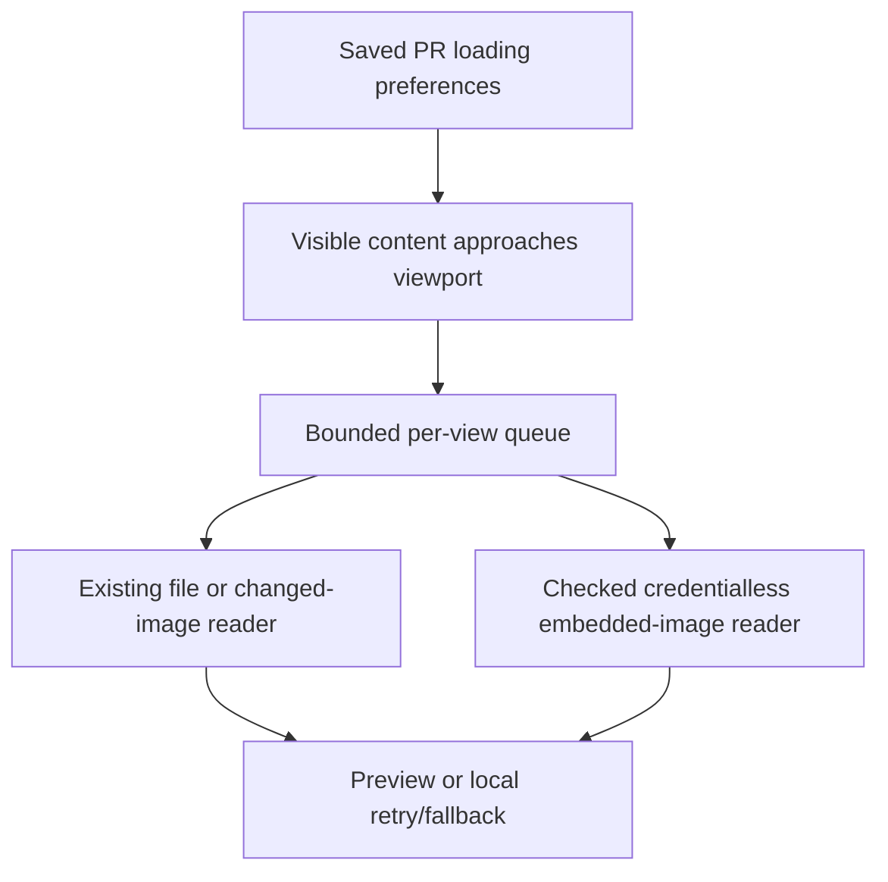

# Automatic Pull-Request Content Loading

## Why

Reviewing a pull request currently requires repeated “Show image” and “Load diff” clicks, while screenshots embedded in its description and comments remain links. Readers who prefer a continuous review should be able to opt into automatic previews without removing resource limits or exposing provider credentials to image hosts.

## What Changes

- Add two independent, persisted preferences under Settings → Integrations → Pull requests: **Automatically show images** and **Automatically load large diffs**, both off by default and shared by the desktop and its served browser clients.
- The image preference covers both changed-image comparisons in Files and supported images embedded in published PR descriptions/comments, as the user explicitly requested. Load only as visible content approaches its scroll viewport, not every image or withheld file on opening a PR.
- Automatically load withheld diffs through the existing per-file loader. Preserve the distinction between loadable withheld content and files that exceed hard preview limits.
- Add a separate credentialless, bounded service read for embedded public HTTPS Markdown images. Authorise sources against the cached PR content, prevent private-network access and unchecked redirects, validate bytes through the existing raster-image inspector, and render only in-memory object URLs. Support at most three manually validated HTTPS redirect hops for attachment/CDN URLs; authenticated provider reads remain no-redirect.
- Preserve the default no-fetch treatment of embedded images when the image preference is off. Raw HTML, SVG images, relative sources and assets requiring authentication remain outside embedded-image preview support and retain their existing inert/link treatment.
- Keep automatic work concurrency-limited, pause pending work in hidden tabs or collapsed content, retain explicit retries and loaded previews, and preserve reading position, editor identity, drafts and review progress.

## Capabilities

### New Capabilities

- `pr-content-loading`: Own the two preferences, their cross-surface lifecycle, near-viewport automatic loading, and the source-authorised, credentialless embedded-image read and its privacy/resource boundaries.

### Modified Capabilities

- `pull-request-viewer`: Make changed-file image and withheld-diff loading preference-aware; permit checked embedded image previews in otherwise-untrusted content; grant detached PR windows the required read-only commands without widening their mutation permissions or CSP.
- `diff-view`: Permit a host to choose automatic withheld-file loading and preference-dependent image loading while preserving default/manual behaviour, the shared renderer and all hard limits.
- `settings-view`: Place the two switches with the PR integrations, next to review skip patterns, with explicit network/privacy descriptions and the existing persistence/error rules.
- `github-pull-requests`: Distinguish credentialless embedded-content image fetches from authenticated GitHub operations; preserve API-only token delivery and every existing provider safety boundary.
- `bitbucket-pull-requests`: Make the same distinction for BitBucket while preserving its authenticated endpoint restrictions and shared provider limits.

## Impact

- **Pure primitives:** `crates/openspec-core/src/pr_content_image.rs` (new) and the existing `image.rs` inspector; direct edges to the existing lockfile's Markdown parser and URL parsing libraries as needed, with dependency/lockfile changes reviewed explicitly.
- **Shared service:** `crates/openspec-app/src/settings.rs`, `service.rs`, `events.rs`, `pull_request_cache.rs`, and a new `pull_request_content_images.rs` module for source authorisation and credentialless public-image transport. The existing authenticated `usage_http.rs` clients remain isolated from this new reader.
- **Transport and permissions:** `src/api.ts`/`src/types.ts`, `crates/specforge/src/commands.rs`, `crates/specforge/src/lib.rs`, `crates/specforge/build.rs`, its main/PR capability allowlists, and `crates/specforge-web/src/dispatch.rs`/`sse.rs`. New commands and notices are supported on both rich-client transports.
- **Frontend:** Settings primitives in `src/components/settings/IntegrationsGroup.tsx`; a preference hook and bounded loading controller; `PullRequestView.tsx`, `DiffView.tsx`, `MarkdownView.tsx`, `pullRequestMarkdown.tsx`, `ObjectImage.tsx` reuse and PR-only styles.
- **Verification:** Hermetic security/transport tests, settings and queue tests, component retention tests, browser viewport/scroll checks and native main/detached smoke.
- **Unchanged:** Commit-detail behaviour; numeric diff/image limits; provider read budgets and credential handling; review submission/confirmation; workspace Markdown; raw-HTML and Mermaid execution policy; navigation/layout persistence; terminal UI; marketing site. No local repository content, git state or provider content is written by automatic loading. This change creates no general-purpose URL proxy, asset download/export feature, image-upload flow or virtualised diff renderer.
