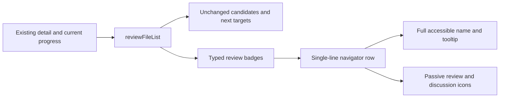

## Context

The generic diff navigator is already single-line. The PR workspace overrides it in `src/styles/base.css`: review rows allow wrapping and `.pr-file-badge` reserves a full-width second line. Nested rows can also push their change counts onto a third line.

`reviewFileList` in `src/pullRequestWorkspace.ts` currently returns `badges: Map<string, string>`, combining review words and discussion counts into display text. `DiffView` consumes that text without knowing the underlying state. Replacing words with honest, accessible icons therefore needs a small frontend metadata-contract change as well as CSS. This design records that boundary and its compatibility decisions; it does not introduce another renderer or a new service model.

The existing contracts remain authoritative: see the *File Navigator* requirement in the `diff-view` capability and the *Accessible and Responsive Review Workspace* requirement in the `pr-review-workspace` capability.

## Goals / Non-Goals

**Goals:**

- Keep each PR file entry on one line at the existing 240px sidebar width and in the narrow-view disclosure.
- Recover vertical space through layout, not smaller fonts or a wider sidebar.
- Preserve exact source counts, all review states, discussion presence, complete accessible descriptions and current-file context.
- Keep existing folder, keyboard, filtering, read, write and diff-lifecycle behavior.
- Verify real layout geometry, not only DOM structure.

**Non-Goals:**

- A flat file list, virtualized tree, resizable navigator, density setting or new navigation shortcuts.
- Review-state toggles inside the navigator or changed file/hunk completion semantics.
- Changes to diff headers, source lines, horizontal scrolling, drafts, Finish review or Files-tab progress.
- Rust, IPC, persisted records, provider requests, permissions, themes or dependency changes.

## Decisions

### D1. Carry typed review metadata instead of interpreting label text

Define a small frontend-only `NavigatorReviewBadge` type in the existing pure `src/diffFiles.ts` module. It carries `reviewState: FileReviewState | null`, `discussionCount: number` and the complete wording in `label`. Keep the existing `badges` map keyed by `fileKey`, changing its values from strings to this type.

`reviewFileList` supplies the type from the same progress snapshot and `splitThreads` result it already uses. The caller's current-head/base guard remains in place. A missing per-file state is `null`, including when progress has not loaded or belongs to different commits. Rename aliases keep following the existing thread-to-file join. No additional read is needed.

`DiffView` selects a review icon from the structured state and renders discussion presence from the numeric count. It never parses the English label. The record belongs to frontend presentation code, not the hand-mirrored IPC definitions in `src/types.ts`.

**Rejected:** extracting states or counts from the existing badge string. That couples behavior to wording, makes unknown states fragile and loses type checking. Passing only an icon would also discard the full review description.

### D2. Preserve full nesting with tree-only overflow

Identify file rows separately from directory rows in `NavigatorRows`, and apply the compact layout only below `data-review-navigation`. Use a single-line grid with slots for change-status letter, flexible filename, exact added/removed counts, optional discussion icon and review icon. The filename is the shrinkable cell with ellipsis and a six-character minimum reading budget; counts and icons remain inline. Preserve the existing omission of unavailable counts rather than inventing zeroes.

Keep the navigator's 240px width, type tokens, current-row accent rule and focus treatment. Aim for roughly 24–26px desktop rows at the default text size, with line height allowed to grow for text scaling rather than imposing a clipping fixed height. Restore the shared navigator's full 12px indentation per level, without a cap, so visible nesting agrees with `aria-level` and keyboard ancestry at every depth.

Make the PR navigator a height-bounded column: its controls remain outside the scrollable tree. The tree owns both horizontal and vertical overflow. Give its content one intrinsic-minimum grid column; file and directory rows contribute their full indentation and a short minimum filename budget, not their untruncated maximum-content names. This lets ordinary trees fit the sidebar, but gives deeper trees the width they need without reducing filenames to zero or widening the code pane. Long names still ellipsize.

Keep these wrappers and styles PR-only so non-PR rows and scroll behavior remain unchanged. Keyboard focus reveals the target row's filename inside the tree viewport, not just its oversized row box.

Use inherited theme tokens and existing row padding conventions. Do not override generic `.diff-nav-row`, `.diff-counts` or theme-wide font sizing.

**Rejected:** disabling wrapping while retaining the long text badge. At 240px that would consume the filename or overflow. Widening the sidebar reduces code space and shrinking fonts harms legibility. A three-level indentation cap was initially tried, then rejected after native review: deeper parents and children aligned at the same position and the directory hierarchy was no longer visible. The user approved full indentation with tree-only scrolling instead.

### D3. Use passive, shape-distinct SVG state indicators

Use dependency-free, `currentColor` inline SVGs from `src/components/icons.tsx`, following the existing icon set. The state vocabulary is:

| Review state | Visual shape | Complete wording |
| --- | --- | --- |
| `unviewed` | Open circle | Unreviewed |
| `viewed` | Check | Viewed |
| `partlyViewed` | Circle with an interior partial-progress stroke | Partly viewed |
| `changedSinceViewed` | Circular arrow | Changed since review |
| `skipped` | Horizontal dash | Skipped |
| `null` | Question mark | Review progress unknown |

These are outlined glyphs, not color-only dots or filled badges. A small outline comment icon appears only for a positive discussion count; the exact count remains in the description instead of taking another numeric column.

The row's tooltip and accessible name include the complete safely displayed path, change status, available added/removed counts, review wording and exact discussion count when present. Keep hidden-character escaping when composing these descriptions. SVGs are decorative to assistive technology so the same state is not announced twice. A tooltip supplements the accessible name; a native `title` alone is not an accessible-name strategy.

Icons add no focus target, checkbox, click handler or review write. Clicking anywhere in the row still navigates to the file.

**Rejected:** color-only state dots, emoji and a row of tiny review buttons. They respectively lose state meaning, vary across platforms and change the interaction contract.

### D4. Compress the normal controls without hiding exceptional context

Use one search field with its existing placeholder and a programmatic Find file label. Visually hide the repeated Find file and Show files labels, not their accessible names. Below search, place the flexible filter selector, compact exact matching-file count and a short `Next →` button on the same row. The button's accessible name remains Next unreviewed and its disabled explanation remains available.

Change `DiffNavigation.controls` from an opaque fragment to named `search`, `filter` and optional `clear` React-node slots. `PullRequestView` still owns their values and handlers; `Navigator` owns the search/toolbar/notices layout. This keeps DOM, visual and keyboard order aligned without inspecting children or using CSS ordering tricks. Update the caller, renderer and test fixtures together.

When space is tight, shorten the visible matching label to its number while retaining the complete matching-files wording for assistive technology. Keep all full option labels in the native select. Do not narrow controls by reducing their font size.

Keep Clear filters available when filtering is active. Unavailable-progress, empty-results and out-of-filter-current-file messages remain separate readable notices rather than being truncated into the toolbar. Normal controls fit in two rows; exceptional notices and existing coarse-pointer minimum targets may legitimately make this area taller.

**Rejected:** icon-only search/filter controls or removing warnings and clear actions to meet a rigid overall height. Those would conceal useful actions or make unavailable progress look like an empty review. Reordering an opaque controls fragment with CSS would also risk a visual order different from the keyboard order.

### D5. Preserve the existing renderer and state owners

Only the presentation metadata and row/control markup change. Preserve `navigatorTree`, directory keys, file keys, full visible and semantic depth, roving focus, `aria-current`, scroll activation, filter pruning and next-target traversal. Do not key/remount the navigator, file sections or editor owners on review state.

Non-PR callers still omit `navigation` and retain their existing rows, controls and responsive behavior. PR views continue to use the existing narrow disclosure and layout fallback. Hover/focus details must not resize a file row or displace adjacent rows.

**Rejected:** a PR-specific tree component or rebuilding the diff subtree on each progress update. Both duplicate established behavior and risk losing loads, drafts or reading position.

## Risks / Trade-offs

- **Icons are less explicit than repeated words** → Use distinguishable shapes, full tooltip/accessibility wording and a distinct unknown marker; keep the visible status-filter labels.
- **Deep nesting and large counts compete with filenames** → Preserve full depth, reserve a short filename reading budget and scroll only the tree when necessary. Keep controls fixed and test actual parent/child indentation beyond three levels, not only semantic depth.
- **Compact controls become too small for coarse pointers or text scaling** → Preserve existing target minima, allow the controls area to grow and test scaling without allowing file metadata to wrap.
- **Shared CSS or metadata changes affect commit detail** → Scope compact rules to PR navigation, keep optional navigation absent for non-PR hosts and include a non-PR regression case.
- **A markup test passes while the browser still wraps** → Add `scripts/check-pr-file-navigator.js` for real-browser row alignment, uniform height and overflow assertions, using synthetic review data.
- **Visual verification accidentally changes real review data** → Use mocked/local fixtures with no provider submissions or mark writes. Record native visual verification honestly; do not mark a blocked native check complete based only on a Chromium fixture.

There is no persisted-data migration. Reverting the frontend presentation and its typed metadata together restores the previous layout without altering review progress or drafts.
