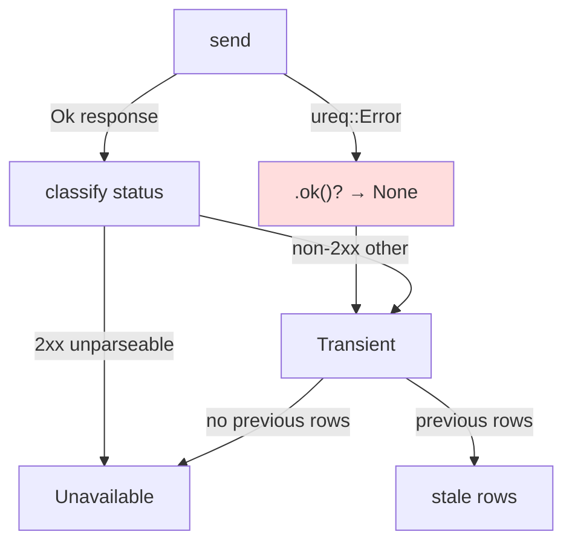
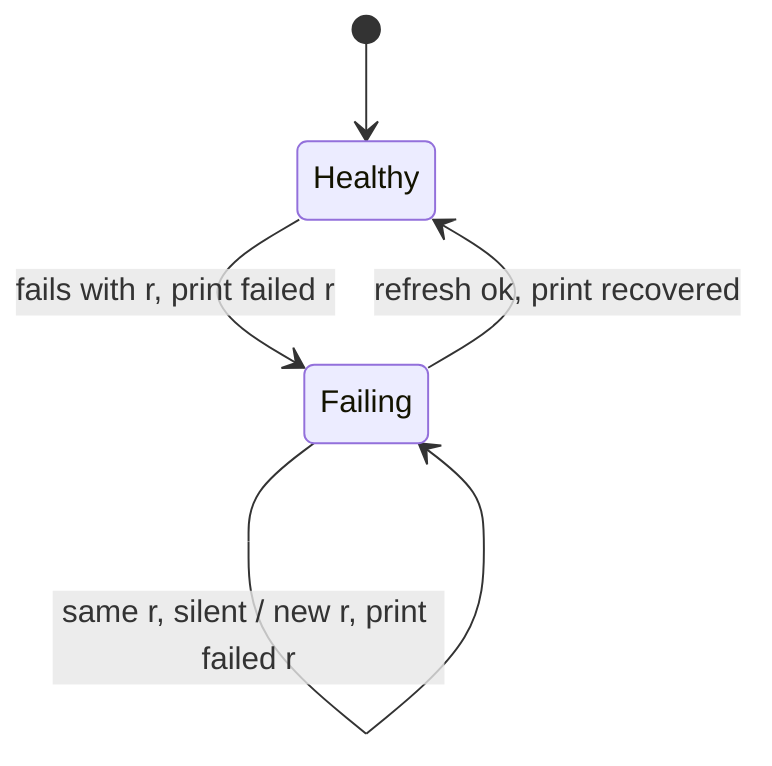

## Context

The rustls-backed `ureq` agents are configured in two places:

- `usage_http::agent` (`usage_http.rs`), the authenticated, no-redirect, no-proxy transport behind BitBucket, GitHub and the quota pollers. It takes `ureq`'s default `RootCerts::WebPki`.
- `pull_request_content_images::pinned_agent`, the credentialless embedded-image transport. Its `TlsConfig` has verification on and the default roots.

The BitBucket poller's `send()` turns any `ureq::Error` into `None` (`.call().ok()?`). The chain maps that to `FetchResult::Transient`, and `degrade_to_stale` reports it as `Unavailable` when there are no earlier rows. `bitbucket_detail` does the same at two sites. Nothing is logged, on purpose, so the token can never leak.

The report that prompted this change comes from `specforge-serve` running inside WSL on a managed Windows machine with TLS inspection and no proxy. The panel shows "BitBucket is unavailable right now." and gives no other signal.



## Goals / Non-Goals

**Goals:**
- Connect successfully wherever the machine's own trust store, or `SSL_CERT_FILE` / `SSL_CERT_DIR`, trusts the presented chain.
- Make every BitBucket "unavailable" or "stale" explain itself, both in the panel and on stderr, without weakening the *Privacy and Safety* requirement.
- Ship as a single build that both fixes the likely cause and confirms it.

**Non-Goals:**
- Proxy support of any kind (the affected machine has none; `proxy(None)` stays).
- A switch that disables or relaxes certificate verification.
- Failure reasons for the GitHub panel or the quota pollers (they do benefit from the trust change).
- A log file, a log framework, log levels or a "test connection" UI.
- Any output from the terminal frontend, which owns its screen and runs no poller.

## Decisions

### 1. Trust the union of Mozilla roots and OS roots, through `RootCerts::Specific`

`trust_roots::root_certs()` returns a `RootCerts::Specific(Arc<Vec<Certificate<'static>>>)`, built once behind a `LazyLock`. It contains the Mozilla set from `webpki-root-certs` (the same roots as `webpki-roots`, shipped as full DER certificates, because `RootCerts::Specific` takes certificates, not bare trust anchors, and hand-building certificates from anchors was rejected as unnecessary security-sensitive code) plus every certificate `rustls_native_certs::load_native_certs()` returns. That function honours `SSL_CERT_FILE` / `SSL_CERT_DIR`, reads the openssl-probe locations on Linux, the keychain trust settings on macOS and the system store on Windows. Certificates that fail to parse are skipped. If loading fails outright, the set is Mozilla only. Both agent builders pass the same value.

$$\text{trusted} = \text{Mozilla} \cup \text{OS} \qquad \text{OS} = \emptyset \implies \text{trusted} = \text{Mozilla (today's behaviour)}$$

- *Rejected: `ureq`'s `platform-verifier` feature (`RootCerts::PlatformVerifier`).* It **replaces** the Mozilla set instead of adding to it. A minimal Linux image with no `ca-certificates` package, which is a common musl deployment, would then trust nothing and stop working everywhere. On Linux it reads the same files that `rustls-native-certs` reads, so it gains nothing here.
- *Rejected: an app setting for an extra CA file path.* `SSL_CERT_FILE` is the established convention that WSL users and IT departments already set for `curl`, `git` and Python. A second, SpecForge-only mechanism would be one more thing to explain.
- *Rejected: switching to `native-tls`.* It links OpenSSL on Linux, which breaks the static-musl `specforge-serve` requirement in the `release-pipeline` capability.

`ureq` 3.4.0 never caches its rustls `ClientConfig` (see `usage_http.rs`'s module docs), so each new connection rebuilds a `RootCertStore` from the vector. The vector itself is built only once: we don't rescan `/etc/ssl/certs` on every connect. With idle-connection reuse in place, the per-connect rebuild is the cost we already pay with webpki today, just a few hundred entries larger.

### 2. A closed failure-reason enum, not error text, crosses IPC

```rust
#[serde(tag = "kind", rename_all = "camelCase")]
pub enum UnavailableReason {
    CertificateUntrusted,      // rustls InvalidCertificate(UnknownIssuer | BadSignature | NotValidForName | Expired | …)
    Tls,                       // any other rustls / ureq Tls failure
    Dns,                       // ureq HostNotFound, io NotFound from resolution
    Connect,                   // ConnectionFailed, refused / reset / unreachable io kinds
    Timeout,                   // ureq Timeout, io TimedOut
    HttpStatus { status: u16 },// non-success not mapped to unauthenticated / rate limited
    UnexpectedResponse,        // 2xx body that does not parse
    RateLimited,               // 429, or the shared deadline holding the poller
}
```

`BitbucketPullRequestsState.reason: Option<UnavailableReason>` is `Some` exactly when the status is `Unavailable` or the snapshot is stale. A change of reason makes the snapshot different, so it is announced under the existing *A refresh that changes nothing is silent* rule.

- *Rejected: sending the error's `Display` string to the frontend.* It is free text from `rustls` and the OS, it gets mixed up with the server's reply, and it would make the wire shape depend on library wording. The panel needs a sentence it can own; the raw text belongs on stderr.
- *Rejected: a reason on the GitHub snapshot in the same change.* The panel and type are shared, but `reason` is optional, so the GitHub side can adopt it later without a breaking change.

`classify(&ureq::Error) -> UnavailableReason` checks `Error::Rustls(e)` **and** `Error::Io(e)` whose inner error downcasts to `rustls::Error`. The handshake runs inside the stream, so a certificate rejection can surface either way. A real-TLS test pins down which way it surfaces in 3.4.0 (task 2.2). `rustls` becomes a direct dependency at the version already locked, purely for that downcast.

### 3. stderr, one line per change of reason



Format: `specforge: bitbucket: GET /2.0/workspaces/{workspace}/pullrequests/{user} failed: certificate not trusted (invalid peer certificate: UnknownIssuer)`. Detail reads print one line per failed read in the same form, because each read happens because the user asked for it. The startup line, `specforge: tls: trusting 146 bundled + 151 system root certificates`, is printed once, when the root set is first built. A zero there is the clue for a machine whose CA lives only in the Windows store.

Redaction rules (spec'd): no token, no header, no body, no query string, no concrete workspace, repository, user or pull-request identifier. Every path is printed as its template. The error text is `rustls::Error` / `io::Error` `Display`, which carries no request data.

- *Rejected: the `log` facade with an `env_logger`-style subscriber.* The workspace has no logging framework. Every existing diagnostic is an `eprintln!` in `openspec-app`, and adding a framework for one module would be a bigger, separate decision.
- *Rejected: stdout.* `specforge-serve` uses stdout for its startup banner (the URL to open). Diagnostics go to stderr like every other `eprintln!` in the crate, and they still show up in the WSL terminal.
- *Rejected: logging on every poll.* At the 120-second default that is 720 identical lines a day.

## Risks / Trade-offs

- **[Risk] A locally installed root can now intercept SpecForge's traffic, including the BitBucket token.** → That is the same trust decision the browser, `curl` and `git` on the machine already make. The machine's owner controls the trust store. The token is still never sent anywhere other than `api.bitbucket.org` and never through a proxy. We accept this as the cost of working on managed machines, and we state it here so it isn't mistaken for an oversight.
- **[Risk] The corporate CA exists only in the Windows store, not inside WSL.** → The startup line shows `0 system` (or a low count) and the panel says "certificate not trusted". Together they point the user to `update-ca-certificates` or `SSL_CERT_FILE`, which we document in the panel's tooltip text.
- **[Risk] A huge or corrupt `SSL_CERT_DIR` slows startup or fails to load.** → Loading is lazy (on first HTTPS use, off the UI thread, in the poller), bad entries are skipped, and an outright failure falls back to Mozilla only and is reported on the startup line.
- **[Risk] Certificate rejections surface through `Io`, not `Rustls`, and get classified as `Connect`.** → Task 2.2's test runs a real TLS server with an untrusted self-signed certificate and asserts `CertificateUntrusted`.
- **[Trade-off] `rustls-native-certs` is a new download.** → It is small and pure Rust on Linux (so the musl static build is unaffected). On macOS and Windows it links only system frameworks.
