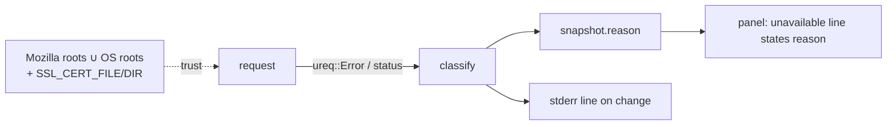

# Trust System Root Certificates and Diagnose BitBucket Failures

## Why

On a locked-down finance machine running `specforge-serve` under WSL, the BitBucket pull-request panel only ever says "BitBucket is unavailable right now." There is no way to learn why. `send()` drops the `ureq` error with `.call().ok()?`, and five different causes all collapse into the same unavailable state. The most likely cause is TLS inspection. The network re-signs `api.bitbucket.org` with a corporate root CA that the machine trusts (in WSL's `/etc/ssl/certs`, or through `SSL_CERT_FILE`). SpecForge's rustls client trusts only the bundled Mozilla roots (`webpki-roots`), so the handshake fails, while `curl` and `git` in the same shell succeed.

## What Changes

- **Trust the machine's root certificates.** Every outbound HTTPS client — the authenticated provider transport in `usage_http` (BitBucket, GitHub, the quota pollers) and the credentialless embedded-image transport — verifies against the union of the bundled Mozilla roots and the operating system's roots, honouring `SSL_CERT_FILE` / `SSL_CERT_DIR`. Verification is never disabled. The union is loaded once per process.
- **Say why BitBucket is unavailable.** A failed refresh is classified into a closed set of reasons (certificate not trusted, other TLS failure, DNS, connection, timeout, HTTP status, unexpected response, rate limited). The snapshot carries that reason when it is unavailable or stale, and the panel's unavailable line states it ("BitBucket is unavailable: this machine does not trust the server's certificate.").
- **Log it to stderr.** `specforge-serve` and the desktop app print one line when the poller's failure reason changes, one when it recovers, and one per failed detail read. Each line names the request by path template, never by workspace or repository slug, and gives the classified reason plus the TLS or I/O error text. At startup they also print one line with how many system roots were loaded. The token, headers and bodies never appear.

## Capabilities

### New Capabilities

- `outbound-https-trust`: which root certificates SpecForge's HTTPS clients trust (bundled Mozilla roots plus the OS store and `SSL_CERT_FILE`/`SSL_CERT_DIR`), when they are loaded, and the startup line reporting how many system roots were found.

### Modified Capabilities

- `bitbucket-pull-requests`: adds two requirements. An unavailable or stale snapshot carries a closed-set failure reason that the panel's unavailable line states. Poller and detail-read failures are reported on stderr under fixed redaction rules. The existing requirements (polling, panel, privacy, connection reuse) are not changed.

## Impact

- **Rust:** a new `crates/openspec-app/src/trust_roots.rs` (process-wide root set); `usage_http.rs` and `pull_request_content_images.rs` take their `TlsConfig` root certs from it; `bitbucket.rs` (`send`, `FetchResult`, `next_state`, `degrade_to_stale`, the poll loop's logging) and `bitbucket_detail.rs` (its two `.call().ok()?` sites) classify their errors; `BitbucketPullRequestsState` gains `reason`.
- **IPC:** `BitbucketPullRequestsState.reason` (optional, closed enum, camelCase) is mirrored in `src/types.ts`; `src/components/PullRequestPanel.tsx` renders it. The GitHub snapshot is unchanged and its panel line stays as it is.
- **Dependencies:** `rustls-native-certs` (new download, pure Rust on Linux, so the musl static `specforge-serve` build in the `release-pipeline` capability still holds), `webpki-root-certs` (new download, the same Mozilla set as `webpki-roots` but shipped as real DER certificates, which is the form ureq's `RootCerts::Specific` takes), and a direct edge to `rustls`, already locked through `ureq`, for downcasting TLS errors.
- **Deliberately unchanged:** no proxy support. `proxy(None)` and the *An exported proxy is ignored* scenarios stay as they are, because the affected machine has no proxy. Certificate verification is never disabled, and there is no "trust anyway" switch. The terminal frontend still runs no poller and prints nothing. The GitHub panel gets the new trust roots but no failure reason; that is a possible follow-up. There is no log file and no "test connection" button.
