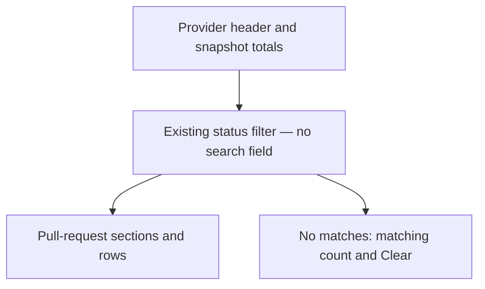

# Remove Search From Pull-Request Widgets

## Why

The search bar takes up space in the compact pull-request widgets that could show more pull requests. Removing it simplifies the widgets while keeping their existing status filters for triage.

## What Changes

- Remove the free-text search field from both GitHub and BitBucket pull-request widgets in the desktop application and browser skin.
- Remove the widgets' search-query state and title, repository, PR-number and branch-name text matching, rather than hiding the input while retaining an invisible filter.
- Keep the existing filter selector: All pull requests, Failing checks, Conflicts and Drafts, plus Review requested for GitHub only. Matching/total counts and Clear remain available when a non-default filter is selected; Clear restores All pull requests.
- Preserve provider sections, snapshot header totals, PR numbers, active-PR highlighting, stable row order, collapse controls, panel positioning and open/worktree gestures. Filtering remains local and adds no provider reads.
- Keep filtered no-match results distinct from an empty provider snapshot or authentication failure. Remove search-only styling without leaving a blank controls row.

## Capabilities

### New Capabilities

_None._

### Modified Capabilities

- `pr-review-workspace`: Update the *Provider-Panel Triage* requirement to remove free-text search from provider panels while retaining status filtering, matching counts, clear-filter behavior and existing row interactions.

## Impact

- `src/components/PullRequestPanel.tsx`: remove the search control and query state, and make filtering and Clear depend only on the selected status filter.
- `src/pullRequestWorkspace.ts`: remove the panel matcher’s free-text search input and matching logic without changing the Files navigator's search or review filtering.
- `src/components/PullRequestPanel.test.ts` and `src/pullRequestWorkspace.test.ts`: replace widget-search expectations with coverage for the absent search field and retained filtering, counts, reset and row behavior.
- `src/styles/base.css`: remove search-only panel styling while preserving shared control styles and accessible target sizes.
- The behavior delta belongs to `pr-review-workspace`; the provider discovery and panel-placement contracts remain unchanged.
- Frontend only — no Rust, IPC, provider-query, credential, settings, persistence, dependency or terminal-UI changes. The PR Files navigator's path search, discussion filters, archive search and workspace-file filtering are deliberately unchanged.
