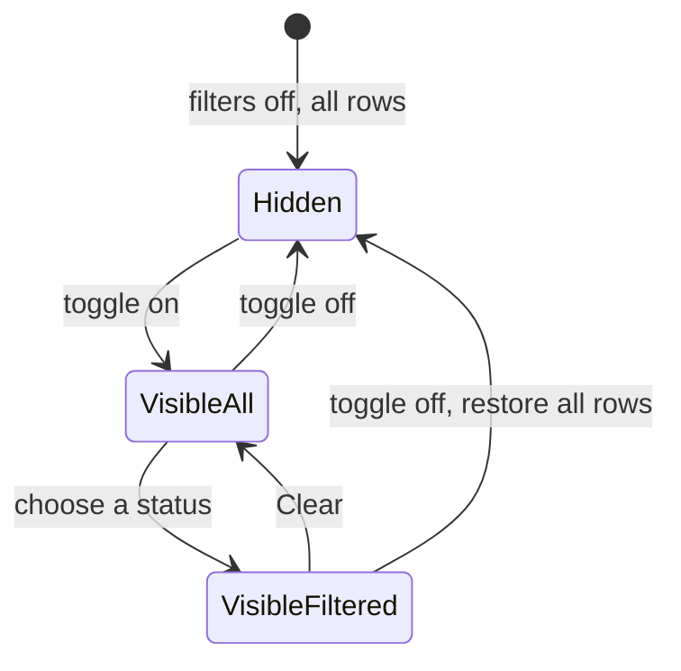

# Toggle Pull-Request Panel Filters

## Why

The always-visible status dropdown uses space in the compact pull-request panels even when every pull request is being shown. Keep the lists uncluttered by default while retaining filtering when the reader wants it.

## What Changes

- Hide the GitHub and BitBucket panels' filter controls by default, without hiding either panel or changing its integration setting.
- Add a labelled, keyboard-accessible funnel-icon toggle beside each panel heading, separate from its collapse button.
- Reveal the existing status selector with All selected. Keep Failing checks, Conflicts, Drafts and GitHub-only Review requested, matching counts, Clear and the no-match message.
- Turning the toggle off restores All and removes the complete controls row, so no invisible filter remains active.
- Keep each toggle local to its mounted panel: the providers and viewer surfaces are independent, and remounting starts with filters off.
- Preserve snapshot totals, provider sections, stable row order, active-PR highlighting and PR/worktree navigation. Filtering adds no provider reads.
- Split the existing long provider-panel triage contract into focused requirements while preserving all scenarios and behavior, so strict OpenSpec validation passes without a length-warning exception.

## Capabilities

### New Capabilities

_None._

### Modified Capabilities

- `pr-review-workspace`: Keep *Provider-Panel Triage* as the panel-preservation contract and retain every scenario. Extract focused requirements for status filters, optional filter controls, toggle accessibility, filter feedback and stable row order, including hidden-by-default controls and reset-on-hide behavior.

## Impact

- `src/components/PullRequestPanel.tsx`: local filter/disclosure state, independent header controls and conditional filter-row rendering.
- `src/components/icons.tsx`: a dependency-free funnel icon.
- `src/styles/base.css`: compact header layout, toggle focus/expanded treatment and a 44×44 coarse-pointer target.
- `src/components/PullRequestPanel.test.ts`: default-hidden rendering, both providers' filtering/reset behavior, independence and remount coverage.
- `openspec/changes/toggle-pr-panel-filters/specs/pr-review-workspace/spec.md`: a complete modified triage requirement plus focused added requirements, each with a concise normative description and testable scenarios; main specs remain unchanged until normal sync/archive.
- Frontend only, shared by the desktop application and browser skin: no Rust, IPC, provider-query, credential, application-setting, persistence, dependency or terminal-UI changes. The Files navigator's search and review filters are unchanged.
