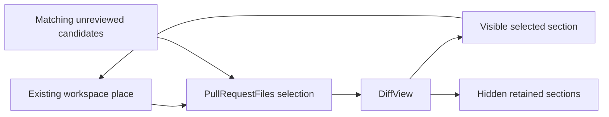

## Context

See `proposal.md` for motivation. `PullRequestFiles` supplies review metadata to the shared `DiffView`, whose navigator currently scrolls between all sections. `usePullRequestWorkspace` saves a path and offset from visible sections. Diff loads and folds are keyed to the complete model array.

## Goals / Non-Goals

Keep one explicit selected path per mounted PR Files view without changing the model, review storage, command boundary or commit-detail behavior.

## Decisions

### Controlled selection through the shared renderer

`PullRequestFiles` owns selection and computes both targets from existing matching unreviewed candidates. An optional `DiffView` selection prop supplies the path, selection callback and directional toolbar controls. The navigator uses the selected path rather than inferring it from scrolling. Explicit reveal selects before expanding and positioning its target.

Rejected: pass a one-element `files` array. That drops cached loads, folds and image reads on every selection and removes other files from the navigator.

### Hide sections without unmounting editors

Use native `hidden` on non-selected sections. Keep per-file slot identity and the complete model intact. Automatic eligibility checks and workspace capture ignore hidden sections. Preserve existing completion collapse rather than automatically advancing after a mark.

Rejected: unmount every non-selected section. Unsaved component-local editor text would be lost; reconstituting it requires a separate editor-state redesign.

### Reuse existing resumption and traversal

Expose the saved path from `usePullRequestWorkspace` for initial selection and teach capture to ignore hidden sections. Extend `nextCandidate` with direction, retaining its one-wrap behavior and current-file exclusion.

Rejected: persist an independent selected-file record. It could disagree with the existing saved reading location and add a migration.

## Risks / Trade-offs

- Hidden sections retain DOM and editor memory → preserve existing eager rendering cost; no additional model or duplicate renderer.
- Hidden DOM can corrupt scroll capture or automatic reads → explicitly exclude hidden sections and test late-load and resumption behavior.
- Progress changes can remove a navigation candidate → selection remains independent; only explicit navigation moves it.
- Narrow views hide the tree → keep directional controls in the always-visible diff toolbar with existing themed controls and target sizes.
