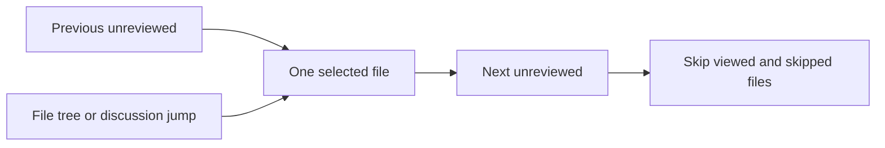

# Single-File Review Navigation

## Why

Scrolling through every changed file makes it difficult to work systematically through a review. Show one file at a time and let the reviewer move in either direction past files already viewed.

## What Changes

- Show only the selected file in PR Files, retaining the tree for direct access.
- Add Previous and Next controls that follow matching unreviewed files in either direction, skipping viewed and pattern-skipped files and wrapping once.
- Keep the current file selected when its review state changes, and preserve loaded content, folds and editors while other files are hidden.
- Restore the selected file on reopening; discussion and draft jumps select their target before revealing it.

## Capabilities

### New Capabilities

_None._

### Modified Capabilities

- `pr-review-workspace`: Single-file presentation with bidirectional unreviewed navigation, explicit selection and existing resumption.
- `diff-view`: Optional host-selected file visibility without changing non-PR hosts or discarding per-file view state.

## Impact

Frontend only: `src/components/PullRequestView.tsx`, `src/components/DiffView.tsx`, `src/pullRequestWorkspace.ts`, `src/hooks/usePullRequestWorkspace.ts`, their tests, `src/styles/base.css` and `src/CLAUDE.md`. No Rust, IPC, provider-write, dependency, setting or commit-detail behavior changes. Existing local review storage and read budgets remain unchanged.
