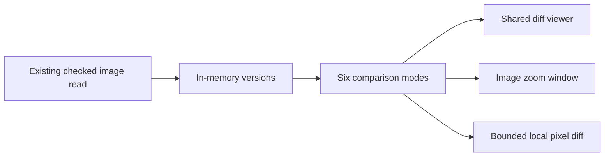

# Playwright-Style Image Review

## Why

Changed screenshots and assets are difficult to review using only separate versions or a black-background blend. Playwright's report viewer provides complementary ways to spot changes: highlighted pixels, individual versions, side-by-side comparison, a draggable wipe and blinking.

## What Changes

- Replace the image-only Both/Difference choice with six explicit modes: **Diff**, **Before**, **After**, **Side by side** (the default), **Slider** and **Blink**.
- Offer the same modes in PR reviews and image zoom windows through shared components. Commit detail benefits from the existing shared renderer; no PR-specific renderer is introduced.
- Align differently sized versions at their top-left corners at one scale, without stretching either version.
- Compute highlighted diffs locally on demand with pixelmatch, a separate pixel-work ceiling and a cancellable worker. Report changed pixels and dimensions; preserve other modes when highlighting cannot be computed.
- Make the slider keyboard/touch operable and blinking explicitly pausable, visibility-aware and reduced-motion aware.
- Keep provider reads, loading preferences, refusal rules, review marks and drafts unchanged.

## Capabilities

### New Capabilities

_None._

### Modified Capabilities

- `diff-view`: Extend image comparison and zooming with Playwright-style modes, independent of text diff layout, and bounded local pixel highlighting.

## Impact

Frontend changes in `src/diffImage.ts`, new image-diff worker/pixel helpers and shared comparison components, `src/components/DiffView.tsx`, `src/components/ImageWindowRoot.tsx`, `src/components/ImageZoom.tsx`, their tests and `src/styles/base.css`. Add the small browser-compatible `pixelmatch` dependency and update `bun.lock`.

No Rust, IPC, permissions, provider/network policy, persistent settings, review submission, local git state, site or CI changes. The original CSS difference blend is replaced by highlighted Diff, not retained as a seventh mode.

Reference: [Playwright's imageDiffView.tsx](https://github.com/microsoft/playwright/blob/main/packages/web/src/shared/imageDiffView.tsx). Playwright consumes a precomputed diff attachment; SpecForge must derive its preview from the two checked file versions without another provider request.
