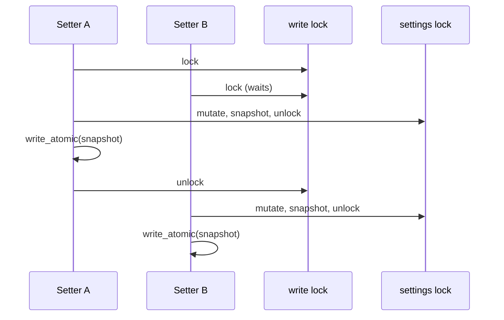
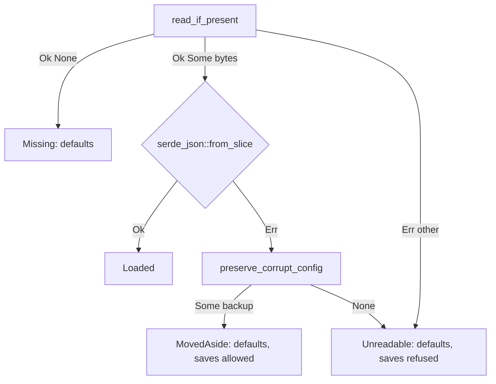

## Context

SpecForge keeps four JSON stores in its shared config directory (`config_dir()`, every instance resolves the same one):

| File | Owner | Write today | Damaged file today |
|---|---|---|---|
| `workspaces.json` | `openspec-core` `WorkspaceRegistry::save` (`registry.rs`) | temp + fsync + rename | `bootstrap` moves it aside (`preserve_corrupt_config`) |
| `review-progress.json` | `openspec-app` `review_progress.rs` `write` | temp + fsync + rename (a copy of the registry's) | `read_for_write` moves it aside |
| `settings.json` | `openspec-app` `SettingsStore::save` (`settings.rs`) | `fs::write` (truncate in place) | silently replaced by defaults |
| `presentation.json` | `openspec-core` `WorkspacePresentationStore::save` (`presentation.rs`) | `fs::write` (truncate in place) | load error discarded by `bootstrap` |

Three verified defects meet in `settings.json`:

1. `SettingsStore::save` writes in place, so a crash mid-write leaves a truncated file.
2. `SettingsStore::load` runs `fs::read_to_string(..).ok().and_then(|s| serde_json::from_str(&s).ok()).unwrap_or_default()`. Every failure becomes defaults, with no log and no backup. Missing files, permission errors, truncated JSON and whole-document type mismatches are all treated the same way. In `AppService::bootstrap`, defaults mean empty identity aliases. If any registered workspace has a git identity, the first-run seed then calls `set_identity`, which saves the defaults over the damaged file during launch.
3. 25 of the 26 mutating methods (the `set_*` setters) lock the settings, mutate, clone, release the lock and then save. The exception is `update_favorite_change_ids`, which saves under the lock. The embedded web server shares the desktop's `Arc<SettingsStore>` (`specforge/src/lib.rs`, `web_svc = svc.clone()`), and `specforge-web`'s async `dispatch` calls the setters from tokio workers. So a desktop window and a browser tab can save at the same time. Two concurrent `fs::write` calls can also interleave into invalid JSON, which defect 2 then turns into a silent reset.

`presentation.json` has defect 1. It also has a variant of defect 2: `load` correctly returns `InvalidData`, but `bootstrap` throws it away with `.unwrap_or_else(|_| WorkspacePresentationStore::new(..))`, and the next name, colour or disable edit overwrites the file. No sibling change covers `presentation.json`. It is in scope here because its fix is the same helper.

Constraints from the live specs:

- settings-view *Settings Persist by One Rule*: a failed write is reported on the control, so saves must keep returning `io::Result`.
- workspace-registry *Lossless Registry Migration and Data Preservation*: the registry's save semantics are already fixed, and the refactor must keep them exactly.
- Backward-compatible loading: older files, unknown panel positions and unknown reading widths must still load. This is the per-field tolerance that spec-browser, document-width, commit-graph, dashboard, pull-request-viewer, github-pull-requests, bitbucket-pull-requests and terminal-ui each rely on.

## Goals / Non-Goals

**Goals:**

- One atomic-write recipe and one corrupt-file preservation function, both in `openspec-core` and used by all four stores.
- `settings.json` and `presentation.json` are never truncated by a crash or torn by a concurrent writer inside one process.
- A damaged settings or presentation file is never overwritten by defaults. If it parsed badly it is preserved, and if it could not be read it is left alone.
- Saves within one instance reach disk in the order their changes were made, and readers never wait for the I/O.

**Non-Goals:**

- Merging concurrent saves from separate processes. The desktop app, `specforge-serve` and worktree dev instances each hold an in-memory copy and the last whole-file writer wins. A merge would need file locking or re-reading before every write, which is a separate design.
- Widening per-field tolerance. A field without a tolerant deserializer that holds a wrong type still fails the whole parse. The only difference is that the file is now preserved instead of silently lost.
- The activity log's `persist()` (`openspec-core/src/activity_log.rs`). It is also non-atomic, but it belongs to `cache-dashboard-history`.
- The registry's handling of read errors other than parse errors. `bootstrap` moves `workspaces.json` aside on any load error, and that stays as it is.
- Out of scope, so nobody looks for it again: per-field schema migration, and settings encryption or keychain storage for credentials.

## Decisions

### D1. A shared `openspec_core::config_file` module

Add `crates/openspec-core/src/config_file.rs`, declared `pub mod config_file` in `lib.rs`:

- `pub fn write_atomic(path: &Path, bytes: &[u8]) -> io::Result<()>`. Staging directory: `path.parent()` if it is non-empty, otherwise `"."`. Steps: `create_dir_all` on the staging directory, then `tempfile::NamedTempFile::new_in(staging_dir)`, `write_all`, `as_file().sync_all()`, `persist(path)` with the `PersistError` mapped to its `io::Error`, and finally a best-effort `File::open(dir).sync_all()`. This is the recipe in `registry.rs` and `review_progress.rs` today, line for line. Dropping the `NamedTempFile` on any error path deletes the staged file, so a failed write leaves nothing behind.
- The staging-directory choice is a small private `fn staging_dir(path: &Path) -> &Path`, so its empty-parent branch can be tested directly. If it were inlined, a mutant that flipped the filter would still write somewhere that works.
- A private `fn write_atomic_with(path, bytes, before_persist: impl FnOnce() -> io::Result<()>)` lets tests inject a failure after staging and before the rename. `write_atomic` calls it with a no-op. This is the only deterministic way to show that a failed write keeps the previous file intact, without relying on file permissions (which root ignores).
- `pub fn preserve_corrupt_config(path: &Path) -> Option<PathBuf>` is moved from `openspec-app/src/service.rs` and now returns the backup path when the file was moved. Naming is unchanged: the first free `<name>.corrupt-<n>`, with a nanosecond-suffix fallback. Its two existing tests move with it.
- `pub fn read_if_present(path: &Path) -> io::Result<Option<Vec<u8>>>` returns `Ok(None)` for `NotFound`, `Ok(Some(bytes))` on success, and the error otherwise. Both damaged-file paths need this three-way split, and it uses bytes rather than a `String` so that invalid UTF-8 counts as a parse failure rather than a read failure.

Callers moved onto it: `WorkspaceRegistry::save`, `WorkspacePresentationStore::save`, `review_progress.rs` `write` and `read_for_write`, and `SettingsStore::save`.

*Alternative rejected: put the helper in `openspec-app`.* `openspec-core` cannot depend on `openspec-app`, so the registry and the presentation store could not use it, and the registry's copy would remain. `tempfile` is already a normal dependency of `openspec-core` for exactly this purpose (`Cargo.toml`: "Atomic config writes").

*Alternative rejected: a third copy inside `settings.rs`.* Two copies already exist, and the review-progress copy's doc comment says it mirrors the registry. A fourth store would make a fourth copy, and the copies would drift apart.

### D2. Ordered saves: a write lock taken before the data lock

`SettingsStore` gains `write: Mutex<()>`. Every mutating method goes through one private helper:

```rust
fn update<R>(&self, f: impl FnOnce(&mut AppSettings) -> R) -> io::Result<R>
```

The helper does the following:

1. It takes `write`.
2. It takes `settings`, keeps a copy of the previous value, applies `f`, clones the snapshot, and releases `settings`.
3. It serializes the snapshot and calls `save`, which uses `write_atomic`.
4. If the save fails, it re-takes `settings` and restores the previous value before returning the error. This mirrors `WorkspacePresentationStore::mutate_and_save`.
5. It releases `write`.

The 25 drop-then-save setters and `update_favorite_change_ids` all become calls to `update`. `set_review_skip_patterns` keeps validating before it calls `update`, so a refused list still takes no lock and writes nothing. `update_favorite_change_ids`' doc comment, which explains that it saves under the data lock, is rewritten to point at `update` instead. Read-only accessors such as `snapshot`, the `*_enabled` getters and `skip_rule` take only `settings`.



Why it stays correct: every mutation happens while `write` is held, and the snapshot is saved before `write` is released. Snapshots therefore reach disk in mutation order, and each one includes every earlier mutation. Lock order is always `write` before `settings`. Nothing takes `write` while holding `settings`, so the locks cannot deadlock.

The rollback in step 4 restores the whole previous `AppSettings`. That is safe because no other mutation can run while `write` is held. A reader may briefly see the attempted value before the rollback. That window already exists today without any rollback at all, and the spec's "the control shows the stored value" is about the state after the call returns.

*Alternative rejected: hold the `settings` mutex across the save,* which is what `update_favorite_change_ids` does today. It is correct, but `File::sync_all` on macOS issues `F_FULLFSYNC`, which can take tens of milliseconds. The readers that poll every tick (`github_enabled`, `bitbucket_enabled`, `claude_quota_enabled`, `skip_rule`) would stall behind it on the watcher and poller threads.

*Alternative rejected: a generation counter that drops stale snapshots.* It is also correct, but a setter whose snapshot was superseded would return `Ok` without writing anything itself. Showing that its value reached disk then depends on reasoning about the later writer. The write lock is fewer lines and easier to read.

*Alternative rejected: keep in-memory state on a failed save,* which is today's settings behaviour. The new unreadable-file mode (D3) makes every save fail. Without the rollback, a refused switch would still take effect for the session while its control reported the failure. The presentation store already rolls back for the same reason.

### D3. Load classifies before it decides

`SettingsStore::load(path)` stays infallible. Its callers are bootstrap and many tests, and none of them can do anything better than start. It records a public `SettingsLoad` outcome that `bootstrap` reads in order to log:



- `Missing`: defaults are used and nothing is written. This is the same as today.
- `Loaded`: the stored settings are used. Per-field tolerance is untouched, since `#[serde(default)]` and the hand-written `Deserialize` for `DocumentWidth` and `PanelPosition` still apply inside `from_slice`.
- `MovedAside(backup)`: the damaged file is moved to `settings.json.corrupt-<n>` before anything can save, then defaults are used. The bootstrap identity seed then writes a new file, and the backup is never touched.
- `Unreadable(reason)`: defaults are used and the store is *held*. `save` returns an `io::Error` that names the path and the original error, for example "settings.json could not be read at startup (…); SpecForge will not save over it", without touching the file system. Together with D2's rollback, every setter in the session fails, the failure is reported on the control, and memory stays at defaults. If `preserve_corrupt_config` cannot move the file, the outcome is also `Unreadable`, so that no save can overwrite an unparseable file that was left in place.

`bootstrap` adds an `eprintln!` for `MovedAside` and `Unreadable`, worded like the existing registry message. The terminal frontend calls `bootstrap` before it enables raw mode (`specforge-tui/src/main.rs`), so the line does not corrupt the UI.

The doc comments on `DocumentWidth` and `PanelPosition` in `settings.rs` say that a failed parse "silently resets" every preference. Update them to say that the file is moved aside and the app starts from defaults. The point those comments make, that tolerance prevents a whole-file reset, still holds.

*Alternative rejected: move the file aside on any read error,* as `bootstrap` does for `workspaces.json`. A transient `EIO`, or a permission problem the user fixes before the next launch, would still lose the settings for every later launch unless the user knew to rename the backup back. Leaving the file in place and refusing to save keeps the next launch able to read it.

*Alternative rejected: make `load` return `Result` and let `bootstrap` decide.* Every test and the `pull_request_read.rs` fixture would have to re-implement the classification, and a caller that wrote `unwrap_or_default` would bring the bug back. Keeping the decision inside the store means every caller gets the guarantee.

### D4. The presentation store mirrors the settings decisions

- `WorkspacePresentationStore::save` builds its `ConfigFile` exactly as it does now and calls `config_file::write_atomic`. `mutate_and_save`'s rollback is unchanged.
- `load` switches to `read_if_present` and keeps its current contract: a missing file gives an empty store, a parse failure gives `InvalidData`, and any other read error is returned as is. Non-UTF-8 content stays `InvalidData`: today it is `read_to_string`'s own error kind, and afterwards it is `from_slice`'s parse error. Either way `bootstrap` treats it as a parse failure.
- A new constructor, `WorkspacePresentationStore::refusing_saves(path, reason: String)`, returns an empty store whose `save` fails with that reason and never touches the file system.
- `bootstrap` replaces `.unwrap_or_else(|_| new(..))` with a match:
  - `InvalidData`: call `preserve_corrupt_config`. If it returns a backup path, log and use `new(path)`. Otherwise use `refusing_saves`.
  - Any other error: log and use `refusing_saves`.

*Alternative rejected: leave `presentation.json` to a later change.* It has the same truncation defect and the same discarded load error, and no sibling change lists it. With the shared helper in place the fix is one call plus one match.

## Risks / Trade-offs

- [Setters now queue behind each other's fsync.] → Writes are user-driven and rare, and window geometry is already debounced in `src/hooks/useDetachedWindow.ts`. Readers never take `write`, so the hot polling paths are unaffected. The desktop's synchronous setter commands can now wait for at most the one save already in flight (from a browser tab, say) before their own. `unblock-main-thread` deliberately keeps those setters synchronous, and one queued fsync is the same order of cost as the setter's own.
- [Two instances launching at once with the same damaged `settings.json`.] → If another instance moves the file aside between this instance's read and its own move, `preserve_corrupt_config` finds nothing to move and the outcome is `Unreadable`, so this instance refuses saves for the session even though nothing is left to protect. That is the safe direction, and it needs a cross-process race at launch. Cross-process coordination is a non-goal.
- [The unreadable mode makes every settings control fail for the session.] → This is deliberate. The alternative overwrites the user's real file. The message names the file and the reason, and the next launch reads the file normally once the cause is fixed.
- [A whole-document type mismatch that used to reset silently now leaves `.corrupt-<n>` files behind.] → Each one is a recoverable copy of the user's data, which is the point. The count only grows on repeated damage.
- [Moving `preserve_corrupt_config` changes `review_progress.rs`'s import and the registry path in `bootstrap`.] → This is a mechanical move. The existing `service.rs` tests at the old location (moves file aside, no-op when absent) move to `config_file.rs` unchanged. The `review_progress` tests that cover `read_for_write` keep passing as written.
- [The registry refactor could subtly change its save semantics.] → `write_atomic` is the registry's own recipe, extracted. The registry tests that cover save, reload and "a save that fails partway leaves the previous config file intact" must pass unmodified.
- [The test at `service.rs` (`set_review_skip_patterns` with `settings.json` replaced by a directory) expects a save failure.] → `NamedTempFile::persist` onto an existing directory fails with `EISDIR` on macOS and Linux, and the staged file is removed when it is dropped. The error still propagates, so the test passes. The tasks list it to run explicitly.
- [Cross-process writers still lose updates.] → This is out of scope. Atomic rename means the file is always one writer's complete document and never a mix.
- [The "readers do not wait" test needs a bound.] → The test holds the write lock and reads from another thread through a channel with a generous `recv_timeout`. The bound only matters if the code is broken, and a correct build answers at once, so the test does not depend on machine speed when it passes.
