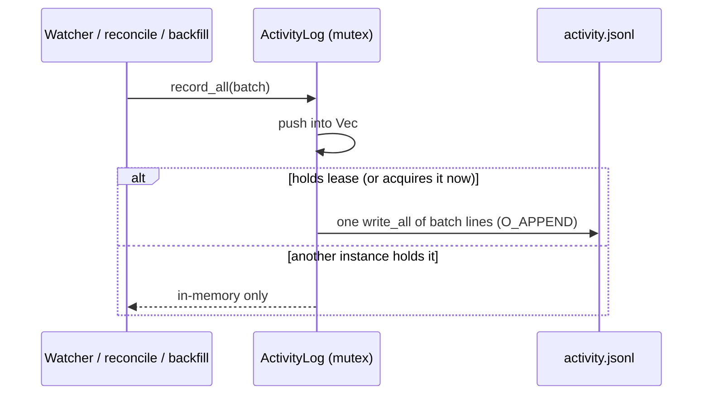
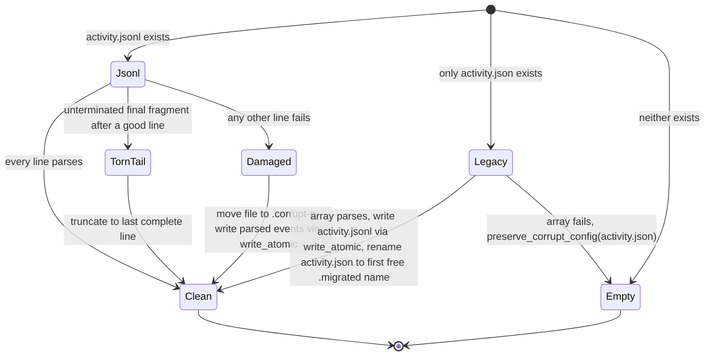

## Context

The Dashboard reads three things from history: change lifecycles, the year-long commit activity behind the heatmap and streak, and today's commit garden. The first two already sit behind `RepoCache<T>` (`crates/openspec-core/src/repo_cache.rs`). `AppService::spawn_lifecycle_cache_invalidator` (`service.rs` ~375-398) invalidates them on `CacheEvent::GraphChanged`, and the unregister path (`service.rs` ~1344-1348) evicts them. The garden has no such cache. `AppService::commit_garden` (`service.rs` ~1979-2056) calls `commit_log_authored(repo, GARDEN_COMMIT_LIMIT)` for every repository view on every call. That function (`git.rs` ~1056-1110) runs `git log --all --date-order -z -n 500` and then `remotes()` (another spawn), and it is empty-on-error. `useCommitGarden` refetches on `graph-changed`, `cache-updated`, `change-archived`, window focus and midnight. `cache-updated` itself fires on every relevant spec batch, every `.git/index` write (`refresh_status_for`) and every window focus.

`ActivityLog` (`crates/openspec-core/src/activity_log.rs`) is a `Mutex<Vec<Achievement>>`, persisted by `persist()`:

- `persist()` runs `serde_json::to_string_pretty` under the mutex and then `std::fs::write` after the guard has dropped.
- `record` and `record_all` both call it. The watcher calls them inline in async `handle_events` (`watcher.rs` ~1116-1118), and once per archived id (~1178-1191). `reconcile_lifecycle` calls them from the Dashboard's blocking pool, and `backfill_activity` from a std thread.
- `load()` maps any read or parse failure to an empty `Vec`. `backfill_activity` (`service.rs` ~2468-2494) treats an empty log as first launch.
- The live log is 2.5 MB and 7,870 events.

`task_completion_history` (`git.rs` ~2007-2096) runs one bounded `git log`, then one `git show --name-only` per commit, then one `git show <sha>:<path>` per active `tasks.md` touched. That is about 539 sequential spawns on this repository.

The sibling change `atomic-settings-persistence` adds `openspec-core/src/config_file.rs`, with `write_atomic` (temp, fsync, rename, best-effort directory fsync) and the moved `preserve_corrupt_config`.

## Goals / Non-Goals

**Goals:**

- A garden fetch with no history move issues no git process.
- Appending achievements costs work in proportion to the batch.
- Events reach disk in the order they were recorded.
- No crash, corrupt file or migration loses an event that was already persisted.
- Two instances sharing the config directory do not double-persist an achievement.
- The first-launch task-history backfill runs a fixed number of git processes per repository, and its output matches today's.
- Logic stays in `openspec-core` / `openspec-app`, where `cargo mutants` can reach it.

**Non-Goals:**

- **Redundant clones and full-log scans in `AppService::dashboard`.** These are the double clone of `lifecycles`, the double clone of `query_window`, the `HashSet`s in `missing_lifecycle_events`, and the per-commit `String` in `commit_days`. Together they cost milliseconds per fetch at today's log size. `me_created_change_ids` scans the whole log deliberately, because "did I create this change" is a lifetime fact (`dashboard`, *Today's Progress Hero*).
- **Incremental lifecycle mining.** A history move re-mines only that repository (about 60 ms on this repository, on the blocking pool). The `cache-change-lifecycle` design deferred `--not <previous-tips>` mining pending measurement, and nothing measured since justifies it. It would also have to stay identical under rebase, amend and branch deletion (`dashboard`, *Change Lifecycle Mining*).
- **Changes to `CommitActivityCache`.** It wraps the empty-on-error `commit_activity_with_authors` as infallible, so a transient failure pins an empty heatmap until the next `GraphChanged`. `populate` warms only `lifecycle_cache`. Both are real and both are small, and both are left for a follow-up.
- **Pruning or compacting the log.** The *Activity Event Log* requirement makes the log append-only, so no event is ever dropped or rewritten.
- **Merging events across processes.** Instances that do not hold the persistence lock do not see events the holder writes after they load, which is also true today.
- **Frontend refetch triggers.** `useCommitGarden` and `useDashboard` are unchanged. The `useDashboard` re-render belongs to `stabilize-frontend-rendering`.

## Decisions

### 1. Garden commits go behind `RepoCache`, caching only the raw commit list

Add `pub type GardenCache = RepoCache<Arc<Vec<AuthoredCommit>>>` in `repo_cache.rs`, and update that module's doc, which says "two derivations" share the cache, to name the third. Add a `pub garden_cache` field to `AppService`, public like its two siblings so `tests/dashboard.rs` can observe eviction, invalidated in `spawn_lifecycle_cache_invalidator` (in the same match arm as the other two, and in `invalidate_all` on `Lagged`) and evicted with them on unregister. `commit_garden` then does this for each `WorkspaceView::Repo`:

```rust
let commits = garden_cache.get_or_compute(&repo_id, |r| {
    commit_log_authored_checked(r, GARDEN_COMMIT_LIMIT)
});
let mut plant = compute_garden(&commits, today, &identity);
```

`compute_garden` changes to take `&[AuthoredCommit]` and clones only the commits from today. The `Arc` makes a cache hit a refcount bump rather than a 500-element clone. The per-view loop moves out of the async closure into a named function, `garden_plots(views, today, &identity, &cache, miner)`, in `openspec-app`. A test can then inject a counting miner, and `cargo mutants` sees the loop. The comment in `commit_garden` already notes that a closure inside an `async fn` produces no mutants.

`today`, the identity config and `active_count` are applied after the cache on every call. They change without any history move: midnight, an alias claim, a change created or archived. Caching the computed `WorkspaceGarden` would have served yesterday's plot, or a stale accent.

`commit_log_authored_checked` returns `Result<Vec<AuthoredCommit>, LifecycleError>`, reusing the error type `change_lifecycle_checked` uses. `commit_garden` is `commit_log_authored`'s only caller today, so the empty-on-error wrapper is removed with its re-export rather than kept with no caller (an unexercised `unwrap_or_default()` body would be a surviving mutant), and the doc links in `garden.rs` (~159-165) point at the checked function. `RepoCache` never retains an `Err`, so a transient failure is retried on the next fetch. That is the same rule *Graceful Degradation Without Git* states for lifecycles.

**Alternatives considered:**

- *A dedicated garden cache keyed by HEAD tips.* Rejected: it repeats the single-flight and invalidated-while-in-flight logic that `repo_cache.rs` warns against duplicating, and validating the tips costs a spawn per fetch.
- *Caching the computed plot.* Rejected for the staleness reasons above.
- *Debouncing the frontend triggers instead.* Rejected: it would weaken the *Live, Today-Scoped Updates* contract and leave the TUI and web frontends paying the full cost.

Correctness: on a miss, the cached list is exactly what an uncached call would read, because it is invalidated by the same `GraphChanged` that already keeps the lifecycle and heatmap caches correct. Ref decorations come from refs, and a ref move is a `graph` concern. A `git remote add` with no fetch changes no ref and so no decoration. A remote rename moves `refs/remotes/*` and fires `graph`.

### 2. A linked worktree's HEAD and reflog are graph concerns

`RepoPaths::classify` (`repo_monitor.rs` ~148-178) treats the main worktree's `HEAD` and `logs/HEAD` as `graph`, but everything under `.git/worktrees/` as `status` and `reconcile` only. A commit on a detached HEAD in a linked worktree therefore fires no `GraphChanged`. The `cache-change-lifecycle` design records this as a known gap (its Decision 1 addendum). Today the garden hides the gap by re-mining on every `cache-updated`, and Decision 1 would expose it. Classify `worktrees/<name>/HEAD` and `worktrees/<name>/logs/HEAD` as `graph` as well, keeping their existing `status` and `reconcile` concerns. This closes the gap for all three caches at once. The cost is one extra `GraphChanged` per linked-worktree checkout, which re-mines one repository and is what a main-worktree checkout already does. Concerns are merged per debounced batch, so a branch commit, which already touches `refs/heads`, still yields one event.

**Alternative considered:** *Accept the gap for the garden as well.* Rejected: it would silently break the *Live, Today-Scoped Updates* scenario "A new commit appears", which holds today. The fix is a two-line classification change with a unit test.

### 3. The activity log becomes append-only JSON Lines

The persisted log becomes `activity.jsonl` in the config directory, one compact JSON `Achievement` per line, each terminated by `\n`. `record_all` (and `record`, which becomes `record_all(vec![event])`) holds the events mutex for the whole operation:

1. Push the events into the in-memory `Vec`.
2. If this instance holds the persistence lease (Decision 4), serialise the batch into one buffer and `write_all` it to the file, which is opened with `append(true)`.

Holding the mutex across the write keeps disk order equal to memory order. That closes the lost-update race in today's `persist()`, where `fs::write` runs after the guard drops. The write is a few hundred bytes, so holding the lock costs no more than today's serialisation under the lock. It also stays inline on the watcher's tokio worker, because the multi-megabyte rewrite was the blocking part. There is no `fsync` per append: a process crash keeps whatever reached the page cache, and an OS crash can lose only the most recent appends and never damage an earlier line. Decision 5 covers a torn tail.

`reconcile_lifecycle` computes `missing_lifecycle_events` and appends the result inside one critical section. Two concurrent Dashboard fetches therefore cannot both append the same missing lifecycle event, which the current lock, drop, re-lock sequence allows.

The watcher's archival loop (`watcher.rs` ~1178-1191) collects its `ChangeArchived` achievements into the same `Vec` as the batch's other achievements, so the batch makes one `record_all` call, one append and no per-id rewrite. Today the batch's achievements are recorded at ~1116-1118, before the `refresh_aggregated_view_for` await, while the archived set (`list_archived_changes`) is computed only after it. So the archived-id computation moves up to just before that `record_all`: after the `cache.contains` guard (a batch for a removed workspace still records nothing) and before any `CacheEvent` is broadcast. It depends only on `old_ids`, `new_ids` and the workspace's `archive/` listing, none of which the view refresh changes. The `ChangeArchived` cache events are still sent per id, in the same order and at the same point as before. One side effect is welcome: an archival is now on the log before its `change-archived` event reaches a Dashboard that refetches on it, whereas today the event is sent first.

**Alternative considered:** *Keep the JSON array, with compact JSON, `write_atomic` and the write moved to `spawn_blocking`.* Rejected. Every batch would still cost O(log), at 2.5 MB doubling every ten weeks. The write would still need its own sequencing so that an older snapshot could not land last, and the intent of this change is an append-cost log. `write_atomic` is still the right tool for the one-off whole-file writes in Decision 5.

**Alternative considered:** *SQLite.* Rejected: it adds a dependency and a schema for a single append-only table with no indexed queries.



### 4. A persistence lease through an advisory lock on `activity.lock`

The desktop app, a standalone `specforge-serve`, the TUI and `wt:dev` slots all resolve the same `config_dir()`. Under the whole-file format, the last writer wins. Two instances watching the same workspace therefore record the same transitions, and only one copy survives, so counts come out right by accident while events seen by only one instance are lost. Appending without coordination would turn that into duplicates and double the hero and heatmap counts. So persistence is single-writer:

- `ActivityLog::open(config_dir)` opens or creates `activity.lock` and calls std `File::try_lock()`, which is stable and backed by `flock` / `LockFileEx`. The holder keeps the handle for the life of the process, and the OS releases it on exit or crash.
- An instance that is not the holder still records in memory and serves its own views. On each `record_all` it calls `try_lock()` again, a single cheap syscall. Once it acquires the lock it trims any torn tail (Decision 5) and from then on appends only the events it records after acquiring. Earlier in-memory events are not flushed, because the previous holder, watching the same registry, almost certainly persisted them already.
- The lock lives on a separate file so that the atomic replacements in Decision 5 never swap the locked inode out from under the holder.

This is a narrowing of the live *App-Data Persistence and Workspace Read-Only Guarantee* requirement, whose scenario says previously recorded achievements survive a restart. An achievement seen only by a non-holder (a workspace registered in that instance's session alone) is not persisted. The delta therefore MODIFIES that requirement explicitly, keeping both live scenarios verbatim and adding one for this case, rather than leaving the *Single Persisting Instance* requirement to contradict it silently.

**Alternative considered:** *Fuzzy de-duplication at append time.* This would match `(kind, workspace, change_id, magnitude, author)` within a time tolerance against lines another instance appended. Rejected: the tolerance is a guess, and two genuine identical check-offs in quick succession would be merged.

**Alternative considered:** *Read-modify-write under the lock, as `review_progress.rs` does.* Rejected: it reintroduces the O(log) cost per batch.

### 5. Load, migration and corruption handling

The holder runs `ActivityLog::open` as below. A non-holder only parses and never writes.



- **Torn tail.** Every append ends in `\n`, so an interrupted append is exactly an *unterminated* final fragment. When such a fragment follows at least one complete line that parses, it is dropped, and the file is truncated to the end of the last complete line, so the next append does not glue onto the fragment. Non-holders skip the fragment without truncating. A new holder runs the same check on acquiring the lock. If an append fails part-way (for example `ENOSPC`), the instance flags that the tail needs re-checking before its next append. Truncation is reserved for this one shape because it destroys bytes without preserving them: a *terminated* final line that fails to parse cannot come from a torn append (it is damage, or the zero-filled extent an OS crash can leave, with later appends glued on), and a file with no complete parseable line at all may be anything, so both take the Damaged path and are preserved first.
- **Damaged.** Any other unparseable content moves the file aside with `preserve_corrupt_config`, so its original bytes survive as `activity.jsonl.corrupt-<n>`. The events that did parse, possibly none, are then written to a fresh `activity.jsonl` with `write_atomic`. Copying the file in place instead would re-detect the same bad line, and produce another `.corrupt` copy, on every launch.
- **Legacy.** A parseable `activity.json` array is written out as `activity.jsonl` with `write_atomic`, and only then is it renamed to `activity.json.migrated`, never deleted. If the process crashes between those two steps, `activity.jsonl` wins on the next load, and the leftover `activity.json` is renamed then. The rename never replaces an existing kept copy: `rename(2)` silently overwrites its target, and an `activity.json` can reappear after migration (an older build still running beside this one rewrites it whole), so the leftover goes to the first free `activity.json.migrated`, `activity.json.migrated-1`, … name, with the same numbering loop `preserve_corrupt_config` uses. An unparseable `activity.json` goes through `preserve_corrupt_config` and the log starts empty, so the backfill runs. That satisfies "moved aside, not treated as no history and overwritten". Today that file is silently overwritten.
- **Non-holder load.** A non-holder parses `activity.jsonl` when it exists and otherwise the legacy `activity.json`, keeping every line that parses and skipping the rest. It writes, truncates and moves nothing; the holder does that.
- **Backfill trigger.** `backfill_activity` still keys on `log.is_empty()`. A torn tail or a partly damaged file keeps every good event, so the log is not empty and the backfill does not re-run. The *Git Backfill* requirement's "holds no prior history" is preserved.

`preserve_corrupt_config` and `write_atomic` come from `openspec-core/src/config_file.rs`, added by `atomic-settings-persistence`. If this change lands first, it moves `preserve_corrupt_config` from `service.rs` into that module itself, and the sibling rebases onto it. There is never a second copy. `AppService::bootstrap` (`service.rs` ~262, ~323) calls `ActivityLog::open(&config_dir)` instead of `ActivityLog::load(config_dir.join("activity.json"))`.

**Alternative considered:** *Ignore all unparseable lines in place.* Rejected: a damaged file would never be visible to the user or to support, and a half-written line in the middle would be appended after forever.

### 6. Task history in two git processes

`task_completion_history` makes two git processes in place of 1 + C + T:

1. **One history walk.** It is one `git log --all --reverse --since <since> --raw --no-abbrev -z --diff-merges=dense-combined --format=<RS>%H<US>%at<US>%an<US>%ae -- openspec/changes` invocation. The commit set, order and window are exactly today's log, which is path-limited the same way. `--raw` gives each changed path's post-image blob id: the last object id on a `::` combined line for a merge, and the destination's object id for a rename. `--diff-merges=dense-combined` reproduces what `git show` reports for a merge by default (`--cc`), whereas a plain `git log --name-only` would report nothing for merges. No rename flag is passed, so the walk follows the user's `diff.renames` exactly as `git show` does today. Only paths that `active_change_id_of_tasks_path` accepts are kept.
2. **One `git cat-file --batch`.** It is fed the deduplicated non-zero blob ids on stdin, and only object ids, following the `commit_file_blobs` rule in `crates/CLAUDE.md`. The existing private helper `cat_file` (`git.rs` ~1655) writes all of stdin before reading stdout, which its comment justifies only for "two short lines at most"; with hundreds of ids git would block on a full stdout pipe while the helper blocks on a full stdin pipe. So `cat_file` itself moves its stdin write onto a writer thread that is joined after `wait_with_output`, which keeps one helper for both callers rather than adding a second. The reply is parsed with the existing `blob_header_size` header rule, but per object rather than all-or-nothing as `parse_blob_contents` does, because a `<id> missing` reply (a partial or shallow clone) must count as 0, which is what today's failed `git show <sha>:<path>` yields. Each blob's completed-checkbox count is computed once with `parser::count_completed_in_text` and looked up by id. An all-zero post-image id (a deletion) counts as 0 without being read, which is today's "file deleted reads as 0" rule.

The `last_completed` fold over the walk's records stays as it is, with the same positive-delta emission, the same per-path baseline and the same author. Both processes go through `git_command`, so `invocation_log` counts them and WSL routing still applies.

**Alternative considered:** *`git log --name-only` with `cat-file --batch` fed `<sha>:<path>` requests* (the brief's suggestion). Rejected: it writes paths into `cat-file`, against the repository's object-id-only rule, and it needs a separate merge flag for names anyway. Raw blob ids make deletions explicit and let identical blobs be read once.

**Alternative considered:** *Parallelising the existing per-commit spawns.* Rejected: the number of processes stays the same, and the load lands on the machine at the moment of first launch.

## Risks / Trade-offs

- **[A cached garden misses a history move that fires no `GraphChanged`]** → Decision 2 closes the one known case. A missed broadcast (`Lagged`) already flushes every cache. Any remaining unclassified path would affect the lifecycle and heatmap caches the same way, so it would surface there.
- **[`tests/dashboard.rs` reads the garden right after a commit and races the asynchronous invalidation]** (`commit_garden_is_computed_without_opt_in`, ~173-182) → The post-midnight branch re-reads the garden in a loop until the new commit's plot is live, the same "wait for the observable outcome, not a timer" pattern `graph_changed_re_mines_only_the_affected_repository` already uses. The deadline exists only to fail a hung test, never to assert speed. Waiting on a cache generation counter instead was rejected: the generation is cache-wide, so a late `GraphChanged` from the fixture's own setup commits could advance it before the post-midnight commit's event and let the test re-read a stale list.
- **[An instance that does not hold the lease records events that are never persisted]** → Accepted. The holder watches the same shared registry and persists the same achievements. The edge case is a workspace registered only in the non-holder's session. Today that edge case loses events in a different way (overwritten wholesale), so this is no regression.
- **[No fsync per append]** → An OS crash can lose the last few seconds of achievements but cannot damage earlier lines, and Decision 5 trims a torn tail. Live achievements are also partly re-derivable, because the Dashboard's lifecycle reconciliation re-adds missing created and archived events from git.
- **[An older build runs beside this one, for example a not-yet-upgraded `specforge-serve` from npm]** → It knows neither the lock nor `activity.jsonl`, so it keeps rewriting `activity.json` from its own memory. Events it records are not merged into `activity.jsonl`. On this build's next launch the reappeared `activity.json` is kept under a fresh `.migrated-<n>` name (Decision 5), so nothing is overwritten and the user can recover it by hand. Accepted: mixed-version operation is transient, and merging two logs is the cross-process merge listed under Non-Goals.
- **[Downgrading to a build that reads only `activity.json`]** → The old build finds no `activity.json`, because it has become `activity.json.migrated`, and backfills from git. Restoring the user's events means renaming `.migrated` back. This is documented in the tasks' release-notes item.
- **[Path-limited rename detection differs from `git show`'s]** → The walk is limited to `-- openspec/changes`, so rename detection only pairs paths inside it. An active `tasks.md` moved *out* of `openspec/changes` shows as a deletion (baseline reset to 0) where today's unlimited `git show --name-only` lists only the outside destination and leaves the baseline alone. The two only diverge if the same path is later re-created, and moves within `openspec/changes` (archive moves, change renames) pair exactly as today. The parity fixture (task 3.1) pins the archive-move case; if the implementer finds the out-of-tree case matters, dropping the deletion when the commit's unlimited diff shows a rename would restore it at the cost of a third process.
- **[`--diff-merges=dense-combined` needs git ≥ 2.31]** → Use `--cc` instead if the implementation must support older git. On current git it produces the same names. The parity test pins the behaviour either way.
- **[A partially damaged log can make an instance believe it holds no history]** → It cannot: the backfill runs only when no line parsed at all, and the bytes are preserved first.
- **[The two-step migration fails half-way]** → `write_atomic` ensures `activity.jsonl` is either complete or absent. The legacy file is renamed only after that step succeeds, and the step is idempotent on the next launch.
