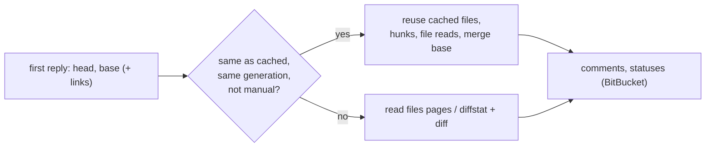

# Efficient Pull-Request Reads

## Why

Every pull-request detail read downloads and parses the whole file list again, even when neither commit has moved. Most re-reads are caused by a new comment, a review or a CI status flip, none of which changes the files. On GitHub a 300-file pull request costs 8 of the 500 hourly detail requests per re-read: the query, six full files pages and one empty page. On BitBucket each re-read fetches up to ten diffstat pages and up to 8 MiB of diff, then re-parses them. Each re-read also throws away the work the reader has already done: a file loaded on request loses its content and hunk keys, and the learned merge base is dropped. The next load sends the compare and contents GETs again, and the file's hunk marks read as "not known" until it is reloaded.

## What Changes

- **Reuse the files when the commits are unchanged.** A detail read compares the head and base commits from its first reply (the GraphQL query on GitHub, the pull-request payload on BitBucket) with the cached detail's, under the same credential generation. On BitBucket the payload's `links.diff` and `links.diffstat` must also be unchanged. When everything matches, the read skips the files pages (GitHub), or the diffstat pages and the diff (BitBucket). It carries over the cached detail's files as they are:
  - the files the budgets withheld, with their hunks;
  - every file a file read has already loaded;
  - each file's hunk keys;
  - the merge base.

  A manual refresh always reads the files again. That is the way out if a provider ever served an incomplete list.
- **Keep the merge base across a re-read of the same commits.** On GitHub and BitBucket alike, it is now dropped only when a read reports a different head or base commit. It is no longer dropped on every new read.
- **No trailing empty files page on GitHub.** The number of files pages comes from the query's `files.totalCount`: at most 20 pages, and still stopping early at a short page. A pull request whose file count is an exact multiple of 50 no longer costs one extra request.

Request counts per read become:

$$\text{GitHub: } 1 + p_{\text{files}},\quad p_{\text{files}} = 0 \text{ on reuse, else } p_{\text{files}} \le \min\!\left(\max\!\left(\left\lceil \tfrac{n}{50} \right\rceil, 1\right), 20\right)$$

Here $$n$$ is the query's `files.totalCount`; a short page can end the list sooner, and a reply without a total keeps today's bound of 20 pages.

$$\text{BitBucket: } 2 + p_{\text{comments}} \text{ on reuse, else } 3 + p_{\text{diffstat}} + p_{\text{comments}}$$

**Out of scope.** These were found during the performance sweep and deliberately left out, so nobody re-discovers them:

- *Fetching GitHub files pages concurrently.* GitHub's guidance is to send one token's requests serially. A secondary rate limit would set both deadlines and stall the panel's poller as well. With reuse in place, the pages are rarely sent anyway.
- *Running BitBucket's detail GETs in parallel.* It would cut latency only. It would also make it harder to stop at the first 401, 403 or 429, or when the provider is disabled, which the shared deadline and the disabling scenario both require.
- *ETags or conditional requests.* The GraphQL POST has no conditional form. The app's own budget is charged before a 304 is known, so ETags would save GitHub's quota but none of the detail budget.
- *Adding `pagelen` to the BitBucket diffstat link.* Its default page length is unverified, and nothing shows that it matters.
- *`take_counts` in `bitbucket_detail.rs` being O(files × diffstat).* About 10^6 comparisons in the worst case, once per read, off the main thread.
- *The review-progress store re-parsing and rewriting `review-progress.json` on every mark and every read.* It all runs off the main thread on a small file. The spec also requires a re-read before every write, because `specforge-serve` and the desktop app share the file.
- *The detail cache being bounded by entry count (32, as the spec requires) rather than bytes, and `SkipRule` being recompiled on every progress call.* The cache only grows large if a reader opens many very large pull requests in one session. The recompile cost is negligible.
- *The cache cloning the whole detail on every answer.* Minor next to the IPC serialization that follows.
- *`DETAIL_QUERY` not paginating reviews, comments, review threads or checks.* This is a correctness gap, not a performance problem. Fixing it needs a spec change to the fixed-query rule and belongs in a separate follow-up change.
- *Sharing one HTTP connection agent.* That is the sibling change `reuse-http-connections`.

## Capabilities

### New Capabilities

_None._

### Modified Capabilities

- `pull-request-viewer`: adds *Detail Re-reads Reuse Unchanged Files*, the cross-provider rule for when and what a re-read reuses. Modifies three requirements:
  - *GitHub Detail Reads*: the page count comes from the query's file count, the files are skipped on reuse, and the merge base survives a re-read of the same commits.
  - *BitBucket Detail Reads*: the diffstat and diff are skipped on reuse, and the request formula changes to match.
  - *Pull-Request Image Reads*: the merge base is dropped only when a read reports different commits.
- `bitbucket-pull-requests`: *Privacy and Safety* states that a detail read requests the diffstat and diff only when it does not reuse the cached files. The host, link and redirect rules are unchanged.

## Impact

- **Code (openspec-app only):**
  - `crates/openspec-app/src/github_detail.rs`: `read_with` gains a reuse check after the query and the totalCount-driven page bound.
  - `crates/openspec-app/src/bitbucket_detail.rs`: `read_with` gains a reuse check after the payload, before the diffstat and diff.
  - `crates/openspec-app/src/pull_request_detail.rs`: `ReadParts` gains a reused-files variant, and `assemble` passes reused files through.
  - `crates/openspec-app/src/pull_request_cache.rs`: a reuse snapshot, plus `CachedDetail` keeping the BitBucket links it was read by; `store` carries the merge base and the latest file-read results across when the commits match.
  - `crates/openspec-app/src/pull_request_read.rs`: wires the reuse snapshot into `read_github` / `read_bitbucket` and switches it off for manual refreshes.
- **Not changed:**
  - No IPC shape or command change, and no frontend change in `src/`, `crates/specforge`, `crates/specforge-web` or `crates/specforge-tui`. The view receives the same `PullRequestDetail` it does today.
  - The freshness rule (60 s / 30 s), the 32-entry cache, the in-flight limit, the deadlines and the detail budgets stay as they are, and so does the `DETAIL_QUERY` text.
  - `FILES_PER_PAGE` stays 50.
  - The worst-case requests per read (21 on GitHub, 23 on BitBucket) are unchanged, so the BitBucket budget inequality still holds.
  - The review-progress store, and the shared HTTP agent (`reuse-http-connections`).
- **Related sibling changes:** `reuse-http-connections` covers per-request cost, and `unblock-main-thread` covers where reads run. Neither overlaps this one.
