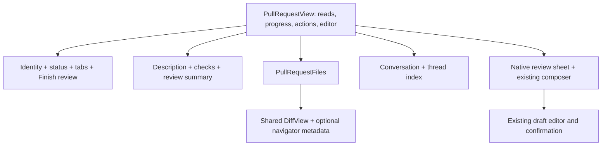

# Pull-Request Review Workspace Design

## Context

`PullRequestView` owns detail reads, action state and local progress, then renders all sections sequentially. `PullRequestFiles` adapts review state into the shared `DiffView` slots. `DiffView` already provides a tree navigator, responsive split/unified layouts, lazy reads and stable per-file rendering. `ReviewDraftEditorProvider` owns the native editor shared by inline drafts and `PullRequestReviewComposer`.

Provider panels consume snapshots and retain separate GitHub Yours/To review and BitBucket authored lists. None of the proposed presentation features needs additional provider data. Existing unknown states, read budgets, capability checks and native confirmation remain authoritative.

## Goals / Non-Goals

**Goals:** Fast access to code, reliable resumption, visible outstanding work, accessible completion, readable status, and searchable provider queues in both main and detached PR presentations.

**Non-Goals:** New provider operations, browser writes, Rust/IPC changes, provider discovery expansion, merge readiness claims, a complete event timeline, unified inbox or spec-to-code mapping.

## Decisions

### D1. Three local working views under one persistent owner

Use Overview, Files and Discussion tabs under the existing identity header. Overview contains description, check details and a review-count summary; Discussion contains general conversation followed by the thread index. Files contains the existing diff. File count includes unlisted files with the existing truncation notice. Discussion count counts displayed general entries plus thread roots, not replies; unresolved count remains separately labelled.

Retain detail/action/editor ownership above the tabs. Lazily mount Files on its first activation, then retain it while hidden so switching tabs does not discard loaded diffs, folds or selections held by the renderer. Hidden panels must be excluded from focus and accessibility navigation. Pause measurement/restoration until visible; do not treat zero-width hidden panels as a new diff-layout preference. Save and restore per-panel scroll anchors using the existing outer scroll container.

Tab choice is viewer-local, keyed by canonical PR identity and surface (main or detached), persisted in a bounded, versioned local-storage record of the 50 most recently used PRs. Storage failure falls back to memory. First visit defaults to Overview. On unmount, retain selected file and approximate section-relative position for resumption; on reopen, restore after the file section exists, falling back to its header or Files start if missing. Line-level positions are discarded when head/base commits differ. Returning within a mounted PR preserves full current diff state; reopening does not promise persistent folds or loaded file content.

Tab changes do not add application history entries or change PR addresses. Explicit jumps override the stored tab. Other windows do not force this window's active tab, filters or scroll position.

Rejected: one long page with anchor links, because it retains the code/composer separation. Rejected: route changes per tab, because presentation navigation should not pollute Back/Forward or require address migration.

### D2. Extend the navigator with host-supplied review metadata

Keep the full `files` input stable. Add optional presentation metadata and navigation methods to `DiffView` rather than passing filtered arrays that would reset loading caches or lose anchored drafts. PR predicates and labels belong in PR presentation helpers; the renderer only consumes generic badges, candidate keys and navigation targets. Commit views omit these options and retain existing behavior.

Split source lines do not wrap. Keep the existing fixed table for row pairing, gutters and comment slots; give each code cell a native horizontal viewport, with hidden per-line scrollbars. A shared scrollbar at the file's viewport bottom and horizontal gestures on either code side move every code viewport in that file to the same offset. Gutters, change markers, header and discussion slots remain fixed. Equal overflow ranges account for the slight width difference caused by the center border. DOM refs and native scrolling avoid re-rendering rows on horizontal gestures.

Measure natural text widths independently of the common minimum scrolling width. Re-measure on content/fold changes, resize and font changes; ignore hidden retained tabs and restore their previous horizontal position when shown. Keep source whitespace, pairing, copying and narrow unified fallback unchanged.

Rejected: word-aware wrapping alone, because the user's second screenshot showed that indented lines still zigzagged over multiple visual rows. Rejected: scrolling a widened entire table, because the old or new half would disappear offscreen. Rejected: visible per-line scrollbars, which make large reviews impractical.

The workspace scroll-port lookup includes its starting element: a detached window scrolls the PR pane itself, whereas the main presentation scrolls an ancestor pane.

Search/filter narrows navigator candidates, not the underlying rendered file sections. This keeps active files and editors in place after a mark changes filter membership. Label the result as a filtered file list and retain an explicit current-file row if it no longer matches. Folder ancestors remain visible for matching descendants.

Search is case-insensitive path substring matching. A single state filter intersects search: All, Unreviewed (included and not currently viewed), Changed since review, Has discussion (any listed thread), Skipped. Unknown progress never becomes an unreviewed or skipped assertion: progress-dependent filters and next-unreviewed stay unavailable until progress loads, with a local explanation. Navigation uses original file order, wraps once and excludes skipped/viewed files for next-unreviewed. No candidates produces an explanatory empty state and disabled navigation.

Navigator progress badges distinguish viewed, unreviewed, changed and skipped using labels/icons as well as color. Existing progress rules determine precedence; skipped remains skipped even if an old patch mark exists. An active editor is never unmounted by navigation filtering.

Rejected: a second PR-only diff renderer, because it duplicates layout, image, slot and loading behavior. Rejected: filtering `files` before rendering, because it risks dropping active drafts and violating cache/render-isolation guarantees.

### D3. One native finish-review sheet, one editor

A persistent header action opens an accessible modal sheet containing a draft-item index, local progress summary and the existing composer/status machinery. The action shows the number of pending draft items; unavailable/loading action state remains inspectable in the sheet rather than disappearing. Draft summary alone is not counted as an inline item.

Opening or closing does not create, discard or submit a draft. The provider stays mounted; flush the existing save path when closing, keep unsaved editor state alive and expose save failures on the persistent action. Item links close the sheet and reveal their anchor in Files; unplaced items lead to the existing detached-draft placement controls without inventing a line.

Preserve the existing explicit native confirmation and its frozen draft revision. Remaining files are informational, never a new eligibility rule. Show the byte indicator at 90% of the existing byte limit or on validation failure; enforce the same byte limit throughout.

Use existing dialog primitives where available, with focus containment, Escape dismissal and focus restoration. On narrow screens the sheet fills the available content area. Browser code renders no action or sheet and does not load native action state.

Rejected: a second draft state inside the sheet, which would diverge from inline editors and other native windows. Rejected: a permanently expanded bottom composer, which consumes scarce diff height.

### D4. Actionable status and honest thread navigation

Detail-header status uses readable review counts and check/discussion summaries. Check counts derive from loaded detail and are labelled as last-read data; summary-row signals remain the fallback before detail arrives. Never combine numbers from different snapshots into an inferred readiness claim. Clicking checks opens Overview at checks, reviews opens Overview at its count summary, and unresolved discussions opens Discussion with its Unresolved filter.

Within checks, retain stable order inside failure, pending, other non-passing and passing groups. Passing checks are collapsed by default. Retain every provider state and safe link.

Discussion offers All, Unresolved and Outdated filters over thread roots, with path, author, excerpt, reply count and state. General conversation remains in its provider submission order and is not filtered by thread controls. Next unresolved follows original file order and then unlisted-thread order, wraps once and skips resolved threads. Jumps use existing side-qualified anchoring: reveal folded file/hunk as necessary; outdated, ranged or unrendered locations land at the existing preamble; unlisted paths land at the unlisted-thread section. Explicit navigation can override navigator filtering to reveal the target without changing filter settings. Missing targets after refresh produce a notice and return to the thread index.

Rejected: treating Discussion as a provider activity timeline, because the current detail lacks all events and bodyless reviews. Rejected: fetching check logs or avatars, because these are additional data/network concerns.

### D5. Local panel triage with stable ordering

Pass the current PR reference from `App` into panels for canonical selected-row comparison. Include PR number in row identity, visually prioritize the title, and retain compact branch metadata and established row/worktree gestures.

Search title, repository, number and both branches case-insensitively. A single filter intersects search: All, Failing checks, Conflicts, Drafts, and GitHub-only Review requested. Preserve GitHub sections and BitBucket authored scope. Header totals remain snapshot totals; an active filter displays matching/total counts and a clear-filter affordance, distinct from the provider's empty/authentication states.

Use snapshot order on first load. During the mounted panel lifetime retain relative order of surviving rows, append new rows in snapshot order, and remove absent rows; handle each section independently. Updates must not remount the focused row. Filters and search remain local, transient UI state and never trigger reads.

Rejected: urgency-based automatic sorting, because updates would move targets while the user is reading. Rejected: a unified queue, which changes provider organization beyond this change.

### D6. Shared tokens and constrained responsive layout

Reuse the existing typography, spacing, border and focus tokens. Keep identity, status and navigation visually distinct without introducing large decorative cards. Sticky header height continues to publish `--diff-sticky-top`, including the new navigation row. On narrow panes use the existing folded navigator plus an accessible file-list disclosure; expose search, filters and jump controls there. Essential controls remain reachable without hover and clear of macOS drag regions.

Rejected: fixed desktop three-column dimensions, because PRs also run in narrow panes, detached windows and browser surfaces.

## Risks / Trade-offs

- [Hidden diff measurement can change layout or lose position] → Mount lazily, retain state, measure only visible geometry and restore anchors after layout settles.
- [Long-lived hidden diffs retain memory] → Retain only the currently mounted PR; bound persisted presentation records, and do not retain a cache of mounted PR components.
- [Filters can conceal the current target] → Filter navigator candidates only, retain current-file context, and allow explicit jumps to reveal out-of-filter targets.
- [Progress and provider detail may be temporarily unavailable or stale] → Preserve null/unknown states and existing freshness notices; derive claims from their named source.
- [Sheet closure races draft persistence] → Keep the existing editor above the sheet; use its revision/save flow and leave failures visible after dismissal.
- [Shared diff changes regress commit views or per-file rendering] → Optional host metadata, stable full file arrays and targeted existing regression tests.
- [Tabs hide context] → Persistent status summaries and explicit cross-view jumps keep blockers discoverable.

## Migration Plan

Ship additive viewer-local state keys; no service-data migration. Existing durable drafts, progress and layout preferences remain unchanged. Roll back by reverting presentation changes; new local-storage records can be ignored. Update the viewer specification alongside the new workspace capability.

## Open Questions

None blocking implementation. Confirm exact spacing and narrow-layout breakpoints during visual verification using existing design tokens and the current diff fallback behavior.
