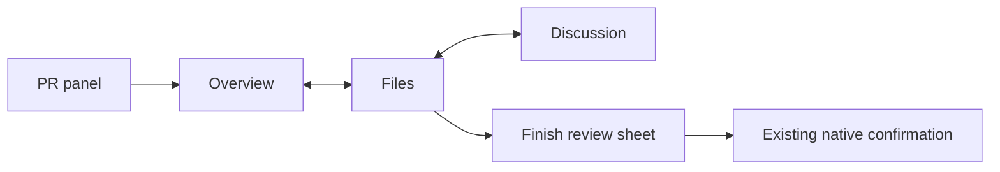

# Pull-Request Review Workspace

## Why

The PR view makes reviewers scroll through description, conversation, checks and a submission form before reaching code, then return above the code to finish. Existing diff, draft and progress capabilities need a navigable workspace that makes outstanding work and review completion easy to find.

## What Changes

- Organize each PR into Overview, Files and Discussion views with counts, accessible navigation and per-PR resumption; show local review progress beside the Files count using the existing themed meter and completion mark.
- Add review-aware file search, state filters, progress markers and next-unreviewed navigation to the existing diff navigator.
- Keep a native-only Finish review control available while reading; open a review sheet containing pending drafts, summary, decision and the existing confirmed submission flow.
- Present readable, actionable checks/review/discussion summaries; prioritize failing checks and group passing checks.
- Add a thread index with contextual jumps and honest fallback locations for outdated or unavailable lines.
- Improve provider panels with selected-PR highlighting, PR numbers, local search and triage filters, retaining provider sections and established row gestures.
- Keep split-diff source lines unwrapped, with synchronized horizontal scrolling per file; preserve equal halves, fixed line numbers/markers, aligned rows and stationary discussion slots.

## Capabilities

### New Capabilities

- `pr-review-workspace`: Workspace navigation and resumption, review-aware file navigation, actionable status, discussion index, finish-review sheet and local provider-panel triage.

### Modified Capabilities

- `pull-request-viewer`: Replace the prescribed single-document content order and above-files composer placement with named working views and a persistent native finish-review entry point, preserving existing content, transport and window contracts.
- `diff-view`: Replace wrapped side-by-side source lines with synchronized code-only horizontal scrolling and one shared scrollbar per file.

## Impact

- Frontend: `src/components/PullRequestView.tsx`, `PullRequestReviewComposer.tsx`, `PullRequestPanel.tsx`, `DiffView.tsx`, `PullRequestControl.tsx`, `src/App.tsx`, supporting presentation-state helpers and hooks, and `src/styles/base.css`.
- Add focused behavior tests and inspect desktop/browser, detached and narrow presentations. The shared diff renderer must preserve commit-detail behavior and per-file render isolation, apart from the intentional unwrapped split-code presentation shared by both hosts.
- Horizontal scroll measurement/synchronization lives in `src/hooks/useDiffHorizontalScroll.ts` and `src/diffHorizontalScroll.ts`; `scripts/check-diff-wrap.js` verifies actual browser geometry rather than word boundaries alone.
- Frontend only: no Rust, IPC, provider API, polling, permissions or dependency changes. Durable drafts, local review marks, native confirmation and stale-commit recovery retain existing service semantics.
- No unified provider inbox, merge/close/resolve actions, browser review writes, commit-history timeline, automatic requirement mapping or side-by-side spec-context panel. The terminal UI remains unchanged.
