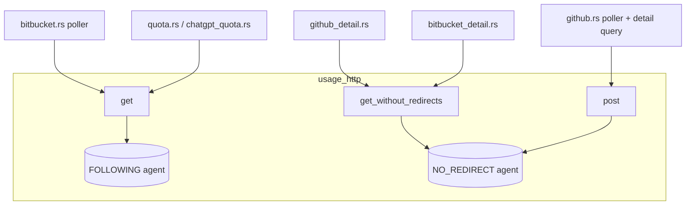

## Context

`crates/openspec-app/src/usage_http.rs` is the only place in the workspace that builds an HTTP request: a grep across `crates/` finds no other ureq construction. It exposes three builders, each with its callers:

| Builder | Callers | Posture |
|---|---|---|
| `get` | `bitbucket.rs` `send` (poller), `quota.rs`, `chatgpt_quota.rs` | 15 s global timeout, non-2xx kept on `Ok`, `proxy(None)`, redirects followed (ureq never forwards `Authorization` across one) |
| `get_without_redirects` | `github_detail.rs` `send_get` / `send_get_raw`, `bitbucket_detail.rs` `send_get` | same, plus `max_redirects(0)` |
| `post` | `github.rs` `send` (poller and detail query) | same, plus `max_redirects(0)` |

Each builder calls `ureq::get(url)` / `ureq::post(url)` and then `.config()…build()`. In ureq 3.4.0 (`Cargo.lock`), this has three costs on every request:

1. **A new connection on every request.** `ureq::get` / `ureq::post` build `Agent::new_with_defaults()` (`lib.rs:615-633`). Each agent gets its own `ConnectionPool` and `DefaultConnector` (`agent.rs:103-158`). Nothing is pooled, so every request does a TCP connect and a TLS handshake.
2. **An environment read on every request.** `Config::default()` calls `Proxy::try_from_env()` (`config.rs:872`). The `proxy(None)` override then discards the result.
3. **The TLS config is never cached.** The `.config()` override makes the request *request-level* (`run.rs:36-41`). `RustlsConnector::get_cached_config` (`tls/rustls.rs:95-134`) never fills its `OnceLock` for a request-level config. It reuses a cached config only when an agent-level request has already filled it. As a result, every new connection runs `build_config`, which builds a rustls `ClientConfig` with the webpki root store.

The posture itself is deliberate. The module note and the doc comments on each builder explain it, and two hermetic tests pin it: `a_post_never_follows_a_redirect` and `a_detail_get_never_follows_a_redirect`. These specs depend on it:

- `github-pull-requests`: *GitHub Privacy and Safety* says "SHALL NOT be sent through an ambient proxy configuration. No request SHALL follow a redirect."
- `bitbucket-pull-requests`: *Privacy and Safety* says a detail read and an image read "SHALL NOT follow a redirect", and the token "SHALL NOT be sent through an ambient proxy configuration".
- `pull-request-viewer`: *GitHub Detail Reads* and *BitBucket Detail Reads* say "none following a redirect".

Request volume:

- **GitHub detail read:** 1 POST plus about $$\lfloor n/50 \rfloor + 1$$ files GETs for $$n$$ changed files (8 for a 300-file PR, capped at 21). A file read or an image read adds up to 3 GETs.
- **BitBucket detail read:** 5 to 23 GETs.
- **BitBucket poller:** 2 + W GETs per cycle, all sent one after another.
- **GitHub poller:** 1 POST at least every 60 s.
- **Quota pollers:** 1 GET each, at least every 30 s.

## Goals / Non-Goals

**Goals:**

- Requests in a burst to one host share pooled connections. A burst is a detail read, a file read, an image read or a BitBucket poll cycle.
- The rustls `ClientConfig` is built once per agent, not once per connection. ureq's first fill of its cache is racy by its own comment (`tls/rustls.rs:118-124`): requests that race an agent's very first TLS connection may each build a config and discard all but one. That is why the spec deltas state connection reuse as the contract and leave the config count here, as a goal, rather than as a `SHALL`.
- No request reads the proxy environment.
- The posture becomes structural. A request inherits `proxy(None)`, the timeout and the status handling from its agent, so a future builder cannot forget them.
- Redirect, proxy, timeout, credential and status-mapping behaviour stay exactly as they are for every caller.

**Non-Goals:**

- **Reusing connections across poll cycles.** See D4.
- **An explicit body-size cap for GitHub's `Reply::read`** (`github.rs` around line 589) and the BitBucket poller's `send`. Both rely on ureq's implicit 10 MB `read_to_string` limit, which `bitbucket_detail.rs` already names as `JSON_LIMIT`. An oversized 2xx body becomes a transient read, which the hourly detail budget (500 for GitHub, 400 for BitBucket) and the in-flight gate bound, so it is not retried forever. Spelling the cap out changes no behaviour and saves nothing, so it is left out.
- **Environment-proxy support.** That is a separate decision about where a credential travels.
- **Changing how many requests a read sends, or their concurrency.** That belongs to `efficient-pull-request-reads`.
- **HTTP/2 or multiplexing.** ureq 3 speaks HTTP/1.1 only.

## Decisions

### D1. Two process-wide agents in `usage_http`, built lazily

Add a private constructor, `fn new_agent(max_redirects: Option<u32>) -> ureq::Agent` (or an equivalent small enum, `Redirects::Follow` / `Redirects::Never`). It builds an agent with `Agent::config_builder()…build().new_agent()`. Two statics hold its results:

- `FOLLOWING: LazyLock<Agent>`, used by `get`;
- `NO_REDIRECT: LazyLock<Agent>`, used by `get_without_redirects` and `post`.

The three builders keep their signatures. Their bodies become `FOLLOWING.get(url)` / `NO_REDIRECT.get(url)` / `NO_REDIRECT.post(url)`, followed by the `Authorization` header. ureq's `Agent` is `Send + Sync` and an `Arc` internally, so the pollers' threads and the detail reads' blocking workers can share it. Its pool sits behind a mutex.

*Rejected: injecting an `Agent` through `AppService` into every poller and read.* Every caller already reaches the network only through these three functions, and the callers' tests inject transports above this layer, so there is nothing to substitute here. Threading an agent through `github.rs`, `bitbucket.rs`, both `*_detail.rs` files, both quota pollers and their spawn sites would touch many signatures to make the same object reachable, and change no behaviour. A static keeps the seam where it already is, and keeps the change inside one file.

*Rejected: `OnceLock` plus a getter function.* It behaves the same. `LazyLock` reads more simply, and the workspace toolchain supports it (it is stable since Rust 1.80; task 1.1 confirms this). If it does not, `OnceLock::get_or_init` is the drop-in fallback.

### D2. The posture lives in each agent's `Config`, not in per-request `.config()`

Both agents set these at agent level:

- `timeout_global(Some(REQUEST_TIMEOUT))`;
- `http_status_as_error(false)`;
- `proxy(None)`;
- `max_idle_age(IDLE_CONNECTION_AGE)`, with explicit `max_idle_connections` and `max_idle_connections_per_host` (see D4).

`NO_REDIRECT` also sets `max_redirects(0)`. The builders call no `.config()` at all, so every request is agent-level.

This holds up for the following reasons, each checked against the ureq 3.4.0 source:

- **Timeout.** `timeouts.global` bounds one call, not the agent's lifetime, so each request still gets its own 15 s.
- **Proxy.** `connect` takes the proxy from the config the call uses (`run.rs:361-403`). That is now the agent's config, with `proxy(None)`. The pool key is `(scheme, authority, proxy)` (`pool.rs:176-191`), so a direct connection could never be handed to a proxied request anyway.
- **Redirects.** `run.rs:180` follows a redirect only while `redirect_count < max_redirects`. `max_redirects_will_error` defaults to `true`, but it only applies while `max_redirects > 0` (`max_redirects_do_error`, `config.rs:202-204`), so with 0 a 3xx comes back as the reply, as today. `redirect_auth_headers` stays `Never` (`config.rs:876`), so `FOLLOWING` still drops `Authorization` on a redirect.
- **Credentials.** The `cookies` feature is off (only the default `rustls` and `gzip` features), so an agent has no jar that could carry state between requests. `Authorization` is a header on each request, never agent state.
- **TLS config.** Agent-level requests fill the connector's `OnceLock` on first use (`tls/rustls.rs:117-132`). After that, every new connection reuses the cached `ClientConfig`.
- **Proxy environment.** `Agent::config_builder()` starts from `Config::default()`, which reads the proxy environment once when each agent is built. `proxy(None)` then overrides the result. That is two reads per process instead of one per request.

*Rejected: one shared agent with the existing per-request `.config()` overrides.* It would pool sockets. But every request would stay request-level, and request-level requests never fill the TLS-config cache, so each new connection would still rebuild the rustls `ClientConfig`. It would also leave `proxy(None)` as something each builder has to remember, rather than something every request inherits.

### D3. Two agents rather than one with a per-request redirect override

The callers need two redirect behaviours:

- the pollers' `get` follows redirects, as today, which the module doc states ("The pollers keep `get`");
- every GitHub request and every detail, file and image read follows none.

*Rejected: one agent with `max_redirects(0)`, and a per-request `max_redirects(10)` on `get`, or the reverse.* Whichever side carries the override is request-level. Request-level requests reuse the cached TLS config only after an agent-level request has filled it, so the benefit would depend on which feature happened to send first. A user with only the quota gauges enabled would never fill the cache.

*Rejected: one agent with `max_redirects(0)` for everything.* This tightens the BitBucket poller and both quota pollers. Their specs do not ask for that, and it could turn an endpoint's legitimate redirect into a permanent transient failure. That behaviour change belongs in its own proposal, not in a performance change.

The cost of two agents is two pools. The BitBucket poller (`FOLLOWING`) and a BitBucket detail read (`NO_REDIRECT`) can no longer share a connection to `api.bitbucket.org`. That costs little, because each burst stays within one kind: a poll cycle uses only `get`, a detail or image read uses only `get_without_redirects`, and a GitHub detail read uses `post` and `get_without_redirects`, which both run on `NO_REDIRECT`. The TLS config is built twice per process, once per agent.

### D4. Keep ureq's 15 s idle age, and pin it explicitly

Set `max_idle_age` to a named constant, `IDLE_CONNECTION_AGE = 15 s`, which is ureq 3.4.0's default. Also pin `max_idle_connections = 10` and `max_idle_connections_per_host = 3`, also the defaults, so a future ureq default change cannot silently widen the idle-socket footprint. The spec states the observable rule:

$$\text{reused}(c) \implies \text{idle}(c) < 15\,\text{s}$$

A burst's requests are sequential and a fraction of a second apart, so they all reuse one connection. A poll cycle 30 s or 60 s later opens a fresh one.

*Rejected: raising the idle age to about 120 s so pollers reuse connections across cycles.* ureq 3.4.0 checks a pooled socket with `is_open()` before handing it out (`pool.rs:263-285`, `unversioned/transport/tcp.rs:237-260`). It never retries a request that fails on a pooled connection that the server closed in the meantime. GitHub's, BitBucket's and the quota endpoints' load balancers close idle keep-alives on their own schedules. A lost race would show up as a transient poll, which marks the panel stale, or as an unavailable detail read. All that to save one handshake every 30 to 60 s on a background thread.

*Rejected: a retry-once wrapper for that race.* It would send a second request against the hourly detail budget and the provider's rate limit. It would also re-send a POST body, and it adds a code path that is hard to test without timing. It can be revisited if the idle age ever needs to grow.

### D5. Deterministic loopback tests, plus assertions on agent config

The new tests stay hermetic and use no timing:

- **Reuse.** A loopback server accepts exactly one connection and answers two HTTP/1.1 keep-alive requests on it (`Content-Length` set, no `Connection: close`). The client sends two requests through the same builder and reads each body to the end. The test asserts that the server saw both requests on the one stream, and that a non-blocking `accept()` on the listener then reports no second connection. If the client opened a second connection, the server would never answer it, so the client would time out after `REQUEST_TIMEOUT` and the test would fail. The test can fail slowly, but it never fails by chance. One test covers `get` twice (`FOLLOWING`), and another covers `get_without_redirects` followed by `post` (`NO_REDIRECT`).
- **Credential per request.** In the reuse test the two requests carry different tokens. The test asserts that each request head has exactly its own `Authorization` value, and that the second head does not contain the first token.
- **No redirect on a reused connection.** The first request gets a 200 keep-alive reply, and the second gets a 302 pointing at a second listener. The test asserts that the 302 is the reply and that the second listener is never contacted.
- **Agent posture.** The test reads each agent's `config()` and asserts:
  - `proxy()` is `None`;
  - `http_status_as_error()` is `false`;
  - `timeouts().global == Some(REQUEST_TIMEOUT)`;
  - `max_idle_age() == IDLE_CONNECTION_AGE`;
  - `max_redirects()` is `0` for `NO_REDIRECT` and greater than `0` for `FOLLOWING`.

  This test is where the proxy contract gets checked. Setting `HTTPS_PROXY` inside a multi-threaded test binary would race the other tests, so the test asserts on the config instead.
- **Mutation coverage.** `ureq::Agent` implements no `Default`, so cargo-mutants cannot replace `new_agent`'s body; that mutant is unviable. That leaves any operator or match-arm mutant on the changed lines, such as an `if`/`match` that picks the redirect limit. The posture test catches those through `max_redirects()`. The redirect tests catch a builder pointed at the wrong agent. The existing header tests catch a dropped `Authorization` header. Keep `new_agent` free of logic that the posture test cannot observe.

The existing tests stay as they are: `a_post_never_follows_a_redirect`, `a_detail_get_never_follows_a_redirect` and the header tests. Their servers send `Connection: close`, so they do not depend on pooling. Each test binds its own loopback port, and the pool key includes the authority, so tests running in parallel cannot hand connections to one another through the shared statics.

## Risks / Trade-offs

- **[Risk] A pooled socket closed by the server inside the 15 s window fails one request.** → `is_open()` catches a socket the server has already shut down with a FIN. The remaining race is the same kind of failure as any network blip, and the callers already handle it: the poller keeps its last snapshot and marks it stale, and a detail read reports the pull request as unavailable. D4 keeps the window short on purpose.
- **[Risk] Process-wide state that tests share.** → The pool is keyed by scheme, authority and proxy, and every test uses its own ephemeral port. The new tests read bodies to the end so their connections return to the pool deterministically. The old tests close their connections.
- **[Risk] Idle sockets stay open after a provider is disabled or its token is cleared.** → Each agent holds at most 10 idle sockets, so at most 20 for the process. None of them carries a credential, and nothing is sent on them. The spec states this outright: an idle connection is not a request. The server or the pool's purge closes them. The per-request enabled-flag checks are unchanged.
- **[Risk] A body read only partly could leave a socket out of step with the next request.** → ureq returns a connection to the pool only when the body reaches its end (`run.rs` `ended`, then `cleanup`). `Connection::reuse` probes the socket again first (`pool.rs:125-145`). A body that is dropped unread, or cut off by a `take(limit)` cap (as in `bitbucket_detail`'s `Reply::read` and `github_detail`'s `send_get_raw`), closes its connection instead. Unread 3xx, 401 and 404 bodies therefore cost a reconnect, never a corrupt connection.
- **[Trade-off] Two pools mean the BitBucket poller and BitBucket detail reads never share a connection.** → Accepted in D3, because bursts never mix the two kinds.
- **[Trade-off] The single-request pollers gain no socket reuse.** → They still skip agent construction, the proxy-environment read and the rebuild of the rustls `ClientConfig`. That is all the benefit that is safely available to them (D4).
- **[Risk] A future ureq upgrade changes a default.** → The idle-pool settings are pinned explicitly, and the posture test asserts every value this design relies on, so a default change fails a test instead of passing silently.
