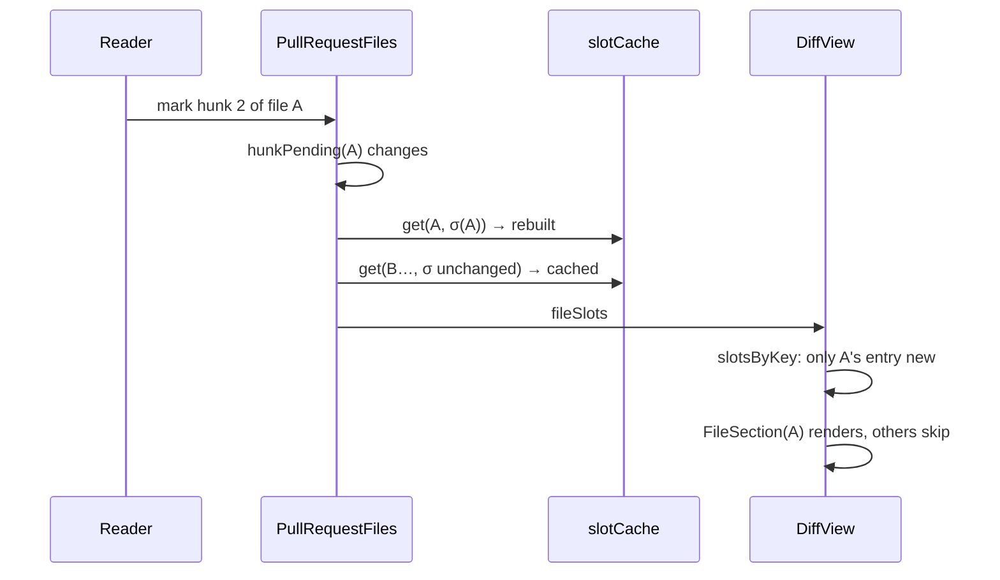

## Context

The frontend (`src/`) consumes Tauri commands and events in each window: the main window (`App`), reader windows (`ReaderRoot`), pull-request windows (`PullRequestWindowRoot`) and image zoom windows (`ImageWindowRoot`). A performance sweep, checked against the source at b581063, found four places where React redoes work whose result has not changed.

1. **`MarkdownView`** (`src/components/MarkdownView.tsx`, about lines 393–647) passes `ReactMarkdown` an inline `components` object of arrow functions. Each render therefore gives every override a new element type. React then unmounts and remounts every heading, `li`, task checkbox, table, link and fence, including `WorkspaceFence → MermaidBlock`. A remounted `MermaidBlock` gets a fresh `useId`, `svg === null` and the `mermaid-block--pending` placeholder, and it runs mermaid's `parse`/`render` and the label-measuring layout effect again. `MarkdownView` is already `memo(…, sameMarkdownViewProps)`, so the triggers are real. One is a content change, which happens on every live edit of the artifact. The other is the link-failure toast: its `failureCount` state lives in `MarkdownViewImpl`, so every failed click costs two full renders, one to show the toast and one to clear it. The pull-request branch memoizes its own `a`/`img`/`pre` (`pullRequestOverrides`), but its headings, `li`, `input` and `table` remount too.
2. **`useWorkspaces`** (`src/hooks/useWorkspaces.ts:44,56`) calls `setViews(next)` with the raw IPC reply after every coalesced cache batch. Every view object is new, so the memos on `RepoNode` (`WorkspaceTree.tsx` ~970) and `FlatWorkspaceNode` (~1253) never skip on a refresh. `LogicalChangeRow` (~1056) has no memo at all. In `App.tsx`, every views-keyed `useMemo` recomputes: `resolution`, `addressToNodePath`, `headerContext` and the `applyGraphRepoId` effect. `usePullRequestLinks` (`src/hooks/usePullRequestLinks.ts:33-45`) depends on `[views, pullRequestsVersion]` and calls `setLinks(next)` unconditionally. Every reader window runs `useWorkspaces`, and every pull-request window runs both hooks (`PullRequestWindowRoot.tsx:54-55`), so each open window repeats those reads and renders per batch.
3. **The pull-request view's diff.** `renderFileHeaderExtra` and `hunkSlots` (`PullRequestView.tsx` ~1035–1095) depend on the whole `progress` and on the `pending`, `hunkPending`, `includePending` and `failed` maps. A mark sets pending, writes, reloads progress, then clears pending, which is at least three parent renders, and a `review-progress-changed` notice from another view adds one more. Each render rebuilds `slotsByKey` (`DiffView.tsx` ~496) with new `HunkSlots` for every file. It also hands every `FileSection` a new `renderHeaderExtra` and new `slots`, which defeats `FileSection`'s memo (~1551). Each file then rebuilds every row through `UnifiedHunks`/`SplitHunks`, and the `pruneShown` layout effect (~511) and the `folds` memo (~522) walk every file. Tokens are memoized per hunk (`diffHighlight.ts` WeakMap), so the cost is creating and reconciling elements for up to the 3,000-line eager budget plus any files loaded on request.
4. **Up-front loading.** `main.tsx` statically imports `App` and all three detached roots, so every window evaluates the main window's whole graph. `MarkdownView` statically imports `rehype-katex` and `katex.min.css`. Mermaid is the only lazy import today (`MermaidBlock.tsx:30`).
5. **`useCommitGraph`** (`src/hooks/useCommitGraph.ts:35-60`) calls `load()` directly for each `graph-changed` notice. Overlapping loads can resolve out of order, and every load sets `loading` to true.

Constraints that shape every decision:

- The `spec-browser` *Reactive Updates from Filesystem* requirement says that an un-initiated refresh preserves the reading position and that an mtime-only refresh does not re-render the document.
- The `document-outline` *Fragment Links Resolve Within the Document* requirement needs the current render's heading set before any `<a>` is classified.
- The `pull-request-worktree-links` *The Pull-Request Links Snapshot* requirement mandates a links re-read on every views re-read.
- The `diff-view` *Folded Hunks* requirement drops shown state whenever the host's fold of a hunk changes.
- The `pull-request-viewer` *Pull-Request Window Permissions* requirement installs the CSP before any fetch it governs.
- `src/CLAUDE.md` says the frontend stays a pure consumer of commands and events. No Rust crate changes here.

## Goals / Non-Goals

**Goals:**

- A re-render of a document keeps every unchanged block mounted. In particular, a diagram is never redrawn for a change that does not touch it.
- A failed link click never reruns the markdown pipeline.
- A views or links read that changes nothing renders nothing. A read that changes one repository renders that repository's rows.
- A review mark renders the marked file's section and the header, and no other section.
- Commit-graph refreshes are coalesced, applied in order, and do not flash a loading state.
- Each window loads its own surface. The maths engine loads only for maths, or off the critical path.

**Non-Goals:**

- **Windowing or `content-visibility` for very large diffs.** This conflicts with DOM-based place-keeping (`recordPlace`/`anchorAt`/`restoreAnchor`), sticky headers and `documentOrderText` copy. The 8 MiB on-request ceiling and the 3,000-line budget are spec-mandated (`diff-view` *Line and Byte Budgets With On-Request Loading*: "None of these limits SHALL be a setting"). A later change can take this on with its own spec delta.
- **Avoiding the remark/rehype parse on a content change.** react-markdown 10 runs the unified pipeline synchronously in every render. This change removes the remounts and the toast-driven renders, not the parse of new content.
- **Per-hunk memo boundaries inside one file.** A mark re-renders the marked file's rows. Making single-hunk updates sub-file would need per-hunk slot identity, and that can follow later if profiling asks for it.
- Shrinking the grammar set, bumping KaTeX (pinned at 0.16.x by `rehype-katex`), any `vite.config.ts` target change, and anything in Rust. The backend dashboard and status work is in `cache-dashboard-history` and `scope-status-recompute`, HTTP caching and compression of the bundle are in `trim-frontend-overhead`, and PR detail reads are in `efficient-pull-request-reads`.
- The refuted or low-value findings listed under *Out of scope* in the proposal: DocumentView's deliberate re-read, `useDashboard`'s render, FileBrowserView's filtering, and MermaidBlock's measuring.

## Decisions

### D1. Module-level markdown overrides with a per-render context

The `h1`–`h6`, `li`, `input`, `table` and `pre` overrides close over nothing but module-level helpers (`headingIdOf`, `liIsDone`, `WorkspaceFence`). They become module-level components collected in a frozen `WORKSPACE_COMPONENTS` object. The `a` override needs per-render state. It becomes a module-level `WorkspaceLink` that reads a `MarkdownLinkContext` provided by `MarkdownViewImpl`. The context value holds:

- `knownHeadingIds`: the lazily built `Set` over this render's `headings` array;
- `onFragment`;
- `attemptOpen`;
- `reportFailure`;
- `web`, the `isWeb()` result.

The context value is created per render, so every `WorkspaceLink` re-renders with its document. That keeps classification against the current heading set exactly as today: `rehypeHeadingIds` fills `headings` during `ReactMarkdown`'s render, before any link child renders. A re-render is cheap, and a re-render is not a remount, so links keep their DOM nodes. The `components` prop becomes `useMemo(() => pullRequestOverrides ? { ...WORKSPACE_COMPONENTS, ...pullRequestOverrides } : WORKSPACE_COMPONENTS, [pullRequestOverrides])`. The PR-mode `a`/`img`/`pre` still win, and PR headings still get no `id`, because `headingIdPass` stays empty in that mode and `headingIdOf` reads only what that pass stamps.

`hast-util-to-jsx-runtime` keys each child by tag name and per-name count (`name-count`). With stable types, an edit therefore remounts only blocks of the same tag that sit after an insertion or removal of that tag. That is why the spec's *Rendered Blocks Survive Document Re-renders* requirement names this one exception.

- *Rejected: keep the arrows but wrap the object in `useMemo` keyed on `onFragment`/`root`/`basePath`.* The `a` override closes over the per-render `knownHeadingIds`, so a memoized closure would classify links against an earlier render's headings and break the fragment-link contract.
- *Rejected: a render-phase ref (`headingsRef.current = headings`).* It works, but a discarded concurrent render can leave the ref pointing at the wrong array. The context is scoped to the render that made it.
- *Rejected: an SVG cache in `MermaidBlock` keyed on (source, scheme), so that remounts become cheap.* A cached SVG embeds the `useId`-derived element ids of the mount that drew it. Two identical diagrams in one document, or a remount next to a still-mounted twin, would then collide on `url(#…)` marker references. Stable types fix the cause, and a cache would only hide it.

### D2. The link-failure toast as its own component

`LinkFailureToast` owns `failureCount` and the timer and exposes `report()` through a ref (`useImperativeHandle`). `MarkdownViewImpl` keeps `toastRef`, and `reportFailure` becomes a stable `useCallback(() => toastRef.current?.report(), [])`. A failure now renders only the toast. `pullRequestOverrides`' captured `reportFailure` stays valid, because it reads a ref. The component keeps the existing markup: `role="status"`, `key={failureCount}` restarting the animation, and `LINK_FAILURE_MS`.

- *Rejected: lifting the toast into `DocumentView`.* Pull-request content renders `MarkdownView` from several hosts (description, comments, threads), and every one of them would need the plumbing.

### D3. Generic structural sharing for IPC replies

A new pure module, `src/structuralShare.ts`, exports `shareStructure<T>(previous: T, next: T): T`. It walks JSON-shaped values: primitives, arrays and plain objects, which is everything Tauri and the web transport return. It returns `previous` for any subtree deeply equal to its counterpart, and otherwise a new container whose equal children are the previous ones. Two arrays are equal only when they have the same length and pairwise-equal items, so order matters. Two objects are equal only when their own enumerable key sets match and every value is equal, so a field that appears or disappears counts as a change. `undefined` and a missing key are therefore different. The result is `previous` itself whenever the whole value is equal, and `setState` then bails out.

`useWorkspaces` applies it in both `refreshViews` and `refresh`: `setViews((prev) => shareStructure(prev, next))`. `setWorkspaces` does the same. `loading` keeps flipping in the `finally` of the first fetch, independent of equality. `LogicalChangeRow` gets `memo`. The props of `RepoNode`, `FlatWorkspaceNode` and `LogicalChangeRow` are audited for per-render identities (inline callbacks or objects from `WorkspaceTree`), and each one found is stabilized. Otherwise the shared data would still not skip.

- *Rejected: compare `JSON.stringify(prev) === JSON.stringify(next)` and keep or replace the whole array.* It is all-or-nothing, so one dirty worktree would still re-render every repository's rows.
- *Rejected: backend revision numbers on views.* That is a Rust and IPC change for a frontend concern, and it would not give per-repository identity.

The cost is a single linear walk over the reply, which is small next to the IPC and the render it saves:

$$T_{\text{share}} = O(|\text{reply}|) \ll T_{\text{render}}(\text{rows})$$

### D4. Links re-read driven by a views-read signal, not views identity

After D3, `views` keeps its identity across an equal read. `usePullRequestLinks`'s `[views]` dependency would then stop firing, and that violates *The Pull-Request Links Snapshot*, because a remote change can alter the links without altering the views. `useWorkspaces` therefore also returns a stable `onViewsRead(listener): unsubscribe`. It is a tiny ref-held emitter, invoked after every successful views read, whether the read changed anything or not. A failed views read does not fire it, which matches today: a rejected `getWorkspaceViews` never calls `setViews`, so it never triggered a links read. `usePullRequestLinks(onViewsRead)` subscribes to it and to both provider-update events. It schedules reads through `useCoalescedRefetch`, which already serializes them: no second read starts while one is in flight, and exactly one follow-up runs after it. A per-read sequence number on top of that is belt and braces against an unmount or a future caller that bypasses the scheduler. The hook stores `setLinks((prev) => shareStructure(prev, next))`. The two callers, `App` (`App.tsx:403`) and `PullRequestWindowRoot` (`PullRequestWindowRoot.tsx:55`), switch to the new argument. `ReaderRoot` uses `useWorkspaces` but not the links, so it ignores `onViewsRead`.

- *Rejected: a `viewsRevision` counter in state.* Bumping it would render `App` on every read, which is exactly the render this change removes.
- *Rejected: MODIFYING the links requirement so that it re-reads only when the views change.* That would miss remote-only changes, and the requirement's guarantee is the right one.

### D5. Per-file slots with a signature cache

A new pure module, `src/slotCache.ts`, exports `createSlotCache<V>()`, which has `get(key, signature, build)`. It returns the cached value when the stored signature for `key` shallowly equals `signature` (same length, `Object.is` per element). Otherwise it builds, stores and returns. It also has `retain(keys)`, which drops the keys of files that are gone. The cache lives in a `useRef` in `PullRequestFiles`.

`DiffView`'s host API grows one optional prop, `fileSlots?: (file: DiffFile) => FileSlots | undefined`, with

```ts
interface FileSlots { headerExtra?: ReactNode; preamble?: ReactNode; hunks?: HunkSlots }
```

The host guarantees that identity is stable while the file's inputs are unchanged. `renderFileHeaderExtra`, `renderFilePreamble` and `hunkSlots` stay as they are for hosts that do not need this; commit detail passes none of them. `DiffView` computes `slotsByKey` from `fileSlots` when it is given. It reuses the previous `Map` when every entry is `Object.is`-equal to the previous one, so `pruneShown` and the `folds` memo do not rerun. It passes `FileSection` the per-file `headerExtra`, `preamble` and `slots` values in place of the render functions.

`PullRequestFiles` builds each file's `FileSlots` through the cache. The signature is a flat tuple of that file's own inputs:

$$\sigma(f) = \bigl(f,\ \text{progress}(f),\ \text{hunkStates}(f),\ \text{pending}(f),\ \text{hunkPending}(f),\ \text{includePending}(f),\ \text{failed}(f),\ \text{threads}(f),\ \text{linked}(f),\ \text{reference},\ \text{page},\ \text{head},\ \text{base}\bigr)$$

Every element is read by today's three builders (`renderFileHeaderExtra`, `hunkSlots` and `renderFilePreamble`, `PullRequestView.tsx` ~1035–1123):

- $$f$$ is the `DiffFile` object itself. The preamble reads `file.content.kind` and the image tests, and the handlers receive `file`. `DiffView` passes the `files` entry, not the loaded content, so this identity holds until the detail changes.
- $$\text{progress}(f)$$ is the file's entry object from `byPath`. That entry keeps its identity across progress reloads because `getReviewProgress` replies are passed through `shareStructure` (D3).
- $$\text{hunkStates}(f)$$ is what `hunkStates(progress, detail, key)` returns: that entry's `hunks` array, or `null` when the progress names another head or base. Both keep their identity under `shareStructure`.
- $$\text{hunkPending}(f)$$ is a string joined from that file's pending hunk entries.
- $$\text{reference}$$ is its four fields (provider, owner, repo, number), not the object, and $$\text{page}$$ is `detail.row.url`. The preamble's host link and `ReviewThreads` read both.

Every handler the slots call (`markFile`, `markHunk`, `includeFile`) goes through a latest-ref, so the cached elements never hold stale closures over `reference`, `head` or `base`. No such hook exists in `src/hooks/` today; this change adds a small one. Head and base are in the signature anyway, so a retarget rebuilds every file whose hunk states it changes.

`fileSlotSignature` lives in `src/pullRequestView.ts`, the view's pure, bun-tested decisions module, so its test needs no DOM. `buildFileSlots` stays in `PullRequestView.tsx`, because it returns elements.

The fold bookkeeping still sees every real fold change. A file whose `folded` set changes gets a new `HunkSlots`, therefore a new `slotsByKey` entry, therefore a new `Map`, and `pruneShown` runs and drops that file's shown state as *Folded Hunks* requires. The place-keeping `folds` string changes as well.



- *Rejected: make `UnifiedHunks`/`SplitHunks` `memo` and leave the slots as they are.* Their props include the new `folds` object and slot functions, so the memo would never hit.
- *Rejected: `DiffView` asks the host for a per-file "revision" string and caches render-function output itself.* That splits responsibility for invalidation between host and view. A signature the host computes keeps the knowledge where the inputs live.
- *Rejected: collapse `pending`/`progress` updates into one `useReducer` so a mark costs one render.* Fewer parent renders still give every file new slots, so this fixes nothing on its own. With D5 the parent renders are cheap anyway.

### D6. Commit-graph refreshes through `useCoalescedRefetch` with a sequence guard

`useCommitGraph` keeps one effect per `(repoId, limit)`. The initial load and every `graph-changed` notice for that repo go through a `useCoalescedRefetch` scheduler. That scheduler is created once per hook instance, so the load it runs reads the current `repoId` and `limit` through refs, not through the effect's closure. It also serializes the reads: a burst of notices during a read costs exactly one follow-up. A repository or window change while a read is in flight therefore waits for that read, whose reply the change has made stale. Each load takes `seq = ++latest.current` and applies its result only if `seq === latest.current` and the effect is still current, which discards that stale reply. `setLoading(true)` is called only when no graph is held, so a refresh keeps the current graph on screen. `GraphRail` already shows its loading state only for `loading && !graph`, so this only removes a wasted render.

- *Rejected: an `AbortController`.* `getCommitGraph` is an IPC call that cannot be cancelled, so the sequence check is needed either way.

### D7. Lazy roots, lazy surfaces, lazy maths

- **Window roots.** `main.tsx` replaces its static root imports with `React.lazy(() => import(...))` for `App`, `ReaderRoot`, `PullRequestWindowRoot` and `ImageWindowRoot`, rendered inside a `Suspense` whose fallback is `null`. The fallback renders nothing, because the body stamps (`data-platform`, `data-surface`, `data-doc-width`) are already applied before mount. `installHeadPolicies` is imported straight from `windowKind.ts`, where it is defined, not through `PullRequestWindowRoot`, and it is still called synchronously before `createRoot().render`. The CSP meta is therefore in the head before the root chunk is requested. The PR window's CSP has no `script-src`/`style-src`, so same-origin chunks load. `readerAddressPath`, which `PullRequestWindowRoot` imports from `ReaderRoot`, moves to a small shared module so that one detached root does not pull in the other. The comment at the top of `windowKind.ts`, which justifies the installer's placement by "`main.tsx` imports every root statically", is reworded to match. The zoom window still loads `DiffView`'s module, because `ImageWindowRoot` imports `EscapedText` from it. `DiffView` imports none of the main window's surfaces, so this meets the requirement, and moving `EscapedText` is optional.
- **Main-window surfaces.** In `App.tsx`, `PullRequestAtAddress` (with `DiffView`), `CommitDetailView`, `SettingsView`, `FileBrowserView` and `ArchiveView` become `lazy`. The default surfaces (the Dashboard, document view, tree and rail) stay eager. Each lazy surface sits in a `Suspense` whose fallback is the detail pane's existing pending presentation, which is never the Dashboard. After the first commit, a `setTimeout`-scheduled idle warm-up issues the same dynamic imports. It does not use `requestIdleCallback` or `requestAnimationFrame`, because hidden windows stall those. Type-only imports (`PaneNavigation`) stay `import type`.
- **Maths.** `MarkdownView` drops its static `rehype-katex` and CSS imports. A module `src/mathEngine.ts` exports a memoized `loadMath()`, which dynamically imports `rehype-katex` and `katex/dist/katex.min.css`, and `mayContainMath(content)`, a conservative test: `$$` anywhere, or a run of three or more backticks or tildes followed by optional spaces and `math`, anywhere in the text. The fence test is deliberately not anchored to a line start, because a `math` fence inside a list item or a blockquote opens after `- ` or `> `. Under `REMARK_MATH_OPTIONS` (`singleDollarTextMath: false`), those are the only sources of the `math-inline`, `math-display` and `language-math` classes that `rehype-katex` typesets, so the test can report false positives but never false negatives. The loaded flag is module state that a render reads synchronously, so a render after `loadMath()` resolves includes the plugin at once. When `mayContainMath` is true and the engine is not loaded, `MarkdownViewImpl` renders its last fully rendered content, held in state, and on a first render with nothing to show, an empty container. It then re-renders once `loadMath()` resolves. The same warm-up as above calls `loadMath()`. `KATEX_OPTIONS` stays shared with PR mode.

- *Rejected: lazy-load only the three detached roots.* The verification found them thin. `App` already imports the heavy surfaces, so this would save the main window nothing.
- *Rejected: render maths documents without the plugin until it loads.* That shows `$$…$$` source for a moment and breaks *Mathematical Notation Rendering*.
- *Rejected: Suspense-throw inside `MarkdownView` while maths loads.* A refresh that is not a transition would show the nearest fallback and blank a document the reader is looking at, which breaks *Reactive Updates from Filesystem*.

## Risks / Trade-offs

- **[Risk]** `shareStructure` treats a field that differs only by `undefined` versus missing as a change, and treats array order as significant. → This is deliberate: it can only cause an extra render, never a missed one. Unit tests cover every JSON shape, including nested arrays of objects, key addition and removal, and `NaN`/`-0` primitives via `Object.is`.
- **[Risk]** A field outside the D5 signature that affects a file's slots would leave stale UI. → The signature is built in one function (`fileSlotSignature` in `src/pullRequestView.ts`), with a test enumerating every input the builder reads. Comments on both `fileSlotSignature` and `buildFileSlots` name the invariant and point at each other: every value `buildFileSlots` reads for file $$f$$ appears in $$\sigma(f)$$, and a new input to the builder is added to the signature in the same change.
- **[Risk]** Lazy chunks add a round-trip on first use of a surface. On Tauri and `specforge-web` both, that is a local read of an embedded asset. → The warm-up after the first paint hides it in practice, and the pending presentation covers any gap.
- **[Risk]** The `mayContainMath` false positives (`$$` in prose or code) load KaTeX needlessly. → It is the same engine that loads later anyway. Correctness matters only for false negatives, and the test cannot produce one.
- **[Risk]** Measuring render counts needs a real window. Chrome MCP automation tabs are hidden, so rAF, IntersectionObserver and `content-visibility` stall there. → The verification tasks use the React Profiler and the DOM-identity checks (`element.isSameNode` across a refresh) in a visible `bun tauri dev` window, or the `specforge-serve` loop with the tab focused. They do not rely on anything rAF-driven. Pure modules carry the deterministic coverage.
- **[Trade-off]** The 956 KB main-chunk figure is unverified in this worktree, so the split's win is estimated. → A task records `bun run build`'s chunk table before and after. If a split produces no meaningful saving, it is reverted and not kept as complexity.
- **[Trade-off]** The remark/rehype parse still runs on every content change. → This is accepted (see Non-Goals). The parse is linear in the document and was never the visible cost; remounts and diagram redraws were.
