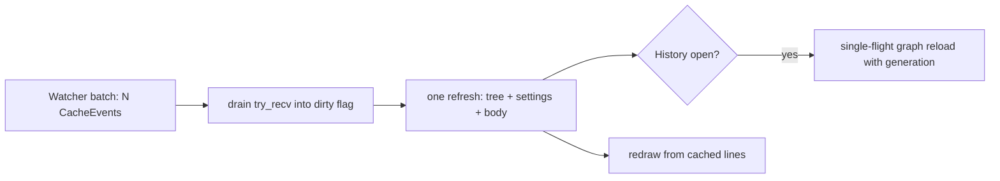

# Trim Frontend Overhead

## Why

The web and terminal frontends repeat work whose result has not changed. The built bundle is about 6 MB, and its three largest JS chunks are 956, 665 and 435 KB. Every page load of the web UI downloads the chunks it uses again, uncompressed and uncached, because no response carries a caching header or a validator. In release builds the server also copies each embedded file into a fresh buffer on every request. Over Tailscale on a phone this is the slowest part of opening the app. The terminal UI runs a full refresh for every watcher event, and one debounced batch emits several. Each refresh does two snapshot clones, two registry reads, an artifact re-read and, on the History screen, a `git log`, with no single-flight. Separately, the TUI re-parses the open artifact's markdown and rebuilds the whole commit rail on every frame, four times a second even while idle.

## What Changes

- **Web: HTTP caching.** Content-hashed files under `assets/` are sent as `immutable` with a one-year lifetime. The application shell (`/`, `/index.html` and every deep-link fallback) and the stable-path root files (icons, favicon, manifest) are sent `no-cache` with an `ETag` built from the embedded file's SHA-256. A matching `If-None-Match` gets a bodiless `304`. A `304` for the shell still carries the three shell headers that the *Localhost Trust Boundary* requirement sets. The build hint is sent `no-store`.
- **Web: compression.** Responses are compressed (br/gzip) when the client advertises support. This covers the JS/CSS bundle and the `/api/invoke` JSON results. The `/api/events` SSE stream and already-compressed images are never compressed or buffered.
- **Web: no per-request copy.** Embedded bytes are served borrowed (`&'static`) in release builds. Debug builds still read `dist/` from disk on every request, so `bun run build` is picked up without a restart.
- **TUI: coalesced watcher refresh.** All cache events that are already waiting are drained into one dirty flag, and the TUI runs **one** refresh per loop turn. This refresh covers the tree, the Settings mirror, the open artifact body and the open graph. It adds no debounce delay. A lagged receiver counts as dirty instead of being dropped.
- **TUI: one graph reload at a time, latest request wins.** Graph replies carry a generation and are discarded when they are stale, for example after a repository switch or a "load more". This fixes a latent bug in which a slower reply for the previous repository could overwrite the current graph. Watcher-driven graph reloads are single-flight: a burst issues at most one more `git log` after the reload already in flight.
- **TUI: per-frame work is reused.** The rendered markdown lines are cached, keyed on the body and the active scheme. The commit-rail lines are cached per graph load and scheme. Only the visible window is cloned, and the selection highlight is applied at draw time. The rail build indexes edges by band, so it is linear rather than $$O(commits \times edges)$$.
- **TUI: no idle redraw storm.** The TUI redraws only after an applied message or a resize. The idle tick drops from 250 ms to 1 s, which is enough for the minute-resolution quota countdown.

### Out of scope (checked and rejected)

- **Double JSON serialization in `specforge-web` dispatch.** `dispatch.rs`'s `to_val` builds a `serde_json::Value` that `Json()` then serializes. That costs one extra tree allocation per response. It is noticeable only on base64 image reads, and even there it is small next to the git or HTTP work behind every command. Changing the return type would ripple through every dispatch test. Compressing `/api/invoke` responses is the larger win for the same payloads.
- **Tray tooltip/title and Dock badge dedupe (`crates/specforge/src/tray.rs`, `dock_badge.rs`).** The overhead is real but small: a few main-thread hops per watcher batch. The `dock-indicator` spec requires the badge to be re-applied on every `CacheEvent` as a self-healing property (see the `dock_badge.rs` comment). Removing that would need a MODIFIED delta in exchange for a negligible gain. The blocking hop onto the main thread from an async worker belongs to `unblock-main-thread`.
- **"`Lagged` leaves the TUI tree stale."** This is mostly refuted. After a lag, the receiver resumes at the oldest retained event, and that event still triggers a refresh. Treating `Lagged` as dirty is kept only as a cheap robustness measure.

## Capabilities

### New Capabilities

_None._

### Modified Capabilities

- `web-ui`: adds the HTTP caching contract for the served bundle (immutable hashed assets, a revalidated shell and stable-path files, `304`s that keep the shell headers) and the response-compression contract (bundle and command results compressed, the event stream never).
- `terminal-ui`: adds watcher-event coalescing (one refresh per burst, `Lagged` counted as dirty, no added delay), commit-graph reloads that are single-flight and generation-checked, and reuse of rendered markdown and rail lines across frames with no idle redraws.
- `web-app-install`: the *Installability Adds No Service Worker* requirement now states that the browser's HTTP cache, under the validators the server sends, is not a client-side cache the bundle manages. The shell is always revalidated, so a cached shell is never presented as live.

## Impact

- `crates/specforge-web/src/assets.rs` (`static_handler`, `shell_response`, new caching helpers), `crates/specforge-web/src/lib.rs` (`router_with_bind` gains a compression layer), `crates/specforge-web/Cargo.toml` (adds `tower-http` with `compression-br`/`compression-gzip`; 0.6.11 is already in `Cargo.lock` through other crates, but the two features pull in `async-compression` and its codecs, which are new to this crate's graph and add to the `specforge-serve` binary), `crates/specforge-web/tests/server.rs`.
- `crates/specforge-tui/src/main.rs` (event loop: drain, dirty flags, conditional draw, 1 s tick), `crates/specforge-tui/src/app.rs` (`Msg::Graph` gains a generation; `reload_graph` becomes single-flight; render caches on `Model`), `crates/specforge-tui/src/ui.rs` (`detail`, `history`), `crates/specforge-tui/src/graph.rs` (band-indexed rail build, unselected lines plus a draw-time highlight).
- **Not changed:** `openspec-core` and `openspec-app` (no shared logic moves; the mutation gate does not apply), the IPC types and `src/types.ts`, the `/api/invoke` wire shape and error envelope, the SSE event contract, the React bundle (`src/`), the desktop shell (`crates/specforge`, including the tray and Dock), and the Vite build configuration. No service worker is added.
- Related sibling changes: `scope-status-recompute` (it evaluated and deferred an `Arc` snapshot of `last_views`, which would have shrunk the per-refresh clone the TUI still makes), `unblock-main-thread` (registry-lock contention of `list_workspaces`, the blocking tray hop) and `stabilize-frontend-rendering` (React-side rendering in `src/`).
