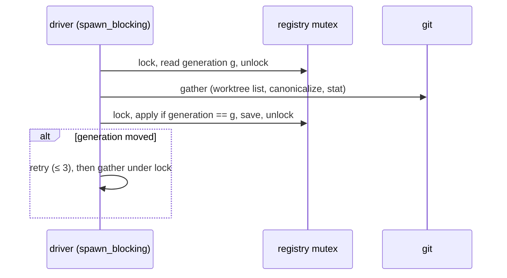

## Context

Tauri runs a synchronous `#[tauri::command]` on the main thread. Anything that thread blocks on, whether a subprocess, a disk read or a lock held elsewhere, freezes painting and input for that long. An `async` command runs on Tauri's tokio runtime instead. There the rule is the one `working-tree-status` › *Non-Blocking Aggregated Recompute* already sets for the recompute: git subprocesses belong on the blocking pool (`spawn_blocking`), not on a runtime worker.

Every sync command in `crates/specforge/src/commands.rs` was audited for subprocess, network or filesystem work, and every async `AppService` method for inline blocking work. The offenders worth fixing:

| Where | Today | Cost |
|---|---|---|
| `get_identity` (sync) → `AppService::identity_info` → `identity::detect_candidate_identities` | `git::git_identity` per registry entry, worktrees included | $$2N$$ `git config` spawns on the main thread per Dashboard mount and per Settings › Identity mount |
| `resolve_tailscale_name` (sync) → `specforge_web::tailscale::discover_name` | `tailscale status --json` via `.output()`, no timeout | a hung `tailscaled` freezes the window. A large tailnet means a large JSON parse on the main thread |
| `repo_monitor::reconcile` → `WorkspaceRegistry::reconcile_repo` | `git worktree list` plus a canonicalize and a stat per worktree, under `registry.lock()`, awaited inline on a tokio worker | fires on every write under `.git/worktrees/**`, so on every index write in any linked worktree |
| `AppService::add_workspace` → `register_resolved` | `git_common_dir`, `worktree_toplevel`, `git worktree list`, `save()` under the lock, inline on a tokio worker | rare (user action), but stalls every registry reader |
| `ensure_browse_root` from `list_markdown_files`, `read_workspace_file`, `watch_document`, `unwatch_document` and the sync `open_artifact_link` | `git_common_dir` fallback before any `spawn_blocking`. `watch_document` and `unwatch_document` have no blocking closure at all | one `git rev-parse` per file-browser call when the repository is registered below its roots |
| `ensure_registered_workspace` / `ensure_registered_repo` | re-canonicalize every stored entry on each call | $$N$$ `realpath` calls per authorization, also from the main thread via `archived_artifact_status` and `open_artifact_link` |
| `get_workspace_views`, `list_workspaces` (sync) | deep clone and serialization on the main thread. `list_workspaces` waits on the registry mutex | memory only, but the clone grows with the number of changes, and the lock wait follows the problems above |
| `open_reader_window` (sync) | builds a webview window from a sync command | `crates/CLAUDE.md` forbids this: it deadlocks on WebView2. Its two siblings are already `async` |

The `specforge-web` dispatch runs the same service calls inline on axum workers (`dispatch.rs`: `get_identity`, `list_workspaces`, `get_workspace_views`, `archived_artifact_status`; `register_workspace` awaits `add_workspace`, whose `register_resolved` runs git inline). `build_guard_config`, called from the synchronous `router_with_bind` inside the async `serve`, runs Tailscale discovery inline on a runtime worker when the embedded or standalone server starts.

## Goals / Non-Goals

**Goals:**

- No subprocess and no unbounded wait on the desktop main thread from any command this change touches.
- No git subprocess while the registry mutex is held, for reconcile and for registration.
- No git subprocess inline on an async runtime worker on these paths, on the desktop and web transports alike.
- Identical observable results: rows, payloads, acceptance and refusal decisions, and the discovered set and its order.
- Logic stays in `openspec-core` and `openspec-app`. The frontend crates only switch commands from sync to `async` and await the service.

**Non-Goals (out of scope, with reasons, so nobody re-discovers them):**

- **`block_on(svc.populate())` in Tauri setup (`crates/specforge/src/lib.rs`).** Deliberate, and left as it is. `dock-indicator` requires the Dock badge on first paint ("Initial badge persists across application restarts"). `view-routing` › *Cold-Load Address Resolution* forbids a spurious not-found on a cold deep link. `useWorkspaces` flips `loading` once. The tray glyph is seeded from the populated view. Deferring populate would need a ready signal on all three surfaces. The narrower win, parallel per-workspace initial parses inside `populate`, is left for a follow-up; no current change owns it.
- **Settings setters** (`set_reader_window_size`, `set_*_enabled`, `set_document_width`, `set_github_token` and the rest). Each does one small, user-initiated write of `settings.json`. They are not hot, and moving them would be churn. The write path belongs to `atomic-settings-persistence`.
- **`get_launch_on_login` / `set_launch_on_login`.** `MacosLauncher::LaunchAgent` is a plist check, not AppleScript, so they are cheap.
- **Narrowing `repo_monitor::classify`** so that only entry-level `.git/worktrees/<name>` events trigger reconcile. The existing comment explains why the whole subtree is keyed: `git worktree add` interleaves its events, so the entry event can arrive before `git worktree list` reports the worktree. Once reconcile runs off-lock and off-worker, its frequency costs one blocking-pool spawn, not a stalled registry. Narrowing would bring that race back.
- **Clone avoidance in `WatcherManager::workspace_views`** (an `Arc` snapshot, not cloning `RepoView.archived`). `scope-status-recompute` evaluated this and deferred it to a follow-up (consumers mutate their copy, so the clone would only move to them). This change only moves the command off the main thread.
- **Reusing `WatcherManager::git_identity_for`'s per-repo memo for Settings.** See Decision 2.
- **The tray and Dock badge updaters** (`tray::spawn_badge_updater`, `tray::spawn_tray_glyph_updater`, `dock_badge::spawn_dock_badge_updater`). Their `set_title`, `set_icon_with_as_template` and badge setters are marshalled by Tauri onto the main thread, and the calling tokio task waits for the result. That hop is unavoidable, because native UI must be touched on the main thread. Each call is one cheap native operation, and the wait is only long when the main thread is already stalled, which is what the rest of this change removes. The per-event redundancy of those writes is `trim-frontend-overhead`'s to judge, and `dock-indicator` requires a write per event anyway. The glyph rasterization already runs on the tokio task, not on the main thread.

## Decisions

### 1. Split registry discovery into a lock-free gather and a locked, optimistic apply

`openspec-core/src/registry.rs` gains:

- `WorktreeFacts`: the sorted, canonical, non-prunable working-tree roots from `git worktree list`, plus the subset whose `openspec/` is a directory. It is produced by a free function `gather_worktrees(&RepoId) -> WorktreeFacts`, which takes no `&self` and so cannot touch the registry.
- `RegistrationFacts`: the result of the registry-independent half of `register_resolved`. That half is the existence and directory checks, `canonicalize`, `git_common_dir`, the `openspec/`-or-`worktree_toplevel` root choice, `too_broad_without_openspec`, and `WorktreeFacts` for the repository. It is produced by `gather_registration(PathBuf) -> Result<RegistrationFacts, RegistrationError>`. The errors that do not depend on registry state (`PathNotFound`, `NotADirectory`, `NotOpenSpecOrGit`, `TooBroad`) are raised here, in the same order as today.
- `WorkspaceRegistry::apply_reconcile(&mut self, &RepoId, &WorktreeFacts)` and `apply_registration(&mut self, RegistrationFacts)`. These are the registry-dependent halves of `reconcile_repo` and `register_resolved`, moved verbatim: `registered_at_a_root`, the sorted insertion, the `AlreadyRegistered` and promotion decisions, the removal of vanished entries, and `save()`.
- A `generation: u64` on the registry, bumped by every mutation of `entries`: the inserts and promotions of `apply_registration`, the inserts and removals of `apply_reconcile`, and `unregister`'s removal and cascade. A no-op apply does not bump it. Drivers record it under a short lock before gathering. An apply whose recorded generation no longer matches returns `Stale` and changes nothing.
- The drivers `reconcile_unlocked_with(&Mutex<WorkspaceRegistry>, &RepoId, gather)` and `register_unlocked_with(&Mutex<…>, PathBuf, gather)` each run three steps: (1) read the generation under the lock, (2) gather with no lock, (3) lock and apply. On `Stale` they retry, up to 3 optimistic attempts. After the third `Stale` they fall back to gathering under the lock, which is today's behaviour and guarantees progress. This fallback is the one place git still runs under the registry lock. The spec requirement names it as a bounded exception, so the contract and the code agree. Reaching it takes three registry mutations, each landing inside a sub-second `git worktree list` window, and that only happens during scripted bulk worktree churn. The gather closure is injectable so that tests can race it deterministically. The production entry points pass `gather_worktrees` and `gather_registration`.

`reconcile_repo` and `register_resolved` remain as the gather and the apply composed under one `&mut self`. Existing tests and the TUI paths keep compiling. `crates/CLAUDE.md`'s rule to call `register_resolved` and not `register` still holds.

The generation check is what keeps the result identical to a serial run. Without it, a registration holding an old truth set could re-add a worktree that a concurrent reconcile had just removed. With it, an apply only ever combines facts with the registry state they were gathered against. The registration decisions (`AlreadyRegistered` and promotion) are re-taken under the lock from current state in any case.

`repo_monitor::reconcile` calls `reconcile_unlocked_with` inside `tokio::task::spawn_blocking`. It then starts and stops watchers and emits on the async side, as today. `AppService::add_workspace` does the same with `register_unlocked_with`. The comment in the status/remotes dispatch (`repo_monitor.rs:293-302`: "Off the async runtime, matching the `reconcile`/`default_branch` dispatches above") is half false today. `default_branch` does run in `spawn_blocking`, but `reconcile` calls `reconcile_repo` inline under the lock. After this change the comment becomes true, and it is reworded to say that reconcile's git runs off the runtime and off the registry lock.

**Alternatives considered:**

- *A separate "discovery" mutex that serializes gather and apply among discovery writers.* Rejected. It needs a new shared object threaded through `repo_monitor`, `WatcherManager` and `AppService`. The generation counter lives entirely inside the registry and follows the pattern `watcher.rs` already uses for `identity_generation`.
- *Turning the registry into an `RwLock`.* Rejected. Writers would still hold it across git, and the main-thread readers would still wait on the writer.
- *Calling `save()` after unlocking.* Rejected. Two saves could then land out of order and persist a state older than the in-memory one. The write is small, and the *Saving is atomic* scenario already constrains it.

### 2. Identity: dedupe per repository, read fresh for Settings, and give the Dashboard config only

`openspec-core/src/identity.rs` gains a pure `identity_probe_paths(entries: &[(PathBuf, Option<RepoId>)]) -> Vec<PathBuf>`. It keeps the first folder seen for each `RepoId`, in registry order, plus every flat folder. The caller drops entries whose folder is not a directory before calling it, so a missing first worktree cannot hide its repository's identity when a sibling worktree still exists. It also gains `first_identity(paths) -> Option<Author>`, which stops at the first path whose identity has a normalised key. That is exactly the element today's `detect_candidate_identities(..).into_iter().next()` returns. Both `first_identity` and `detect_candidate_identities` get a `_with(paths, read: impl FnMut(&Path) -> Option<Author>)` variant, and the public functions pass `git::git_identity`. Tests can then count reads and pin the early stop with no dependence on the machine's global git configuration. `detect_candidate_identities` is otherwise unchanged and is fed the probe paths.

`AppService::identity_info` becomes `async`. It reads the probe inputs under a short registry lock, then runs `detect_candidate_identities` in `spawn_blocking`. A new `AppService::identity_config()` returns `settings.identity()` alone. It backs a new `get_identity_config` command, registered in all four places `src/CLAUDE.md` lists and mirrored in `dispatch.rs`. `DashboardView.tsx` calls it instead of `getIdentity`, because the profile band reads only `config` (`identityKeyOf`, `identityNameOf`). `AppService::bootstrap` seeds with `first_identity(identity_probe_paths(…))`.

Bootstrap stays on the start-up path on purpose. The seeded identity must be in place for the profile on first paint. Stopping at the first hit bounds it to 2 spawns on any machine with a configured identity. The full sweep remains only for the rare machine with no identity configured, and even that is bounded by repositories, not worktrees.

**Alternatives considered:**

- *Read candidates through `WatcherManager::git_identity_for`'s per-repo memo.* Rejected for Settings. That memo is invalidated by `.git/config` writes but not by an edit to `~/.gitconfig`. The suggestions would go stale until restart, which the new *Identity settings read the global configuration afresh* scenario forbids. The memo is also private to the watcher. Dedupe gives most of the saving at no staleness cost.
- *Keep the Dashboard on `get_identity` and only make it `async`.* Rejected. It would still spawn $$2R$$ processes per Dashboard mount for data the Dashboard throws away.
- *Add an `includeCandidates` flag to `get_identity`.* Rejected. It changes an existing command's argument surface on both transports. A separate read-only command is simpler to mirror.

The trade-off of the dedupe is recorded in the modified *Local Identity Resolution from Git Config* requirement. Under `extensions.worktreeConfig`, a per-worktree `user.email` is no longer offered as a separate candidate. The activity log's per-repo memo already accepts the same trade-off.

### 3. Bounded Tailscale discovery without a new dependency

`specforge-web/src/tailscale.rs` factors `discover_name` into `discover_with(cmd: Command, bound: Duration) -> Option<String>`:

1. Spawn with `stdout` piped and `stderr` null.
2. Move `stdout` into a reader thread that reads to the end and sends the bytes on a channel. Reading on a separate thread matters: a large tailnet's JSON can exceed the pipe buffer, and a parent that only waited would deadlock with the child.
3. `recv_timeout(bound)`. On timeout, `child.kill()` then `child.wait()`, and return `None`. On receipt, `child.wait()`, check success, and parse with the existing `parse_self_dnsname`.

`discover_name` passes `Command::new("tailscale").args(["status", "--json"])` and `TAILSCALE_DISCOVERY_TIMEOUT = 3s`. `resolve_name` delegates to `resolve_name_with(manual, discover: impl FnOnce() -> Option<String>)`, so a test can prove that a manual override never calls discovery. Local `tailscale status` normally answers in tens of milliseconds, so 3 s only cuts off a wedged daemon. `resolve_name`'s override short-circuit is unchanged.

Call sites:

- The `resolve_tailscale_name` Tauri command becomes `async` and wraps the call in `spawn_blocking`.
- `specforge-web`'s `serve` path computes the `GuardConfig` in `spawn_blocking` before building the router. A new `router_with_guard(svc, guard)` makes that possible. `router_with_bind` stays synchronous for tests and calls the same builder.

**Alternatives considered:**

- *The `wait-timeout` crate, or tokio's `process::Command` with `tokio::time::timeout`.* Rejected. The first adds a dependency for about 20 lines. The second pulls tokio's `process` feature into a function that `router_with_bind` calls synchronously.
- *Parsing only `tailscale status --self --json`.* Worth trying, but `--self`'s output shape differs across Tailscale versions, and the bound already fixes the freeze. Left as a follow-up, not a decision.

### 4. Commands become `async`, and their blocking work moves into the service

On the desktop, `get_identity`, `resolve_tailscale_name`, `open_artifact_link`, `archived_artifact_status`, `get_workspace_views`, `list_workspaces` and `open_reader_window` become `async fn` commands. Names, arguments and payloads are unchanged, so `src/api.ts` needs no change for them.

- `list_workspaces` drops its duplicated body and calls `AppService::list_workspaces`, which takes the same locks and produces the same rows and sort.
- `AppService::archived_artifact_status` and `AppService::open_artifact_link` become `async`. Their authorization and `stat` work runs in `spawn_blocking` on a cloned `AppService`, which is `Clone` and built from `Arc`s. The opener call stays in the Tauri command, after the await.
- `list_markdown_files` and `read_workspace_file` move `ensure_browse_root` inside their existing blocking closures. `watch_document` runs `ensure_browse_root`, `guard_workspace_document` and `documents.acquire` together in one new closure, so the authorization still happens before any watch is established (`document-watch` › *Per-Document Watch Registration*). `unwatch_document` gets its own closure, and its fallback to `release_by_rel_path` for an unresolvable root is unchanged.
- In `ensure_registered_workspace` and `ensure_registered_repo`, the fast path compares the caller's canonical path against the stored keys and `RepoId`s as stored. The old re-canonicalizing scan runs only on a miss. That keeps an entry saved under a non-canonical spelling authorizable, the missing-folder fallback key that *Lossless Registry Migration* allows.
- The `specforge-web` arms await the now-async service methods. `list_workspaces` and `get_workspace_views` stay inline on the worker: they are memory only, and the registry lock is now short.

**Alternative considered:** keeping the commands sync and spawning a thread inside each. Rejected. A sync command still occupies the main thread until it returns, so the freeze would be the same.

## Risks / Trade-offs

- [The optimistic apply livelocks under constant registry churn] → Bounded at 3 attempts, then today's gather-under-lock, so progress is guaranteed. A test drives a gather closure that races on every attempt and asserts the fallback result.
- [Facts go stale against the disk between gather and apply, for example a worktree removed in between] → Today's code has the same window (the disk can change right after `git worktree list` returns). The next `.git/worktrees/` event reconciles again. Only staleness against the registry is new, and the generation check closes it.
- [Per-repo identity dedupe hides a per-worktree identity under `extensions.worktreeConfig`] → The modified requirement records it, and the activity log's memo already makes the same trade. The user can still add the alias by hand (*Manual Identity Entry*).
- [The one folder probed per repository resolves no identity although a sibling worktree would, for example because it was deleted] → Folders that are not directories are dropped before the per-repository dedupe. A worktree that exists shares its repository's configuration, so any existing worktree gives the same answer.
- [The uncontended path changes its git call count] → It does not. With no race, the driver gathers once, so `repo_monitor`'s `reconcile_adding_three_worktrees_performs_exactly_one_recompute` keeps asserting exactly two `git worktree list` calls.
- [Bootstrap seeding still spawns git on the start-up path] → Bounded to the first hit, and the first paint needs it. A machine with no identity anywhere pays $$2 \cdot (R + F)$$ spawns, not $$2N$$.
- [Killing `tailscale` on timeout leaves a wedged daemon wedged] → Out of SpecForge's hands. Resolution fails closed, and the Settings view shows the name as unresolved, which *The resolved Tailscale name is discoverable to the user* makes diagnosable.
- [`async` commands take `State<'_, T>` and must return `Result`] → All of the affected commands already return `Result<_, String>`.
- [`open_reader_window` changes thread] → That is the point. It matches `open_pull_request_window` and `open_image_window`, which `crates/CLAUDE.md` already requires to be async.
- [Mutation gate on `openspec-core` and `openspec-app`] → The gather/apply split and the generation check are tested through the injectable-gather drivers with synthetic `WorktreeFacts`, with no git and no timing. `identity_probe_paths` is pure, and `first_identity_with` / `detect_candidate_identities_with` take an injected reader whose call count the tests assert. The retry bound is pinned by asserting the exact number of unlocked gathers before the fallback. The fast path and fallback of `ensure_registered_*` each get a test (a stored canonical hit, and a stored non-canonical spelling).
